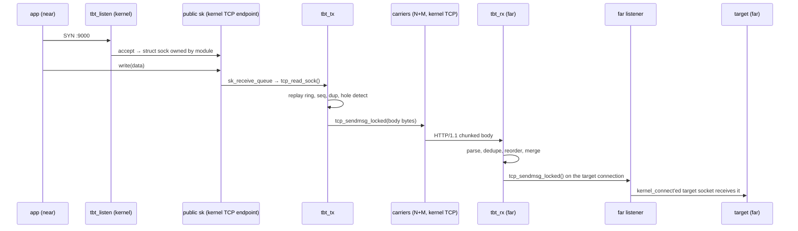
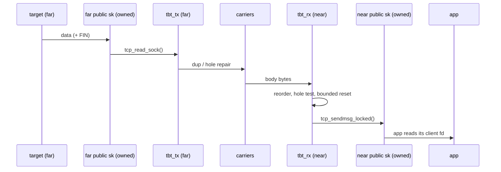

# tbtun — Design

Status: v0, kernel-only, **HTTP-as-QoS-profile**. A kernel TCP tunnel over `N + M`
pluggable carrier profiles with replay-ring loss repair, built on top of (and
replacing the product of) the `tcp-brutal` repository.

Audience: kernel engineers. Everything in this document is implementable by one person
over a sequence of commits (§15); the commit boundaries are written so that a small team
can parallelize along them.

---

## 1. Goal and non-goals

### 1.1 Goal

Export a TCP port on the near (local) machine that is a byte-exact, ordered, full-duplex
stream, while the payload is carried over `N + M` carrier TCP connections spread over
**distinct 5-tuples**.

**The payload does not have to be HTTP.** Nobody here needs HTTP semantics, interoperability,
or a proxy protocol. HTTP/1.1 keep-alive is a *QoS profile* chosen because the local ISP's
traffic classifier gives priority to it (§3). It is the current best guess at "what
classifies as priority on a Chinese ISP", and it is selectable, replaceable, and measurable
(§16, §17). If the classifier keys on something else, the profile changes; the tunnel does
not.

Two independent sources of gain:

1. **Per-5-tuple accounting.** The local ISP rate-limits (policies) each 5-tuple; `N + M`
   independent flows each get their own budget.
2. **QoS classification (a bet, not a fact).** The same ISP is believed to give HTTP/1.1
   priority. The chosen carrier profile makes the flow parseable as ordinary
   client↔server HTTP/1.1 — real request line, canonical header casing and order, chunked
   bodies, plausible `Host`/`User-Agent`, steady keep-alive traffic (§3.2, §16). Whether
   this actually buys priority is *measured*, not assumed (§17); the design keeps a
   `raw` profile for when it does not (§4.2).

Third property, the hard one: **do not wait for retransmission.** When a gap appears in a
carrier's stream, the sender re-emits the withheld bytes from its replay ring on a path
the sequence has not used. Delivery never advances across the gap: if the bytes are gone,
the receiver's bounded hole budget resets the stream. Byte exactness is never traded (§4).

Everything runs **entirely in the kernel**. After configuration, there is no userspace
process in the data path, no character device, no per-stream syscall pair, no userspace
carrier manager, no userspace accept/connect (§2.1, §8.5, §11).

### 1.2 Non-goals

- No congestion-control product. Brutal's "fixed rate + inflate on loss" is deleted; under
  duplicates it is a self-DoS (§5.1).
- No encryption at the tunnel layer. The `http-kal` QoS profile and encryption are in
  tension: a parser-based classifier cannot see inside TLS, so a TLS-wrapped carrier loses
  the class it was chosen for (§3.2, §9.4). Two escapes, both honest: use `raw` inside
  WireGuard when QoS does not matter (§4.2 c), or accept that confidentiality and
  classifier visibility are mutually exclusive on a parser-classified line (§19 Q4).
- No DNS in the kernel: targets and peers are literal addresses in `/proc` configuration
  (§8.3).
- **v0 is IPv4-only.** The public listener, carriers and targets are all `AF_INET`; a
  config line containing a `:` in any address field is rejected with a message saying IPv6
  is not supported in v0. Dual-stack is a later commit (§19 Q5), not a silent gap.
- No accept policy beyond the configured tunnel: every connection to the public listener
  is accepted. There is no hook, no port set, and no uid/device filter. No `SCM_RIGHTS`,
  no per-app credentials (§8.5).
- No lossless guaranteed recovery: unrecoverable holes produce a bounded stream reset,
  never silent corruption (§4.6).

### 1.3 What of the old project is removed

| Path | Fate | Why |
|---|---|---|
| `brutal_cc.c` — `tcp_congestion_ops`, group clock, EDT reservation, TSO hooks | **delete** | CC product gone; duplicates make it harmful. |
| `brutal_sockopt.c` — `TCP_BRUTAL_PARAMS`, `tcp_prot` override, app groups, TLS restore | **delete** | No app API. Its one useful idea — a private `tcp_prot` copy behind an `sk_prot` swap — returns in `tbt_carrier.c` for a different purpose (§9.2). |
| `brutal_rules.c` — prefix rules, `/proc/net/tcp_brutal/rules` | **delete** | Replaced by `/proc/net/tbtun/*` (§8.3). |
| `tools/brutalctl.c`, `tools/Makefile` | **delete** | Replaced by `/proc` writes (§8.4). The repository ships **no** userspace program of any kind afterwards. |
| `example/*.py` | **delete** | Demo of the removed feature. |
| `scripts/_redirects`, release CI | **rewrite** | New artifact: `tbtun.ko` only. Nothing is installed under `/usr/bin`. |
| `brutal.h` | **rewrite** | `tbtun/tbtun.h` + `tbtun/tbt_uapi.h`. |

Kept, edited: `Makefile`, `scripts/install_dkms.sh` (drop the brutalctl step), `scripts/mkdkmsconf.sh`,
`flake.nix`, `README*`, `LICENSE`, `.clang-format`.

---

## 2. Architecture

### 2.1 The one decision that shapes everything

**The module is the TCP endpoint on the public side.** It does not splice bytes into an
application's socket; it *owns* the listening socket and every accepted public connection,
and implements the application-facing TCP itself (§2.5, §8.5). The application sees an
ordinary accepted TCP socket because the module runs the full TCP state machine through the
stock `tcp_prot` code: it drains the receive queue with `tcp_read_sock()` and delivers with
`tcp_sendmsg_locked()` on the same socket (§8.5).

This removes the entire class of "inject into a socket someone else owns" hazards:
`tp->rcv_nxt`/`rcv_wup` bookkeeping, `sk_rmem_alloc` accounting, `sk_data_ready`
re-entrancy, `TCP_ZEROCOPY_RECEIVE` slabs, and the app's own `recvmsg` racing our
injection. None of those apply because *we* are the `sk` owner (the accepted socket is
created by us and never handed to userspace — it is not in any file descriptor table).

The alternative — kprobe/tracepoint on `tcp_sendmsg`/`tcp_recvmsg` of an app-owned socket,
as KeLS and similar L4 tunnel modules do — is retained only as the **fallback capture mode**
(§8.6): it cannot be made race-free against the app's own `recvmsg`, and it breaks on
`io_uring`/`MSG_ZEROCOPY`/`splice`. We do not use it for v0.

### 2.2 Components (all in-kernel)

| Unit | Responsibility |
|---|---|
| `tbt_core.c` | Module init/exit, the global tunnel list and lock, module parameters, capability probe. |
| `tbt_listen.c` | Kernel listener: `sock_create_kern` + `kernel_bind` + `kernel_listen`, accept via `sk->sk_data_ready` work item, owning accepted sockets. |
| `tbt_sock.c` | The public socket's data path: `sk_data_ready` → work → `tcp_read_sock()` feeding the tunnel; tunnel output delivered by `tcp_sendmsg_locked()` on the same socket (the accepted socket near, the target connection far) (§8.5). |
| `tbt_carrier.c` | Carrier sockets: `sock_create_kern`/`kernel_connect`, the `sk_prot` copy, HTTP header emission/parsing, health check, replacement and RETIRE. |
| `tbt_session.c` | Tunnel/session/stream objects, sid allocation, port bitmap, `/proc` tunnels/peers rendering, lifecycle. |
| `tbt_tx.c` | Frame queue, seq assignment, replay retention, duplication, hole detection, token bucket, FBK generation. |
| `tbt_rx.c` | Carrier record parser, dedupe, reorder, hole accounting. |
| `tbt_rec.c` | Record framing: 32-byte header plus `body_len`; no length prefix. |
| `tbt_proto.c` | Frame encode/decode (pure code, shared with the host tests). |
| `tbt_http.c` | HTTP/1.1 container generation and parsing (pure code, shared with the host tests). |
| `tbt_parse.c` | `/proc` grammar (pure code, shared with the host tests). |
| `tbt_procfs.c` | `/proc/net/tbtun/{config,tunnels,peers,stats,ports,http}` (`http` is the debug-only emitted request block). |

### 2.3 End-to-end — forward direction (public app → far target)



Owner per step: listener/accept = `tbt_listen`; application-facing TCP = stock TCP on a
socket we own; capture = `tcp_read_sock()` (does **not** copy into userspace, does not touch
`copied_seq` invariants incorrectly — see §8.5); framing/seq/dup/hole = `tbt_tx`;
carrier write = `tcp_sendmsg_locked` on a socket we created (§9.2); far side is the mirror
image, with the target connection created by `kernel_connect` in `tbt_carrier.c`.

### 2.4 End-to-end — return direction and feedback



Feedback (per-path ack state, RTT, rx state nibbles) rides the same request bodies from the
far side to the near side and the same response bodies in reverse; there is no separate
control connection (§3.6).

### 2.5 Why the module owns the public socket (and what that costs)

- **Correctness**: the two directions use opposite queues. Capture reads the receive
  queue with `tcp_read_sock()`; delivery writes the send queue with
  `tcp_sendmsg_locked()`. `rcv_nxt` is never forged, so the peer's own bytes cannot be
  lost behind an injected sequence, and stock TCP owns the window, retransmission and
  blocking wake in both directions.
- **Capture without userspace**: `tcp_read_sock(sk, &desc, recv_actor)` walks the
  `sk_receive_queue` without copying to userspace. The implementation is **not** zero-copy:
  the actor copies the record into the per-carrier parser (`skb_copy_bits`), and the capture
  path copies the payload again into the retention ring (`skb_copy_bits` + `memcpy`), so
  the bytes are copied twice and no `skb` is retained. The planned skb-reference replay
  ring (§9.6) is not implemented; the cost is two copies per byte, which the probes absorb
  and a later zero-copy capture could remove.
- **Cost**: the accepted socket has no file descriptor; an application cannot `accept()`
  it. That is the point (§13), and it is also the main deployment caveat (§19 Q1).
- **No `MSG_ZEROCOPY` complications**: an app writing to a socket it did not create still
  cannot use `MSG_ZEROCOPY` meaningfully, but that does not affect us as the receiver.

---

## 3. Wire format, carrier profiles, and the QoS constraint

### 3.1 Three constraints, only one of which is about HTTP

**(a) Framing need**: the receiver must find frame boundaries in a byte stream without
parsing application payload.
**(b) QoS need**: on lines where the ISP classifies, the packets must land in the privileged
queue. HTTP/1.1 keep-alive is the *hypothesis* about how to get there; it is not an
interoperability requirement and no HTTP feature is used for its own sake.
**(c) Escape hatch**: where the classifier does not matter (a second VPS hop, loopback,
testing, a line that keys on TLS SNI instead), the tunnel must be able to drop the HTTP
masquerade entirely and still work, byte for byte.

The frame header (§3.3) is **identical in every carrier profile**; only the container
(chunked HTTP message vs bare header+body records) differs. That is what keeps §4–§8
transport-agnostic.

The old draft used chunk extensions (`;t=10;s=1;q=3`). That is syntactically legal and
statistically **abnormal**: essentially no real client emits per-chunk extensions on every
chunk, so a normality-scoring DPI would downgrade it. **v0 therefore puts the frame header
inside the body**, with the body length carried in the header itself, and offers chunk
extensions only as a fallback (§3.4).

### 3.1.1 Carrier profiles

A profile is a `container` — how frames are wrapped on the wire — plus a cadence policy. It
is a module tunable (`profile=`) and is negotiated per carrier in HELLO body byte 22:

```
bit  7 6 5 4 3 2 1 0
     [unused][ gen (4) ][ prof (2)]
```

Bits 1..0 are the profile (`1` http-kal, `2` http-kal-drip, `3` raw; `0` invalid), bits
5..2 are the carrier's **path generation** (§4.3), bits 7..6 are zero. The byte was zero (reserved
flags) in the first C3 build, and `TBT_CONV` was `0x0002` then; it is `0x0005` now that
RETIRE, this byte, the 40-bit sid, and the removal of the placeholder frames are part of
the wire, and `host/test_fuzz.c` pins the new value. An
old peer therefore reads a nonzero flags byte, which it already rejects as unknown; a new
peer rejects a profile it cannot honour, and reads the 4-bit generation from bits 5..2.
The generation travels here rather than in a new field so the HELLO body length is
unchanged.

| Profile | Container | Cadence | Use |
|---|---|---|---|
| `http-kal` (default) | HTTP/1.1 `POST` + `Transfer-Encoding: chunked` keep-alive, chunk data = one frame (`body_len` at header +6) | active: one chunk per record; idle: one PAD chunk every `keepalive_ms` | the only QoS-relevant profile today; assume parseability buys priority (§16) |
| `http-kal-drip` | identical headers, identical framing | one **byte per `drip_ms`** when idle (a legal 1-byte chunk every `drip_ms`), volume `≈ 1 B/drip_ms` | the `M` spares: an idle flow that a classifier would reap or de-prioritise is kept alive with ~8 bit/s (1 B/s payload) instead of a burst every 5000 ms |
| `raw` | one frame per record, no HTTP bytes at all | none needed | second hop / VPS-to-home leg, loopback tests, or any line where QoS does not apply. Also the only safe profile inside WireGuard when the classifier is SNI-based (§16.5) |

Properties:

- **Same frame header** across profiles; only the container and cadence differ.
- **Same replay ring, hole repair, dedupe, feedback** — none of it knows the profile.
- `http-kal-drip` exists because classifiers commonly tier flows by *duration and byte
  count*: a flow that stays open but idles gets reaped, and a flow that reconnects every
  30 s gets re-classified from scratch (paying the TLS/HTTP handshake classification cost
  again, and possibly landing in a different tier). Drip keeps the flow state warm for
  ~3.6 KB/hour of payload.
- Profile choice is per tunnel, not per carrier, except that `http-kal` and
  `http-kal-drip` differ only in cadence and **must** be the same profile family on both
  ends. `raw` never mixes with `http-*` in one session.
- Setting `profile=raw` on a line that the ISP classifies is a *deliberate* downgrade; the
  design does not try to hide that. It is what §17's baseline (a) measures.

### 3.2 What the classifier sees (and must like)

Only for `http-kal` / `http-kal-drip`. Per carrier 5-tuple, in order:

```
> POST /api/v2/upload HTTP/1.1              ← method + absolute-path, HTTP/1.1, CRLF
> Host: <peer address literal>              ← present, matches the connection target
> User-Agent: Mozilla/5.0 (X11; Linux x86_64) AppleWebKit/537.36 (KHTML, like Gecko) Chrome/131.0 Safari/537.36
> Accept: */*
> Accept-Encoding: identity
> Content-Type: application/octet-stream
> Transfer-Encoding: chunked
> Connection: keep-alive
> X-Request-Id: <26 lowercase base32 chars>   ← one plausible correlation id, not "X-TBTUN-*"
>                                           ← blank line, CRLF, no binary, no odd casing
> 2020\r\n                                  ← first chunk, 8224 bytes of chunk data
> <8224 bytes: 32-byte header (body_len=8192) + 8192-byte payload>
> \r\n
> 1000\r\n ... \r\n                          ← subsequent chunks
> 0\r\n\r\n                                  ← segment terminator
< HTTP/1.1 200 OK\r\n
< Content-Type: application/octet-stream\r\n
< Transfer-Encoding: chunked\r\n
< Connection: keep-alive\r\n
< Server: nginx\r\n
< Date: <IMF-fixdate>\r\n
< \r\n
< 2024\r\n<body>\r\n ... 0\r\n\r\n
```

Rules the implementation MUST follow (each exists because a real parser would notice):

1. **Header capitalization**: `Content-Type`, `Transfer-Encoding`, `User-Agent`, `Host`,
   `Connection`, `Date`, `Server` — canonical capitalisation, not lowercase.
2. **Header order**: request line, `Host`, `User-Agent`, `Accept`, `Accept-Encoding`,
   `Content-Type`, `Transfer-Encoding`, `Connection`, then extension headers. This is the
   order mainstream clients emit.
3. **No binary in the header block**; no header names containing `tbtun`.
4. **`Transfer-Encoding: chunked`** must be last among hop-by-hop headers; no
   `Content-Length` on the same message.
5. **Chunk sizes**: hex, lowercase, no leading zeros. A data-bearing chunk is
   `[0x800, 0x2020]` (2048..8224); a PAD-only keep-alive chunk is `0x20` (32) and is the
   one exempt size (§3.3). Body content is opaque binary, which is normal for
   `application/octet-stream` uploads.
6. **Timing**: a carrier must never be idle for more than `keepalive_ms` (default 5000 ms)
   without *something* on the wire: a zero-length chunk is not legal mid-message, so we
   send a **PAD chunk** (one 32-byte `TBT_PAD` frame; 32 bytes of chunk data) or, if the
   carrier is between segments, a fresh empty POST. See §3.7.
7. **Response 200** arrives immediately (before request body completes). A parser sees a
   normal "upload with streamed response" conversation, which is a real pattern.
8. **No `Expect: 100-continue`** (would add a round trip and an extra message shape).

Failure to meet (1)–(5) is a *correctness* bug of the classification goal, not just
cosmetics; §10 T13 has a parser-based conformance check.

**Implementation ruling (request emission).** The block above is fixed by
`tbtun/tbt_http.c`; four details it leaves open are now decided:

- The request carries **no `Date` header**. Rule 1 lists `Date` among the canonical names
  because it appears in the response block below; §9.3 also names it as a varying field,
  but the explicit request block in this section has no `Date`, and a browser request
  normally has none. The emitter follows this section; `Date` is a response header.
- `Host` is a canonical IPv4 literal followed by `:port` (`203.0.113.9:443`; the emitter
  always includes the port, never the optional form
  `203.0.113.9:8443`). No hostname, no IPv6 literal, no leading zeros. The port is
  included when it is not the scheme default (80), so the value matches the connection
  target as this section requires.
- `X-Request-Id` is exactly 26 characters from the lowercase RFC 4648 base32 alphabet
  `[a-z2-7]`; the caller supplies it, because the container unit has no random source.
- `Transfer-Encoding` is emitted after `Content-Type` and before `Connection`, following
  the fixed order in rule 2. Rule 4's "last among hop-by-hop headers" is read as "last
  framing header": `Connection` follows it in the order rule 2 fixes.

**Implementation ruling (request validation).** The far side accepts exactly the block
this section emits and nothing else: the request-line literal, the eight headers in the
fixed order with their fixed values, a valid IPv4 literal (optional `:port`) in `Host`, a
26-character `[a-z2-7]` `X-Request-Id`, and a blank line within `TBT_HTTP_HDR_MAX` (4096
bytes). Extension headers, `Content-Length`, `Expect`, duplicates, lowercase names and
reordering are protocol errors. Nothing in the block identifies the carrier: there is no
`X-TBTUN-Carrier` or equivalent, and "tbtun" never appears on the wire. The carrier index
is the frame header's `path_id` (§3.3). A skip-only scan for the bounded CRLFCRLF
(`tbt_http_skip_request_header`) exists for the receiver's header/body stage change; it
does not validate, so the validating parser remains the admission path. The receiver's
two-stage loop (header, then chunks, reset on DONE) is documented with
`struct tbt_http_msg`; the caller owns the buffer and its offset.

**Implementation ruling (response emission).** The far side emits the response block
above with `Server: nginx` and `Date` computed from a UTC epoch-second input as
IMF-fixdate (`%a, %d %b %Y %H:%M:%S GMT`, exactly 29 bytes). No timezone database or
locale is consulted. Years outside 1970..9999 are refused rather than emitting a
five-digit year.

### 3.3 Body framing (default: length in the header)

Each chunk's data is exactly one frame. A frame is a 32-byte header followed by exactly
`body_len` bytes of payload, where `body_len` is the u16 at header offset +6; there is no
separate length prefix in front of the header, on any profile. One chunk carries one
record: the encoder never combines a DATA frame with PAD or with another record. A PAD
frame is a 32-byte header with `body_len` 0 and travels as its own chunk (38 wire bytes
including the size line and CRLF); a chunk with nothing to send carries one PAD frame.

```
chunk data:  one frame (one record)
constants:   TBT_HDR = 32, TBT_PAYLOAD_MAX = 8192, TBT_REC_MAX = 32 + 8192 = 8224,
             TBT_CHUNK_MAX = 8228
             (TBT_CHUNK_MAX is the chunk-data ceiling, excluding the hex size line and
             CRLF; a full record is 8224 bytes, so the four spare bytes are never used)
```

Frame header, exactly 32 bytes (offsets add up):

```
+0  u8   type        10 DATA / 13 OPEN / 14 FIN / 15 RST
                     20 FBK / 21 WINDOW / 22 HELLO / 23 PAD / 24 RETIRE / 25 SACK
                     (11 PREDICT and 12 CANCEL were removed in 0x0005)
+1  u8   flags       bit0 HEAD_OF_RUN, bit1 DATA_VERIFIED, bit2 KEEP, bit3 low-prio,
                     bit4/bit5 reserved (were MUST_ORDER / has-token); bits 6..7 zero
+2  u8   path_id     index of the carrier this copy will be sent on (0..15)
+3  u8   path_ack_count (0..16)
+4  u16  path_ack_mask   bit p set ⇔ feedback present for path p
+6  u16  body_len    bytes of payload after this header (0..8192)
+8  u64  seq          stream sequence (DATA)
+16 u64  uack         cumulative seq received on this frame's own path
+24 u32  sid_lo       low 32 bits of the 40-bit stream id
+28 u8   sid_hi       high 8 bits of the 40-bit stream id (v4 uses them)
+29 u8   reserved2 (0)
+30 u16  conv         0x0005
(total: 32 bytes)
```

Every stream frame carries the full 40-bit stream id as `(sid_hi << 32) | sid_lo`; there is
no "high bits only in OPEN" variant. Session-level frames (HELLO, RETIRE) carry sid 0.

**Receive validation is total.** `tbt_hdr_check()` runs once per record and rejects a
header unless every field is in range: `conv` exact, flag bits outside `TBT_FF_MASK` zero,
`path_id` 0..15, `path_ack_count` 0..16, `path_ack_mask` bits outside the carrier limit
zero, `body_len` at most `TBT_PAYLOAD_MAX` and inside the type's bounds, `reserved2` zero.
The 40-bit sid is fully valid. A record that passes is safe for any consumer; payload *contents* (the
OPEN and HELLO fields) are validated by the layer that reads them.

Payload layouts:

- **DATA**: payload = raw application bytes (1..8192); a zero-length DATA frame is
  refused on receive, because it wedges the receiver and the emitter never sends one.
- **OPEN**: payload empty; the header's `sid_hi:sid_lo` names the stream.
- **FBK**: payload = `nr × 18 B`, one entry per path, `nr = path_ack_count`:
  `u8 path_id; u8 rx_state; u64 uack; u32 recv_cnt; u32 rtt_us`. `path_id`'s low nibble is
  the carrier index and its high nibble is the *peer's* generation for that path (learned
  from the peer's HELLO), so stale feedback for a replaced carrier is ignored (§4.3).
  `uack` is the cumulative DATA payload bytes received on that path (v4); it is
  used for inflight and negative proof, not as a per-stream delivery proof. `recv_cnt`
  is the DATA records received on that path; `rtt_us` is the receiver's TCP SRTT for the
  carrier (0 when unmeasured). `rx_state`: 0 ok, 1 any stream has a hole, 2 any stream
  is paused/connecting, 3 session closing. Per-stream state travels in SACK.
- **WINDOW**: `u64 total_recv_ts_ns; u64 path_recv_ts_ns[16]; u16 credit`.
- **HELLO**: `u8 ver; u8 role; u8 nonce[16]; u16 payload_max; u16 chunk_max; u8
  profile|gen`. `ver` is `TBT_WIRE_VERSION` (1), independent of the module version. The last byte has exactly the §3.1.1 layout:

  ```
  bit   7 6 | 5 4 3 2 | 1 0
       zero |   gen   | prof
  ```

  bits 1..0 are the profile (`1` http-kal, `2` http-kal-drip, `3` raw; `0`
  invalid), bits 5..2 are the carrier's path generation (0..15), and bits 7..6
  are zero. The transmitter builds `profile | (gen << 2)` and the receiver masks
  `& 3` / `>> 2` (`tbt_carrier.c`, `tbt_rx.c`). The receiver does not check bits
  7..6 today, so a peer that puts generation in bits 7..4 is read as generation
  0 rather than rejected. The byte was reserved flags in the first C3 build.
- **PAD**: empty; exists only to keep the carrier warm.
- **RETIRE**: payload = `u8 index` (exactly 1 byte); `seq` is the retired generation.
  A far-side carrier slot retires before a replacement at the same index joins (§4.3).
- **SACK**: payload = `u8 state` (0 ok, 1 hole, 2 paused/connecting, 3 dead);
  header `sid_hi:sid_lo` names the stream and `uack` is its contiguous received offset.

Resume token (16 B): `u8 tracks; u8 order; u16 withheld_len; u32 withheld_h2;
u64 withheld_seq`.

**Implementation ruling (chunk decode).** The receive side is deliberately more liberal
than the emit rules, because it must accept a peer and a middlebox that only relays:

- A size line accepts uppercase hex and leading zeros (RFC 9112's `1*HEXDIG`); the emitter
  still produces only lowercase sizes with no leading zeros. An empty size line, a bare
  LF, a size above `TBT_CHUNK_MAX`, or a size/extension line longer than
  `TBT_HTTP_CHUNK_LINE_MAX` (1024 bytes) is a protocol error.
- Chunk extensions (`8;name=value`) are accepted and ignored on receive. The emitter never
  produces them; they exist only as the §3.4 fallback, which is not this container.
- The trailer section after the 0-chunk is accepted and ignored, bounded by
  `TBT_HTTP_HDR_MAX` (4096 bytes).
- A chunk whose announced size is 1 is legal on receive: it is the `http-kal-drip` filler
  of §3.1.1. Rule 5's size range applies to data-bearing chunks and to the PAD chunk; a
  drip chunk is neither, is not a frame, and the receiver discards every body run of it.
  The test is the announced size, not the length of one run: a PAD chunk split across
  reads also yields runs shorter than the chunk.
- A PAD chunk carries one 32-byte PAD frame (`body_len` 0): chunk size `0x20` (32), 38
  wire bytes including the size line and CRLF.
- **One chunk carries exactly one record.** The encoder never splits a record across
  chunks. A receiver rejects a chunk whose announced size is neither 1 (drip) nor
  exactly `TBT_HDR_LEN + body_len` for the header it carries (32..`TBT_REC_MAX`); a
  chunk carrying two records, or a record split across two chunks, is `PROTO`. PAD
  (size 32, a whole `TBT_F_PAD` frame) is a record and is passed through; drip (size
  1) is filler and is discarded. PAD and drip may interleave between records. This is
  a security-relevant stance: it removes the ambiguous framing a hostile peer could
  use to smuggle bytes.
- The frame layout is `TBT_CONV` 0x0005: `body_len` is the u16 at header offset +6 and
  there is no 4-byte prefix. `tbt_uapi.h`/`tbt_proto.c` are authoritative for the current
  wire.
- The response parser requires status 200, accepts HTTP/1.0 and HTTP/1.1 status lines,
  requires `Transfer-Encoding` to be exactly `chunked` when present, and rejects a message
  carrying both `Transfer-Encoding` and `Content-Length` (RFC 9112 §6.3).

### 3.4 Fallback: chunk-extension mode (not implemented)

If a middlebox mangles binary chunk bodies (rare but real), the supported escape hatch is
`profile=raw` (§3.1.1), which drops the HTTP container entirely. A chunk-extension framing
mode (`;t=10;s=1;q=3;z=1f40;f=0:a=3`, chunk data = pure payload) was prototyped behind a
`framing=ext` key, but the mode was never implemented: the key parsed and the emitter kept
using length framing. The key was removed so a write cannot silently select a
path that does not exist. If the mode returns, it needs its own wire negotiation and a
conformance test. It is worse for QoS classification (§3.1) and is never the default.

### 3.5 Chunk sizing and TCP segmentation

The framing constants are fixed and identical in both directions (§3.3):

| Constant | Value | Meaning |
|---|---|---|
| `TBT_HDR` | 32 | frame header |
| `TBT_PAYLOAD_MAX` | 8192 | DATA payload ceiling |
| `TBT_REC_MAX` | 8224 | `32 + 8192`, one complete record |
| `TBT_CHUNK_MAX` | 8228 | chunk-data ceiling; a full record is 8224 |

A chunk is exactly one record (32..`TBT_REC_MAX`); the encoder does not pad a short
record. A PAD record is its own 32-byte chunk (38 wire bytes).

A chunk is emitted as one `tcp_sendmsg_locked` call of `hex_size + 2 + chunk_data + 2`
bytes; the kernel segments it. MSS is a TCP property and nothing else: it decides how many
segments a chunk becomes, and the receiver's parser is a byte stream (§9.5). There is no
`TBT_MSS` and no "one chunk == one segment" requirement. The ceiling bounds a burst to one
chunk (at most 8228 bytes of chunk data plus its size line and CRLFs; a full frame record
is 8224 bytes); GSO may merge chunks into larger skbs without changing framing.

### 3.6 Stream identity and the initiator rule

- The **near** side allocates `sid` from a per-session `u64`: `sid_next++` with a
  16-bit random prefix generated at session creation, masked to 40 bits. Allocation happens
  in `tbt_session.c` under `session->lock`.
- **v4 uses the full 40 bits**: `sid = (prefix16 << 24) | (counter & 0xffffff)`;
  `sid_hi` carries the top 8 bits and the far-side hash key is a `u64`. The 24-bit counter
  wraps after 16.7 M allocations; the allocator skips sid 0 and any live/tombstone sid.
- The far side keys `sid → stream` in a hash. **Adoption rule (implemented, C3+):** the
  first frame on every carrier MUST be HELLO, which carries the session nonce; the frame
  header's `path_id` is the carrier index. HELLO is what authorises the peer to name
  streams on that connection. A session carries up to `TBT_STREAMS_MAX` (128) concurrent
  streams. On the far side an OPEN for an unknown sid adopts that stream; DATA, FIN or RST
  for an unknown sid is dropped, because only OPEN may create a stream. OPEN is sent once
  per carrier for each stream. A late OPEN for a stream that is already closing is
  dropped. The HELLO gate is stronger than C2's OPEN gate: a port-reusing or hostile
  connection cannot name a stream at all without the session nonce. On the far side the
  nonce is pinned by `nonce=`, or adopted from the first HELLO that passes the source
  check (trust-on-first-use); the source address of that first authenticated HELLO
  becomes the session **anchor**, and every later HELLO from another address is refused
  before its nonce is examined (`join_src_reject`). A configured far `peer=` fixes the
  anchor at session creation. Without `nonce=`/`peer=` the first connection chooses the
  session; configure both to remove that race.
- **Initiator rule**: only the near side allocates sids and only the near side opens
  carriers. The far side never initiates. The far side's *public* connections (target-side)
  are created by the module but their stream ids come from the same near-side allocator —
  the far side only mirrors them.
- No sid is ever derived from a 4-tuple. The "fill_md5-style derivation" the brief
  suggested is rejected (§19 Q6, rationale in git history of this doc): NAT port reuse after
  a crash collides, and the derivation is a chosen-port attack surface.

### 3.7 Keep-alive and warmth

- **`keepalive_ms` default 5000 ms**. Rationale: DPI/state machines that reap
  idle flows are commonly configured in the 5–30 s range; 5000 ms sits below the low end. This
  is an **assumption, not a measurement** (§19 Q2, §17).
- If a carrier has had no bytes in either direction for `keepalive_ms`, emit a PAD chunk
  (32 bytes: one header-only PAD frame) in the request body; if the response body is idle,
  the far side also emits one. The receiving parser discards it.
- `http-kal-drip` carriers instead emit one byte every `drip_ms` (default 1000 ms, so
  ~8 bit/s per spare), which is cheaper than PAD bursts and keeps the flow's byte-rate
  tier alive. Recommended for the `M` spares (§3.1.1, §16.4).
- Not implemented: the carrier never emits a chunked terminator or a fresh POST. It keeps
  one chunked POST for the life of the carrier (headers once, then chunks; PAD/drip for
  idle). The planned between-segment behavior — after `0\r\n\r\n` and before the next POST, the gap should also stay
  under `keepalive_ms`; the next POST starts as soon as there is a frame to send, and an
  empty chunked POST (`Transfer-Encoding: chunked` then `0\r\n\r\n`) — is **deferred**
  with the fresh-POST work; the code keeps one POST. The planned empty POST is used if the gap
  would otherwise exceed it. That is exactly what an idle upload does.
- A carrier the classifier downgrades or drops is detected by the carrier's own TCP state
  (RST, or `tcp_keepalive` inside the socket, or absence of the response PAD echo for
  `keepalive_ms × 2`) and replaced from the spare pool within one RTT (§9.7).

---

## 4. The N + M redundancy and hole-repair model

### 4.1 Vocabulary

- **N** — distinct carrier 5-tuples that carry the bulk of the data.
- **M** — spare 5-tuples kept warm (open, PADing) but not used for bulk. They replace a
  dead carrier inside an RTT and provide a low-load second copy target when a duplicate
  must be placed. `M = 1` with `N = 4` is the default.
- **dup_degree** — total copies of each new frame: `1` primary + `d` duplicates.
- **speculation** — emitting a copy of a frame the receiver has not acknowledged.

### 4.2 Why not duplicate everything

Every duplicate byte is billed by the ISP per 5-tuple. Full duplication halves effective
capacity. Hole repair fires only when a hole actually exists, so the steady-state overhead
is `d/(1+d)` of the data volume *only for frames selected for duplication*, and ~0 for the
rest.

### 4.3 Hole detection: the geometric test

Sender-side, per `(session, direction, path)`:

```
hole       = the oldest retained frame not covered by the peer's contiguous ack
g          = the run of consecutive retained frames starting at the hole that are
             not known received on their own (index, generation)   (>= 1)
p_late(g)  = 0.919^(g-1)      // "still merely late, not lost" at depth g
declare LOST when p_late(g) < threshold, threshold = 0.919^k_max_hole, k_max_hole=3
```

Implemented in integer fixed point (`late_decay_num/den = 919/1000`, depth ≤ 16, so a
`u32[17]` lookup table computed once at module init). The `0.919` figure is a
*heuristic* decay constant for reordering tails, not a measured law; it is a tunable.

**Depth is counted over records, not byte offsets.** The scan walks the retention list from
the hole and stops at the first frame that is known received on its own path; it never
consults `max_acked` or does offset arithmetic. A hole of depth 1 is depth 1 no matter how
many later writes happened, which is what the old byte-offset scan got wrong: after a path
drop, its per-path high-water could pass the hole's end, and the scan then counted later
records as if they proved the hole received (`depth_fail=18` at `g < 4`, probe G).

**Consistency gate** (the real logic): the sender accepts a hole on path `p` at seq `q`
only when the receiver's *published* view shows that path dropped records — the sender's
writes on `p` below the peer's high-water for `p`, minus the peer's `recv_cnt` for `p`,
is greater than zero — and every other live path's `uack` is ≥ `q`. There is deliberately
no freshness requirement on the lossy path: while it is dropping, no fresh `uack` from it
can exist, so requiring one makes the gate unsatisfiable. No sender-side estimate
(retransmit attribution, loss EWMA, own high-water) takes part. Without this gate the test
fires on mere reordering and floods the wire with useless speculative copies.

**Generation, not just index.** A replacement carrier at the same index is a new path with
an empty sequence space. Every carrier has `{u8 index; u8 gen;}`, the generation travels in
HELLO body byte 22 (§3.1.1), and the FBK entry's path byte is `index | (peer_gen << 4)`.
Each retained frame stores the generation that wrote it on each path bit, and every `uack`,
mask bit, loss estimate and high-water is keyed by `(index, gen)`. Feedback for a stale
generation is ignored, and a replaced path starts with `sent=0, uack=0, recv_cnt=0`. This
removes, in one place, the bug where a replacement carrier's high-water "proved" the old
carrier's frames received in the retransmit, depth and gate accounting.

The receiver has the mirror rule (§4.5), and it is where most of the latency win is
realized, independent of the 0.919 constant.

**What the per-path high-water can and cannot prove.** The receiver publishes per-path
`uack` as a cumulative high-water mark: TCP delivers in order on one carrier, so a later
byte on that path proves every earlier frame on it arrived *only while that path has no
confirmed record loss*. A DATA record dropped at the sender before the write leaves no gap
in the byte stream, so the next record's bytes are contiguous with the previous one and the
high-water jumps over the dropped frame. The code therefore scopes the high-water proof to
paths whose `recv_lag` (writes below the high-water minus the peer's `recv_cnt`) is zero.
The FBK *header* keeps the global contiguous offset, which is what the send window and
retention use.

**The per-hole timer.** The retransmit timer re-sends the first hole on a path other than
the ones the frame used, and declares it once when it does. A 20 ms floor (two 10 ms
feedback intervals) keeps the timer from winning the race against the FBK
cadence. The
declaration is deferred while a copy of the frame is still in flight — a path that wrote it
has a high-water below the frame's end, and a record is atomic, so the bytes cannot have
arrived there yet. That test is sound even on a path with record loss, unlike the
high-water ≥ end test. A frame already written on two paths is a *copy* hole, and a tunnel
configured with `dup` counts its holes through `dup_tx`/`dup_used`, not `holes_declared`:
the duplication is the mechanism under test, and its repairs must not be re-counted as
primary-path declarations.

**When may a frame be retransmitted?** The intended rule is that only the carrier TCP's
own acknowledgement (`snd_una` covering the copy's `snd_nxt` at write) may start the RTO,
so frames queued in our own socket are never declared lost. That rule was implemented
(`first_sent_seq`/`una_observed_ns` per path) and **reverted**: with it, probe I's near
carriers hit the `w_poll` stall because the earlier (false) retransmits had been what kept
`snd_una` moving; the replacements' HELLOs then hit the far's `join_dup` (the old index
still live) and the strict phase deadlocked into a 32 s receiver hole. The retransmit
timer therefore still starts at the handoff, and `retx_ppm` stays 9–20% on shaped
carriers. The carrier-stall/`join_dup` replacement loop must be fixed before this rule can
land; the `drop_ppm` injector will keep using the current `snd_nxt` as its virtual mark.

Measured: with 10% loss on one path the test declares and repairs every hole of a 4 MiB
transfer (one run: `dropped=23 holes_declared=109 holes_repaired=109
holes_unrecoverable=0 rx_max_stall_us=53333`); with a two-second total outage on one path it
repairs every hole without a reset on either end (`phase 1: holes_unrecoverable=0`), and the
phase-2 all-paths-dead case resets in 0.57 s at `hole_budget_ms=500`. `hole_checks`,
`gate_fail`, `depth_fail` and `time_fail` in the stats are the evidence when it does not
fire; `gate_fail` remains the blocker for most isolated losses, and the timer repairs
those, which is the intended division of labour.

### 4.4 What is injected

For a lost seq `q` at depth `g`:

1. **Bytes still in the replay ring** (the normal case, `replay_ms` ≥ 1 s): re-emit the
   *actual withheld frame* as `d2` copies on paths not already used —
   `d2 = dup_degree` for `g == 1`, `dup_degree − 1` for `g > 1`. This is not extrapolation,
   it is immediate loss recovery without RTO.
2. **Bytes no longer in the ring** (only if the ring underflowed, §9.6): nothing is
   emitted. The receiver never advances across a gap, so `hole_budget_ms` bounds the wait
   and the stream is reset when the true bytes never arrive (§4.6 case B). A placeholder
   that carries no application byte cannot advance delivery; one that advances it without
   the bytes would break byte exactness.

We never invent payload bytes. Under TCP-over-TCP no receiver can know the content of a
lost segment; inventing it breaks byte exactness.

### 4.5 Receiver: jitter queue and delivery rule

Per stream, one ordered queue (`rb_root_cached` keyed by seq) plus `next_expected`.

- On arrival: dedupe (§9.5), insert, advance `next_expected` while contiguous, deliver.
- On a hole: start the hole budget. The sender's geometric test decides whether to repair
  from the replay ring; there is no receiver-side second chance, because without the true
  bytes there is nothing to promote.
- Implemented policy, stated exactly: delivery advances `next_expected` **only on an exact
  seq match**; a frame ahead of the gap waits in the tree, and a frame behind it is a
  duplicate. The planned *transparent hole* advance (deliver past a gap and backfill) is
  **not implemented**: there is no hole list, and a gap that the sender cannot fill ends in
  the bounded reset of §4.6. The consequence is that a permanently missing byte costs a
  stream reset rather than a transparent backfill; this is the safe default while the
  sender-side retransmit is the only filler.

This is the asymmetry that makes a kernel-owned endpoint strictly better than a userspace
bridge: the "hole" is a kernel-side concept, invisible to the application, and the
application-visible stream is only ever advanced by real bytes or by a bounded reset.

**Implemented rule (C6).** The receiver starts a hole's deadline when the out-of-order
tree becomes non-empty. The deadline restarts when the *head* of the tree advances (the
contiguous prefix grew, i.e. the hole that was blocking it filled), and clears when the
tree empties. The byte bound (`hole_budget_bytes`, at least 64 KiB, or `rx_reorder_bytes`
when larger) is checked on every insert and is independent of the timer. The events that
may expire a hole are: the head not advancing for `hole_budget_ms` (default 500 ms), or
the tree exceeding the byte bound. A new frame arriving behind the hole does not by itself
restart the deadline; if it did, a full send window could keep the hole alive forever and
deadlock (measured: probe I strict phase, the near's window closed on the far's hole and
the transfer reset).

### 4.6 Resolution of a hole

| Case | Condition | Result |
|---|---|---|
| A | true bytes arrive (any copy) before `hole_budget` | hole removed; delivery continues; no visible effect |
| B | the tree head does not advance for `hole_budget_ms` (500 ms), or the reorder tree exceeds `hole_budget_bytes` (64 KiB, or `rx_reorder_bytes` when larger) | stream RST to the app: `ECONNRESET` on the public socket; far side RSTs the target |

**The honest tradeoff**: case B converts an unbounded TCP retransmit hang into a bounded
reset. On a path with persistent, uncorrelated loss this is a real regression versus plain
TCP. It is correct only when loss is *bursty and short* — which is the profile of
ISP policer drops. The mitigation is that the sender repairs from the replay ring before
the budget expires; with `replay_ms = 1000` a reset needs ~1 s of sustained total loss on
all carriers (§19 Q2). The receiver never advances past a gap: there is no placeholder
frame, because a frame that invents no byte cannot advance delivery.

### 4.7 Duplicate degree policy

**Implemented in C5:** `dup` from the tunnel line (0..3; 0 = primary only, 1 = one
duplicate, 2 = two, ...). Duplicates are byte-identical DATA copies marked
`TBT_FF_LOW_PRIO`; each copy is written on a path the sequence has not used, reserved at
selection time, and `dup_same_path` counts any fallback (it must stay 0 with at least two
usable paths). A duplicate that arrives before the primary is counted in `dup_used`.
The hard ceiling is `max_inflate`: before each duplicate is created the projected
`(goodput + duplicate payload) / goodput` is compared with the cap, and the copy is skipped
(`dup_suppressed`) when it would exceed it; `inflate_ppm` is the measured ratio. With the
default 2.0 and `dup=2`, exactly one duplicate is allowed. The K=16 post-hole escalation and
the two-holes-per-256-frames escalation of the plan are **not** implemented; `dup` is a
fixed per-tunnel degree in C5.

### 4.8 Limits of the model

We cannot beat `min(Σ per-5-tuple limits, LSP aggregate policer, inner RTT × BDP)`.
TCP-over-TCP shares a failure mode when inner and outer traverse the same queue;
carrier spreading is what avoids it, and it is also the honest limit of the claim.

---

## 5. Congestion and pacing

### 5.1 What not to do

Never port Brutal's loss-driven inflation to carriers. With `d` duplicates the loss rate
scales with `d`; a loss-inflating CC reads its own duplicates as bandwidth and collapses.
`brutal_cc.c` is deleted, not adapted.

### 5.2 Carrier CC and pacing

Carriers run the stock CC (default `bbr`). The module sets `sk_pacing_status =
SK_PACING_NEEDED` when duplicating (so fq EDT paces each carrier correctly, including TSO)
and sets `sk_pacing_rate` only for the session-wide cap of §5.3. `TCP_NODELAY` on;
`TCP_CORK` unused.

### 5.3 Tunnel-wide token bucket

**Historical sketch (not the implemented shape).** The original plan was one
`struct tbt_bucket` per session with per-CPU reservations and an `hrtimer`. The implemented
C6 shape is the single `u64` token bucket described below; there is no `tbt_bucket` type in
the tree.

Default `rate_bps = 0`. The cap exists because the *inner* flow's CC (the public socket's
own congestion algorithm, running in stock TCP on a socket we own) already limits rate; the
bucket is the outer safety net for misconfigured inner CC (`cubic` on a 10 G link with a
long RTT).

**Implemented in C6:** one `u64` token bucket per session, refilled on every pump run from
`tunnel_rate` with `burst = 2 × n_car × TBT_CHUNK_MAX`; `rate_bps = 0` is unlimited. It is
checked per DATA frame (duplicates and retransmits included) at path selection; control
frames bypass it. There are no per-CPU reservations yet. The bucket's first job in this
tree is test determinism: probe H uses 2 MB/s to make a 4 MiB transfer last long enough to
inject a two-second outage.

### 5.4 Inflation control

`dup_degree` is the knob; `max_inflate` the ceiling (§4.7).

**Implemented in C5/C6:** the duplicate cap is checked before a copy is created against
the projected `(goodput + duplicate payload) / goodput`, so `inflate_ppm` cannot exceed
`max_inflate` (headers and loss retransmits are not duplication). There is no speculative
placeholder budget: hole repair re-sends retained bytes and is accounted as retransmission,
not as inflation.

### 5.5 Feedback and selection

**Implemented in C3; this section records what the code does, not a plan.**

Every frame carries the sender's contiguous *received* offset for the opposite direction in
`uack` (piggybacked feedback, §2.4). A full **FBK** frame goes out once per session every
10 ms while a stream exists, or immediately after 32 received DATA frames. Its body is one
18-byte entry per schedulable path: `uack` (that path's cumulative high-water mark, the
highest byte offset received on it), `recv_cnt` (DATA records received on that path),
`rtt_us` (the receiver's TCP SRTT for the carrier), and `rx_state` (0 ok, 1 out-of-order
backlog, 2 delivery queue full, 3 dead). The FBK *header's* `uack` is the global contiguous
received offset; the sender's `tx_ack` is that value, clamped to the bytes it has assigned,
so "every live path acked past a frame" reduces to one monotone number. (The planned
`path_score = inflight / (1 + recv_rate)` is not implemented: there is no recv_rate yet.)

**Scheduler.** Each path's `inflight = sent_high - tx_ack`, where `sent_high` is the highest
byte offset written on that path and `tx_ack` is the peer's contiguous received offset.
The pump assigns a path when it is about to write a frame (not at capture time, because a
frame can wait behind a full carrier and must stay re-assignable). It rebuilds an order of
the usable paths sorted by ascending inflight, with a rotating tie-break, at most every
10 ms, and walks that order round-robin over a 64-frame window. A burst therefore stripes
across paths instead of piling onto the lowest-inflight one, and a path that has fallen
behind is deprioritised by its own `sent_high - tx_ack`. The measured per-carrier spread
under 4% injected loss is in §15 C3.

**Send window.** A DATA frame may be written only while
`seq + len <= tx_ack + rx_reorder_bytes/2` (128 KiB with the default 256 KiB). This bounds
the receiver's out-of-order tree, which is what `rx_reorder_bytes` protects. Delivery
backpressure is separate (the pause rule of §8.5), because a *delivered*-offset window
deadlocks the strict send-then-read case: measured in QEMU, the echo path stalled behind an
application that was still sending, with both TX queues full and a 15-frame hole waiting.
The window base was changed to the received offset after that measurement.

**Write space.** A carrier's admission test is the kernel's own
`sk_stream_memory_free(sk)` — `sk_wmem_queued < sk_sndbuf` — not a fixed 64 KiB line. The
carrier's TCP then applies its own backpressure and `sk_write_space` is the fast resume
path. `sk_write_space` is not guaranteed to fire once a queue has drained (the kernel calls
it on transitions, not periodically), so a carrier that was full arms a per-carrier 2 ms
`w_pump` delayed work on `system_dfl_wq`; the timer is cancelled when the queue drains.
`pump_hw_armed`, `pump_hw_disarmed` and `pump_hw_fired` count the timer's life.
`SOCK_NOSPACE` lives in `sk_socket->flags`, not `sk_flags`, and is set while the timer is
armed so the socket layer's own wakeups cooperate. The old 64 KiB admission line left a
shaped 10 Mbit carrier idle for 840 ms per burst; the measured single-carrier control rose
from 2.7–3.2 Mbit/s to 5.5–6.5 Mbit/s after the change (probe I).

**Zero-length control frames and the pump wake.** `tx_queued` counts payload bytes, so a
pinned HELLO/OPEN/FIN/RST (`body_len` zero) adds nothing to it. A killed stream's DATA
frames are purged and only its RST remains; the 2 ms `w_pump` timer then tested
`tx_queued == 0` and skipped the pump, so the RST waited for an unrelated
`sk_write_space` that a quiet carrier never produces. `tbt_pump_work()` also tests
`ctl_queued`, the pinned-frame count: `tbt_tx_control_pinned()` increments it on enqueue,
`tbt_tx_ctl_written()`/`tbt_tx_ctl_fail()`/the pump's obsolete drop decrement it, and
`tbt_tx_free_queue()` zeroes it with the queue. The timer now runs the pump for a
control frame with no payload; the frame is written on its first retry after the
carrier's memory frees. Measured with `near.rst_eagain` (raw n=1, 512 KiB backlog):
before the fix the RST sometimes never left the module queue (`wire` lacked the
32-byte record); after it the record is in `wire` with `ctl_lost=0`, `ctl_queued=0`.
Delivery can still be delayed by the carrier's TCP zero-window persist, a separate
condition documented under "Carrier stall vs peer pause" below.

**Carrier stall vs peer pause.** `tbt_car_poll_work()` marks a carrier lost when
`snd_una` has not moved for `carrier_stall_ms` while `snd_nxt` did. A peer that reports a
full delivery queue (FBK rx_state=2, published as `peer_paused`) or whose delivery queue
we see full (`st->paused`) cannot advance the ack, so the decision is deferred: the
window restarts each poll and `stall_paused_skips` counts the deferral, matching
`tbt_tx_stall_check()`. A resume gets a full `carrier_stall_ms`; a genuinely dead socket
still fails on `!sk` or a non-ESTABLISHED state. Measured in `near.rst_eagain`:
`peer_paused=1`, `lost=0`, `replaced=0`, `stall_paused_skips=1184` during the paused
drain; before the gate the same window reported `lost=1 replaced=1`.

**Peer-window admission.** DATA is admitted only while
`write_seq - snd_una < snd_wnd` (or one chunk when `snd_wnd` is 0). `snd_nxt` is not
enough: it counts sent bytes, so a send buffer filled past the window would still show a
small in-flight value and the gate would never fire. The queued cursor `write_seq` is the
right measure. Filling the carrier's sndbuf past the advertised window parks the tail in
zero-window persist, where recovery is the persist timer rather than the next ACK
(measured: `near.rst_eagain`, the last ~282 bytes static for 60 s while the far's window
was open). DATA stays in the module queue; control frames bypass the gate, so a pinned
RST can leave after the in-window bytes. The gate arms the 2 ms `w_pump` and counts
`win_block`/`win_resume`; a full peer window counts as the pump's hiwat proof. Measured:
`near.rst_eagain` 3/3 with `win_block=152..216`, `win_resume=1`, RST in `wire` at
~98 KiB, `ctl_lost=0`, `ctl_queued=0`.

**RTT.** The sender maintains `rtt_min_us` and an EWMA (`(7*old + new)/8`) per path from
two sources: the FBK's `rtt_us` (the receiver's TCP SRTT of the carrier), and, when a path's
ack advances to a byte inside a retained frame last sent on that path, the elapsed time
since that write. Both are estimates; the FBK's SRTT is the steadier one.

**Loss estimate.** A retained frame whose last write is older than
`rto = clamp(4 × max_path_rtt, 20 ms, 250 ms)` and that the peer has not received is
re-sent on a path other than its last one when another path exists. `max_path_rtt` is the
larger of the FBK's estimate and the carrier's own TCP SRTT: the FBK value can be stale or
zero, and a shaped 40 ms path read as 1 ms retransmits the whole payload (measured: probe I,
`loss_ppm` ~10% with no configured loss). Only the frame at the hole is sent on the timer:
frames behind it may simply be waiting in the peer's reorder tree, and re-sending them would
turn one drop into a burst of duplicates. A retransmit copy that has not been written for a
whole RTO is retried even though it is still marked pending; a copy stuck behind a full
queue otherwise leaves the hole until the peer's budget resets the stream (measured: probe
F, one run in three). A path that is declared lost marks *all* of its outstanding frames for
immediate re-send.

`peers` renders `rx_lag_ppm` from the receiver-published record counts: frames the
receiver has not yet accounted for below the sender's write high-water; includes in-flight
frames and frames in the peer's parser. It is *not* packet loss. The confirmed part is the
sender's writes below the path's high-water that the peer's `recv_cnt` does not account
for, over those writes. A frame in our own send queue is above the high-water and
is not in the denominator; a carrier whose records are merely reordered reads 0. A carrier
whose receiver has a real in-order hole at its parser (the frame at `rx_next` missing while
later frames fill the tree) reads the hole: probe I's shaped carriers still show
0–12,800 ppm from such holes even with no configured loss, because the ratio reports what
the receiver has not received, not what the wire dropped. A separate `retx_ppm` column is
the operator-visible retransmit rate: DATA copies written / unique DATA records written,
counted where the carrier accepts the write, with the tunnel's c3 line splitting the
copies by the branch that queued them (`retx_hole`, `retx_slow`, `retx_pathloss`) and
reporting `dup_bytes_ppm` (copy payload / application bytes). The earlier definition
divided copies by every record on the path, FBK included, and under-reported the rate by
about half. An earlier build sampled the raw `data_frames`/`recv_cnt` deltas
as an EWMA and read 20,000–100,000 ppm on probe I's clean shaped carriers: the carrier's
1 MiB send queue held frames past the retransmit cap and the queued frames inflated the
sent count. The estimator is fixed: it now counts only confirmed loss, and the retention
keeps an acked frame until every per-path copy's high-water has passed it, so a copy still
queued in the receiver's parser is not counted as a drop. The slow path waits 3×RTO:
on a clean 40 MiB n=4 run, 310 of 313 copies came from frames whose carrier TCP had
acked them while the peer's delivery queue (26–32 MB) held the contiguous uack back;
3×RTO cut them to 15–81 and whole-run wire/app from 1.047 to 1.024, with probes J/K
still 3/3 (`benches/README.md` §7). The retransmit timer still
starts at the handoff; the `snd_una`-gated rule was attempted and reverted because it
deadlocked probe I's strict phase through the carrier-stall/`join_dup` replacement loop
(§4.3). The send buffer stays 1 MiB; BDP-sized buffers (both 128 KiB and a
clamp(2 × BDP, 64 KiB, 1 MiB) variant) broke the strict phase by closing the window and
are recorded in §15. `retx_ppm` read 9–20% on shaped carriers under the old 2×RTO grace;
with 3×RTO it reads 0.15–0.8% in the clean 40 MiB n=4 runs.

**Hole detection and repair (C6).** The geometric test of §4.3 runs once per FBK. When
it declares a hole, the real retained bytes are re-sent on paths the sequence has not used
(`d2 = dup + 1` for a depth-1 hole, `dup` otherwise, at least one); if the ring has
underflowed, nothing is sent, because no frame can advance delivery without the true bytes,
and the receiver's bounded hole budget resets the stream (§4.6 case B).
The depth is the record run of §4.3 and the gate uses the receiver's `recv_cnt`; the
per-hole retransmit timer declares the first hole once, deferring while a copy is in flight.
`holes_declared`/`holes_repaired` therefore count primary-path holes; a tunnel with `dup`
configured counts its repairs through `dup_tx`/`dup_used` instead, so a duplication probe
does not re-count the copies' work as declarations.
Retransmits are never suppressed by the peer's delivery pause: the frame at the received ack
is genuinely missing, and suppressing it deadlocked the strict send-then-read case. The
*bounded reset* does discount paused time, because a hole behind an application that is not
reading is backpressure, not loss.

**Retention and replacement.** A DATA frame is retained until `tx_ack` passes its end
offset, capped by `tx_retain_bytes` (0 = unlimited). When a carrier is marked lost (write
error, closed socket, or no `snd_una` progress for `carrier_stall_ms`), every retained frame
last sent on it becomes immediately overdue and is re-sent by the same path selection. The
carrier is excluded from the scheduler at once; the replacement worker dials a fresh
carrier at the same index on a fresh port, and its HELLO re-joins the session.
The stats keys `lost` and `replaced` count the two events.

---

## 6. Control plane, entirely in-kernel

There is no userspace daemon. The whole control plane is:

- **`/proc/net/tbtun/config`** (write): the tunnel grammar of §8.3, applied when a line is
  completed (§8.4.1).
- **`/proc/net/tbtun/{tunnels,peers,stats,ports}`** (read): §8.3, §8.7.
- **Shell redirection is the entire interface.** `echo`, `printf`, and `cat` are the only
  tools; no binary, script, or library is shipped, installed, or required.
- **Timers and workers inside the module** own everything that a daemon would otherwise own:
  carrier creation (§9.1), HTTP header generation (§9.3), response parsing (§9.2),
  keep-alive and drip (§3.7), carrier health and replacement (§9.7), session statistics.

What a userspace control plane would have bought, and why we do not need it: dynamic peer
discovery (not needed: one literal peer per tunnel), credential refresh (not needed: no
auth), and hot config rollout (needed, but a `/proc` write is already hot: changing `n`,
`dup`, or `profile` re-applies on the next frame; adding or removing a carrier happens
through the replacement worker).

Consequences the team should know: configuration is not transactional across tunnels; a
`tunnel` directive that fails validation leaves the old tunnel untouched (no partial
apply); and there is no state file — persistence is `cat /proc/net/tbtun/config > /backup`
and `cat /backup > /proc/net/tbtun/config` after boot (§8.4.1).

### 6.1 Why there is no daemon

Nothing needs to run. No process polls, nothing allocates ports outside the module, no
state is written to disk, and no event needs a listener. The one thing a daemon ever
bought — retrying a failed carrier connect — is the in-kernel replacement worker of §9.7.

There is no `max_retry` key: it was parsed but never used, and was removed.
A failed connect is retried every 200 ms until the tunnel is removed; a `join_dup` storm
is bounded by the 50 ms round and the 20-round cap of §9.7, after which the stream fails
cleanly. A carrier that cannot reconnect therefore does not stay dead silently; the
operator sees `lost`/`connect_fail` in `stats` and the carrier `state` in `peers`.

---

## 7. Local 5-tuple strategy, all in-kernel

### 7.1 Why N + M

`K = N + M` independent flows. Spares pay for themselves the first time a carrier is killed
by a middlebox, a policy shaper, or an HTTP keep-alive timeout; replacing from the spare pool
costs one TCP handshake instead of a new session.

### 7.2 Address and port allocation (kernel side)

- Near side: carrier sources use the host's local address(es), ports drawn from a
  **reserved block** configured once at boot:
  `net.ipv4.ip_local_reserved_ports=40000-40063` (stated in the docs), default block
  `40000-40063` (16 ports), overridable via `/proc/net/tbtun/ports`
  (`ports 41000-41015`). The module keeps one global **bitmap** of block ports
  (`tbt_portmap`), allocates with `find_next_zero_bit`, and releases on carrier close.
  This is strictly better than `IP_LOCAL_PORT_RANGE` alone because the TCP bind below it
  cannot fail on an unrelated ephemeral allocation.
- Bind sequence: `inet_bind()` with the exact `(src_addr, src_port)` from the bitmap, then
  `kernel_connect()`. No `IP_BIND_ADDRESS_NO_PORT` (we want a *specific* port to keep the
  LSP's flow accounting stable across carrier replacement). `SO_REUSEADDR` is **on**
  for the carrier and listener binds (`tbt_carrier.c:1126`, `tbt_listen.c:130`): a replacement
  carrier (and a replaced tunnel line or reloaded module) rebinds a port just freed by
  the dead carrier while the old connection sits in `TIME_WAIT`. The cost is that a
  `TIME_WAIT` tuple can make `connect()` fail;
  the port-block retry below covers it by advancing to the next free bit. The block
  is reserved and the module's bitmap prevents two live carriers from sharing a port,
  so this does not steal an unrelated session's port. `SO_BINDTODEVICE` is not
  implemented; there is no `dev=` key.
- Far side: binds `listen=` (the address carriers connect to). `srcaddrs` is a near-side
  key: it selects the local source address for carriers, and only the first entry is used;
  the remaining entries are recorded for round-trip. Multi-address listeners are not
  implemented.
- Allocation retry: if the chosen port is in `TIME_WAIT` at the peer/our stack, advance to
  the next free bit; after `repeat` ≤ 4 failures, fail the carrier and report
  `alloc_fail` in `/proc/net/tbtun/stats`.

### 7.3 Block sizing

| Use | Default |
|---|---|
| Client carrier block | `40000–40063` (16 slots; `N+M ≤ 16`) |
| Far-side carrier listen port | `listen=` is required; there is no default (`443` appears only in examples) |
| Public proxy port (near) | configured, e.g. 9000 |
| Target (far) | configured literal `ip:port` |

---

## 8. Kernel module structure

### 8.1 Files

```
tbtun/
  tbtun.h          internal types and kernel-side declarations
  tbt_uapi.h       wire constants, frame types/bounds, /proc names, version, TBT_CONV
  tbt_core.c       module init/exit, global list and lock, parameters, capability probe
  tbt_listen.c     kernel listener + accept work
  tbt_sock.c       public-side TCP endpoint (capture and delivery)
  tbt_carrier.c    carrier sockets, sk_prot copy, HTTP headers, health, replacement
  tbt_session.c    tunnel/session/stream objects, sid, port bitmap, tunnels/peers
  tbt_tx.c         frame queue, seq, replay retention, dup/hole, token bucket, FBK
  tbt_rx.c         record parser, dedupe, reorder, merge
  tbt_rec.c        record framing (32-byte header + body_len; no prefix)
  tbt_proto.c      frame encode/decode
  tbt_http.c       HTTP/1.1 container generation and parsing
  tbt_parse.c      /proc grammar (pure code, shared with the host tests)
  tbt_procfs.c     /proc/net/tbtun/*
```

### 8.2 Object model

```c
struct tbt_tunnel {                 /* one per configured near<->far pair */
    struct list_head node;          /* global, tbt_lock */
    struct net *net;
    refcount_t refs;
    struct tbt_cfg cfg;             /* role, addrs, n/m, profile, nonce, ... */
    struct tbt_session *sess;       /* one data-plane session per tunnel */
    struct list_head sessions;
    struct socket *lsock;           /* listener; NULL until bound */
    struct work_struct w_accept;    /* scheduled from lsock->sk->sk_data_ready */
    atomic_t accepting;
    struct tbt_sk_ops def_ops;      /* core callbacks, saved before tbt_ready */
    u64 streams;                    /* accepted connections seen so far */
};

struct tbt_session {
    struct list_head node;
    struct tbt_tunnel *tunnel;
    refcount_t refs;
    spinlock_t lock;                /* streams hash, car[], prov/dead lists */
    struct mutex pump_lock;         /* serialises carrier writes and swap */
    struct hlist_head streams[TBT_STREAM_HT];
    struct tbt_carrier *car[TBT_MAX_CARRIERS_LIMIT];
    u16 n_car, n_pri;               /* dialled carriers; DATA-carrying prefix */
    struct list_head prov, dead;    /* accepted-not-joined; retired */
    u8 nonce[16];
    bool nonce_set, nonce_pinned;
    __be32 anchor_addr;             /* far: the only accepted near source */
    bool anchor_set;
    struct work_struct w_replace;
    struct delayed_work w_fbk;      /* 10 ms feedback tick + retransmit timer */
    struct delayed_work w_reap;     /* tombstone sweeper */
    struct delayed_work w_pending;  /* starts one queued public socket */
    u16 n_pending, n_streams, n_active;
    u64 far_sid, next_sid;
    u32 sid_prefix;
    /* plain u64 counters (§8.7); no __percpu block */
};

struct tbt_stream {
    struct hlist_node node;         /* session->streams */
    refcount_t refs;
    struct tbt_session *sess;
    u64 sid;
    u8 state;
    bool near;
    struct sock *sk;                /* public socket (near) or target (far) */
    struct work_struct w_read;      /* capture: sk_receive_queue -> tbt_tx */
    struct work_struct w_drain;     /* delivery: rx_q -> transmit */
    struct work_struct w_ctrl;      /* FIN/RST noticed in sk_state_change */
    struct work_struct w_kill;      /* reset close: detach, RST, release */
    struct work_struct w_target;    /* far side: dial this stream's target */
    struct socket *target;
    /* tx_seq/tx_ack, retain list, rx_q/rx_tree, hole state */
};

struct tbt_carrier {
    struct list_head node;      /* sess->prov or sess->dead */
    struct socket *sock;
    struct sock *sk;            /* sk_prot = &tbt_tcp_prot (§9.2) */
    struct tbt_session *sess;
    struct work_struct w_connect;
    struct work_struct w_rx;    /* tcp_read_sock -> tbt_rx */
    struct work_struct w_tx;    /* write-space wake -> tbt_tx_pump */
    struct delayed_work w_poll; /* 50 ms liveness net */
    struct delayed_work w_pump; /* correctness wake while a carrier is full */
    atomic_t connected, up, stopping;
    u8 index;
    u32 gen;                    /* session-unique; pinned frames carry it */
    struct tbt_parser *parser;  /* this carrier's partial record (8 KiB) */
    char *http_hdr, *http_tx, *part;
    struct tbt_http_rx *http_rx;
    u64 uack;                   /* peer's per-path high-water */
};
```

**Per-carrier memory.** Each carrier carries its own partial-record buffer,
`TBT_PARSER_BUF = TBT_REC_MAX = 8224` bytes, inside `struct tbt_carrier`. It must be per
carrier, never module-global: two tunnels, or two carriers of one tunnel from C4, would
otherwise interleave each other's half-record. At the 16-carrier limit that is ~129 KiB per
session of pure parse state, which is why `max_carriers` is a module parameter and not
unbounded.

Locking: `tbt_lock` (mutex) for the tunnel list and `/proc` writes only. `session->lock`
(`spinlock_t`, `_bh`) protects `car[]`, the stream hash and the `prov`/`dead` lists;
`pump_lock` serialises carrier writes and carrier swap. The socket lock (`lock_sock`) is
taken **outside** both and never nested inside `session->lock`. Streams are `refcount_t` +
`call_rcu`; session teardown is `synchronize_rcu()` then free.

Data-plane work runs in work items, not in a single pump thread: per stream `w_read`
(capture), `w_drain` (delivery), `w_ctrl` (FIN/RST), `w_kill` (reset close) and `w_target`
(far-side dial); per carrier `w_connect`, `w_rx`, `w_tx`, `w_poll` (50 ms liveness) and
`w_pump`; per session `w_replace`, `w_fbk`, `w_reap` and `w_pending`. Carrier writes are
`tcp_sendmsg_locked`; carrier input is `tcp_read_sock`. Backpressure is handled without
sleeping in the pump: the pump checks `sk_wmem_queued` and leaves the record in the
carrier's `part` tail or the stream queue until a wake arrives.

### 8.3 `/proc/net/tbtun/*` grammar

`config` (read/write, one directive per write; a read renders the current config):
(The `tunnel` directive is shown wrapped for readability; in a write it is one physical
line.)

```
# profile is one of: http-kal | http-kal-drip | raw
tunnel 1 role=near listen=10.0.0.1:9000 peer=203.0.113.9:443
        n=4 m=1 dup=1 keepalive=5000 drip_ms=1000
        profile=http-kal
        srcaddrs=10.0.0.10,10.0.0.11 portblock=40000-40063
        replay=8388608 tunnel_rate=0 max_inflate=2.0 hole_budget_ms=500
        rx_reorder_bytes=262144 tx_retain_bytes=0 carrier_stall_ms=3000
tunnel 1 role=far listen=203.0.113.9:443 target=127.0.0.1:7000
        nonce=00112233445566778899aabbccddeeff
        portblock=40000-40063 n=4 m=1 ...
del 1
flush
```

`carrier` and `session` are **action verbs, not part of canonical config**:
they are written to `config` (or `peers`), take effect on the running session,
and are rendered only in the `tunnels`/`peers` state view: `cat config` never
shows them. `session <tunnel> nonce=<32 hex>` pins the 128-bit session nonce
for reproducible tests (a 16-digit value pins the low 64 bits; the default is
random at tunnel creation).

- All addresses are literal **IPv4** (`a.b.c.d:port`). **No DNS**: a hostname is rejected
  with `EINVAL` and the error text says so. **No IPv6 in v0**: a line with a `:` inside an
  address field is rejected with a message naming IPv6 as unsupported (§1.1, §19 Q5).
- **Comments**: a line whose first non-blank character is `#` is a comment and is ignored.
  A `#` *after* a token is not a comment: the token is unknown and the whole line is
  rejected with `EINVAL` (nothing from it applies).
- `portblock=` is accepted and recorded per tunnel, but the data path uses the **single
  global port block** (`/proc/net/tbtun/ports`) shared by every tunnel. Per-tunnel blocks
  are not implemented. Known gap, tracked.
- `role=near` requires `listen` (public) and `peer` (carrier destination).
- `role=far` requires `listen` (carrier destination) and `target` (literal). An
  optional `peer=` on a far line is the near source address allowed to join
  carriers: the anchor. The port is grammar filler; only the address is used.
- `nonce=` pins the 128-bit session nonce. 32 hex digits are the full value;
  16 hex digits pin the low 64 bits and are left-padded with zeros. On
  `role=near` it is the local session nonce; on `role=far` it is the nonce the
  far side requires from the near side, and every HELLO must match it. Without
  it a far tunnel adopts the nonce from the first HELLO (trust-on-first-use),
  so whoever wins that first connection defines the session. The nonce travels
  in clear text in HELLO: it is a session identifier and an anti-confusion
  token, not a cryptographic secret; use WireGuard when the path is hostile.
  A 64-hex-digit (256-bit) value is refused because the HELLO nonce field is
  128 bits. The runtime `session <id> nonce=` action remains for reproducible
  tests.
- A far tunnel that has neither `nonce=` nor `peer=` is trust-on-first-use: the
  first HELLO that passes the nonce check fixes the source anchor, and every
  later HELLO from another address is refused before the nonce is examined.
  The module logs one warning at session creation for this configuration.
- `max_tunnels`/`max_carriers` are enforced before any allocation: a new tunnel id
  when the global list is at `max_tunnels` returns `-ENOSPC` and changes nothing
  (re-sending an existing id still replaces it), and `n + m > max_carriers` returns
  `-EINVAL`. Both checks run under `tbt_lock` in `tbt_tunnel_add()`.
- Unknown keys → `EINVAL` with no partial application (parse into a stack `struct
  tbt_cmd`, validate, then commit under `tbt_lock`).
- `tunnels` (read): one line per tunnel, nine columns:
  `id role state listen peer target n m streams`. `target` is `-` on a near tunnel;
  `streams` is the number of accepted public connections seen so far.
- `peers` (read): per carrier, `id carrier sport peer uack rtt_us inflight state class
  recv_cnt rx_lag_ppm minrtt_us tx_frames tx_bytes dropped retx_ppm`. Columns 1–15 keep
  their old positions (the old `loss_ppm` is renamed `rx_lag_ppm` in place); `retx_ppm`
  is appended.
- `peers` (write, runtime actions, never part of the canonical config):
  `carrier <index> down` marks that carrier stalled/down and removes it from
  scheduling; `carrier <index> up` clears the forced-down flag and returns it
  to `up` (it does not dial; the replacement worker does); `carrier <index>
  drop_ppm <0..1000000>` arms the debug-only deterministic loss injector at the
  carrier write boundary (a whole record is dropped before it reaches the
  socket, and the carrier's `dropped` column counts it). `drop_ppm` is refused with `EPERM`
  unless the module was loaded with `debug_loss=1`, and the refusal names that
  parameter. An unknown index, an out-of-range ppm, or an unknown action is
  rejected with a message and no partial effect. The same verbs are accepted on
  `config`; `peers` is the state view they act on. The index applies to **every
  tunnel that has a carrier with that index**; there is no tunnel-qualified form.
- `http` (read, debug-only, `debug >= 2`): the last **emitted** request header block,
  verbatim, headers only and never a body, at most `TBT_HTTP_REQ_MAX` (4096) bytes. The
  source is the near side's carrier 0 request emitter in the `http-kal`/`http-kal-drip`
  container (`tbt_carrier.c`); it is a snapshot of bytes put on the wire, not a received
  request, a response, or a live stream. Empty when `debug < 2`. With more than one
  tunnel captured, the reader renders the longest block. It exists because the QoS claim
  is about the bytes the ISP sees; the only end-to-end check is parsing what the module
  actually emitted inside the guest with a strict HTTP parser (§8.4).
- `stats` (read): the stable leading block is exactly three lines, in this order:
  `debug_loss=<0|1>`, `gaps_total=<n>`, `streams_total=<n>`; one `key=value` per line,
  no spaces. Per-tunnel counters follow (§8.7).
- `ports` (read/write): the carrier source-port block. A read shows the block bounds,
  whether it is configured or default, and `ports lo-hi`. A blank line, or `ports 0-0`,
  is a no-op and leaves the block unchanged.
- `profile=` selects the carrier container (§3.1.1). The `M` spares of an `http-kal`
  tunnel automatically use the `http-kal-drip` cadence; there is no separate spare
  profile value. `profile=raw` is refused on a tunnel whose peer has not also negotiated
  `raw` in HELLO.
- `chunk=`, `framing=`, `max_retry=`, `dev=`, and `uid=` were removed: they were
  parsed but never read by the data path. An unknown key is refused with `EINVAL`.
- All files are `0600 root` under `init_net.proc_net`, except `http`, which is
  `0400 root`. The control surface is **init_net-only**; there is no per-netns view.

### 8.4 Operating with `echo` and `cat`

There is no helper program. These lines are the whole CLI:

```sh
echo 'tunnel 1 role=near listen=10.0.0.1:9000 peer=203.0.113.9:443 n=4 m=1' \
     > /proc/net/tbtun/config
echo 'tunnel 1 role=far listen=203.0.113.9:443 target=127.0.0.1:7000 n=4 m=1' \
     > /proc/net/tbtun/config            # on the far host
echo 'ports 41000-41015'      > /proc/net/tbtun/ports
echo 'tunnel 1 role=near listen=10.0.0.1:9000 peer=203.0.113.9:443 profile=raw' \
                              > /proc/net/tbtun/config
echo 'del 1'                  > /proc/net/tbtun/config
echo 'flush'                  > /proc/net/tbtun/config
cat /proc/net/tbtun/config                   # canonical current config
cat /proc/net/tbtun/config > /etc/tbtun.conf # save
cat /etc/tbtun.conf > /proc/net/tbtun/config # restore after boot
cat /proc/net/tbtun/tunnels /proc/net/tbtun/peers /proc/net/tbtun/stats
cat /proc/net/tbtun/http     # debug >= 2: last emitted request header block
```

`config` reads back in **canonical form**: one complete directive per line, a fixed key
order, and **every scalar key rendered explicitly with its effective value**, defaults
included. The list key (`srcaddrs`) and `nonce` are rendered only when set.
The order is

```
role listen [peer] [target] [peer] n m dup profile keepalive drip_ms replay
tunnel_rate max_inflate hole_budget_ms rx_reorder_bytes tx_retain_bytes
carrier_stall_ms portblock [nonce] [srcaddrs]
```

`peer` is the near peer on a `role=near` line (always present) and the far source
anchor on a `role=far` line (present only when configured); a far line therefore
prints `target` before `peer`.

`peer` is rendered for `role=near` always and for `role=far` only when it is configured
(the source anchor); `target` is rendered only for `role=far`. A far tunnel without
`peer=` omits the key, so `peer=0.0.0.0:0` never appears in canonical output (it is not
parseable: port 0 is refused).

`nonce` follows `portblock`, before the list key `srcaddrs`.

A saved file therefore round-trips **byte for byte**: `cat config > backup;
cat backup > config` re-renders exactly what it read, and the text is a fixed point from
the first read, not the second. One normalisation happens at parse time and is visible
in that first read-back: an absent `profile=` is stored as its effective default
`http-kal` (never as an unset 0). A `tunnel` line replaces the whole tunnel, so changing one key means re-sending the full
line; C1 does not merge partial lines. (A read-back does not replay history — it
describes the present.)

### 8.4.1 Parser rules that make `echo` safe

`echo` appends `\n`; `printf '%s'` appends nothing; a shell may split one logical line
across several `write()` calls; and an operator will paste a line twice. The parser is
therefore a **per-open-file line buffer**:

- Writes accumulate in a `char buf[1024]` owned by the open file description.
- Apply a directive **only** on a complete line: `\n` seen, or `flush()` at `release()`
  (so `printf 'del 1' > config` works — the close flushes the last unterminated line).
- A write with no trailing newline is **buffered, not applied**; nothing happens until
  newline or close.
- A line of 1024 bytes or more (with no newline) sets the overflow flag: the rest of
  that line is discarded and `write()` returns `-E2BIG`. A final unterminated line of
  1023 bytes or more is refused at `release()` and not applied; a 1023-byte line that
  ends in `\n` is the longest accepted.
- A syntactically bad or semantically invalid line returns `-EINVAL` from `write()` — the
  shell's `echo` fails visibly and `$?` is non-zero — and **nothing from that line is
  applied**; the buffer is consumed up to the newline and parsing resumes.
- Re-applying the same line is idempotent: `tunnel` replaces in place (§8.3), `del` on a
  missing id returns `-ENOENT` (visible, harmless), `ports` replaces the block.
- A multi-line write (`cat file > config`) is parsed line by line; one bad line does not
  abort the rest, but returns the first error. This is why restore uses `cat`, not `echo`.
- Whole-line `#` comments are ignored, so a saved config may carry explanations. A `#`
  after a token is **not** a comment: the token is unknown, the line is rejected, and
  nothing from it applies (the same rule as any other bad key).
- Defaults are rendered, not omitted, so the operator reads the effective value instead
  of having to know it. `portblock=lo-hi` is parsed, stored and rendered; `0-0` is the
  canonical spelling of "no per-tunnel block" (the module keeps one global block, §8.3).
- `hole_budget_ms` accepts `1..60000` and `rx_reorder_bytes` accepts `1..268435456`.
  An explicit `0` is refused with `-EINVAL`: a zero hole budget expires the first hole
  and a zero reorder bound kills the first out-of-order frame, so such a line would
  create a tunnel that is dead on arrival. Omitted keys keep their defaults (500 ms,
  262144 bytes). Zero stays valid where it has a defined meaning (`tx_retain_bytes`,
  `tunnel_rate`, `replay`, `keepalive`, `drip_ms`).
- The global `ports` file accepts `ports lo-hi` with `1 <= lo <= hi <= 65535`. A blank
  line and `ports 0-0` are no-ops: they leave the block unchanged. `ports 0-0` does not
  clear the block, because carriers need a non-empty block.
- An IPv6 literal in an address field is refused with `-EAFNOSUPPORT` and a message
  naming IPv6; a hostname is refused with `-EINVAL` and a message naming DNS. Both are
  decided by inspection — no resolver is ever consulted.
- The grammar compiles twice: into the module and into `host/test_parse.c`
  (`make host-test`). Every rule in this section is executable without root, and the
  test links the same `tbt_parse.c` the module is built from.

### 8.4.2 `/proc` is the control surface, not `/sys`

All tunables live under `/proc/net/tbtun/`. `/sys/module/tbtun/parameters/` holds only the
load-time module params (`debug`, `max_tunnels`, `max_carriers`, `debug_loss`), all
read-only after load. Reasons: sysfs module params are **per-module, not per-netns**, so
two netns cannot have different tunnels; sysfs attributes cannot express lists or
structures; and sysfs has no idiom for returning an error message a shell can display.
`/proc/net/` is where per-netns socket state already lives and it is plain `echo`-able.

### 8.5 The public socket: capture and transmit, precisely

**Shape (fixed by two measurements).** The accepted socket is the passive end of the
application's connection: the application's `send()` runs on its own client socket, and its
bytes arrive here as ordinary TCP input. Delivery is therefore not a receive-side
operation at all; it is an ordinary transmit on the accepted socket, whose peer is the
application's client socket. The same shape serves the far side's target connection.
`docs/recvmsg-probe.md` and `docs/inject-probe.md` are the two measurements that fixed it;
§18 records what they ruled out.

**Capture (application → tunnel).** `sk_data_ready` is a softirq callback that only
schedules a work item. That work item drains the socket's receive queue:

```c
static int tbt_capture_one(read_descriptor_t *desc, struct sk_buff *skb,
                           unsigned int offset, size_t len)
{
    struct tbt_stream *st = desc->arg.data;
    return tbt_tx_submit(st, skb, offset, len);   /* skb_copy_bits into frames */
}
/* work item, not softirq */
lock_sock(sk);
tcp_read_sock(sk, &desc, tbt_capture_one);
release_sock(sk);
```

`tcp_read_sock()` pops skbs from `sk_receive_queue`, advances `tp->copied_seq`, and is the
same primitive KCM and the kernel's splice path use. The actor must read through
`skb_copy_bits()`: the peer's segments can be nonlinear (page frags), and `skb->data +
offset` covers only the linear head. QEMU caught exactly that: a carrier write put the
32-byte OPEN in a frag, the far side read 32 zeros through `skb->data`, rejected the
record, and stopped its carrier.

**Transmit (tunnel → application).** Delivery is a normal blocking send on the socket the
stream owns:

```c
iov_iter_kvec(&msg.msg_iter, ITER_SOURCE, &iov, 1, len);
msg.msg_flags = MSG_DONTWAIT;
lock_sock(sk);
err = tcp_sendmsg_locked(sk, &msg, len);
release_sock(sk);
```

On the near side `sk` is the accepted public socket, so the bytes cross the connection to
the application's client socket and the application's `read()` finds them. On the far side
`sk` is the target connection, so the target's `read()` finds them. Stock TCP owns the
window and retransmission; a short count is honoured by keeping the frame's offset, and
`-EAGAIN` leaves the frame queued for the socket's `sk_write_space` callback.

**Non-blocking is a correctness requirement, not a tuning.** A blocking
`tcp_sendmsg_locked()` can sleep for an unbounded time in `sk_stream_wait_memory()` while
holding the socket lock. The reset path (`tbt_kill_work -> tbt_sock_detach`) cancels this
work item, and `cancel_work_sync()` then waits for the sleeper forever: QEMU reported
`INFO: task kworker blocked for more than 122 s` in exactly that stack. Delivery is
therefore `MSG_DONTWAIT`, and the reset close runs on `system_dfl_wq` so it never shares
a pool with the work it cancels. The output socket and every carrier also get 1 MiB
send/receive buffers, so the default 16 KiB buffer is not the first thing the tunnel hits.

**Why not receive-queue injection.** `docs/recvmsg-probe.md` measured that the
application's descriptor is its *client* socket, a different object from the accepted
socket, so ops replacement on the accepted socket serves the module, not the app.
`docs/inject-probe.md` then measured the remaining question: appending to the accepted
socket's receive queue does reach the app, but only by forging its sequence space, and on a
duplex connection that loses the peer's own bytes. With the peer sending 4–6 bytes every
400 ms while the module injected, the app read 20484 of 20520 peer bytes; the missing 36
arrived behind an `rcv_nxt` the injection had advanced and were dropped as
`SKB_DROP_REASON_TCP_OLD_DATA` (`tcp_input.c`), and the retransmission was dropped by
`tcp_sequence()` against `rcv_wup`. No repair mode fixes that: `tp->repair` does not stop
input, and it makes the app's non-peek `recvmsg` return `-EPERM`. The module never sets it
and never touches `rcv_nxt`, `copied_seq` or the receive queue for delivery.

**Backpressure is TCP's, and it is end to end.** Capture and transmit use opposite queues
and independent cursors, so they cannot loop or reorder: capture reads
`[copied_seq, rcv_nxt)` from the receive queue; transmit appends to the send queue. If the
application stops reading, delivery returns `-EAGAIN`, the stream's ready queue grows, and
at its cap the carriers stop being read; their receive windows close, the sender's window
stalls, the capture queue fills, and the application's `send()` blocks. If the application
stops sending, capture drains nothing, the public socket's receive window closes, and its
`send()` blocks. The module never drops a frame and never kills a stream for being fast.

The sizes are measured, not guessed:

- `TBT_SQ_MAX` (64 KiB) is the session capture/TX queue. Reaching it pauses capture
  (`struct tbt_stream.tx_paused`), closes the public socket's window and blocks the app;
  it never kills. The `carrier <n> down`-style reset path is elsewhere.
- `TBT_RX_RING_MAX` (64 MiB) is the ready-to-deliver queue. It must hold the echo a strict
  send-then-read application has not read: the application's own receive buffer does not
  autotune without reads, so this queue is the only place those bytes can wait. Probe I
  moves 40 MiB each way and completes byte-exact with it; with the earlier 256 KiB cap the
  stream delivery-paused, could not read the peer's feedback, and was reset.
- The carrier write admission is the kernel's own `sk_stream_memory_free(sk)`
  (`sk_wmem_queued < sk_sndbuf`), so the carrier's TCP owns backpressure and
  `sk_write_space` is the fast resume. A carrier that was full arms a 2 ms per-carrier
  `w_pump` on `system_dfl_wq`; it is cancelled when the queue drains. `SOCK_NOSPACE`
  is set in `sk_socket->flags` while the timer is armed (§5.5).
- The carrier write is `MSG_DONTWAIT`: `-EAGAIN` returns the frame to the queue for another
  path or for `sk_write_space`, so one full carrier does not serialise the other three.

A stream is reset only on *no global ack progress* for `hole_budget_ms`, and that timer is
suppressed while either side is delivery-paused, because a paused stream cannot read the
feedback that would advance the ack. The harness's strict single-threaded burst (4 MiB for
the carrier probes, 40 MiB for the shaping probe) is the test of exactly this; a deadlock
there is a queue-cap or wake bug, not a transport-shape bug.

**OPEN is not a gate.** `tbt_tx_submit()` enqueues DATA unconditionally. C3 announces the
stream with one OPEN per usable carrier, inserted at the head of the session queue before
any DATA can be assigned to that carrier, and a carrier is not schedulable for DATA until
its OPEN has been written. Across carriers the OPEN can still race the first DATA: a
carrier that joins mid-session may receive DATA whose OPEN is queued behind it on the same
path. The far side therefore adopts the stream id from the first stream frame after HELLO,
and OPEN stays the canonical announcement rather than an admission gate. The C2 rule that
survives is the one that mattered: a DATA frame must never be refused for want of an OPEN,
because `tcp_read_sock()` treats a 0-length actor return as "nothing consumed" and stops.
The assertion survives as a `WARN_ON_ONCE` when a DATA frame is pumped with its
enqueue-time `open_pending` flag set.

**Ordering rule that cost a bug (C1):** every callback, work item and timer a socket will
use must be installed **before** `kernel_listen()` / `kernel_connect()` returns control.
A listening socket can deliver readiness while `tbt_listen_start()` is still running, and a
`work_struct` scheduled before `INIT_WORK()` is a corruption, not a missed wake. In practice
`INIT_WORK()` lives in the object constructor (`tbt_tunnel_add()`, `tbt_stream_get()`), and
`start` only publishes the pointer.

**Context rule (C2):** every function that can take a socket lock — `tbt_tx_pump()`,
`tbt_sock_deliver()`, `tbt_rx_skb()` and anything that reaches them — is *sleepable* and
declares it with `might_sleep()`. Callers are work items and the config path only; the one
softirq-side function is the `sk_data_ready` callback, and all it does is `schedule_work()`.
Carrier writes run only in the carrier's `w_tx` work item: running the pump from a
carrier-read work item deadlocked against the window that same work item had stopped
reading. Allocation follows the same split: `GFP_KERNEL` on the config/OPEN path,
`GFP_ATOMIC` only where a caller may be in a read-sock actor that cannot sleep.

**Callback rule:** `sk->sk_data_ready` is never NULL — the stack calls it unconditionally —
and the stock `sock_def_readable` is **not exported**, so every socket whose callback we
install gets a module-provided one (`tbt_ready`, `tbt_car_ready`, `tbt_pub_ready`,
`tbt_target_ready`). Teardown clears `sk_user_data` and leaves our callback installed as a
no-op that returns early; it never restores NULL. The same applies to `sk_write_space` and
`sk_state_change`, which C2 installs: the write-space callback re-arms `SOCK_NOSPACE` when
the pump stops at its high-water mark and wakes `sk_sleep()`, so a pump asleep in
`sk_stream_wait_memory()` can finish.

The invariants this relies on, stated so a reviewer can check them:

- Capture reads `[copied_seq, rcv_nxt)` from the receive queue and never writes either
  cursor; delivery appends to the send queue. The two cursors are independent, so a
  delivered byte can never be captured back into the tunnel (the loop the injection design
  could form), and the peer's own input can never be reordered behind a forged sequence.
- `tcp_read_sock()` is the only reader of the receive queue and `tcp_sendmsg_locked()` is
  the only writer of the send queue; both are serialized by the socket lock, and stock TCP
  generates ACKs, windows and retransmissions as it would for any application.
- On the far side there is no public socket: the same transmit call writes to the target
  connection, so the target's `read()` is the delivery point.

**Where is the socket referenced from?** `sk_user_data` points to the `tbt_stream`; the
stream hash owns a reference to the stream until teardown. The socket itself is owned by
the tunnel (an accepted public connection) or by the carrier (the target dial) and is
released only after `tbt_sock_detach()` has cleared `sk_user_data` and cancelled every work
item. It is never in an fd table.

**No unexported symbol.** The module resolves nothing at load; see §8.8.

### 8.6 Fallback capture (nf hook REDIRECT), and why it is not the default

For deployments that must keep an application's own listening socket (e.g. an app that
`bind()`s the port itself), an alternative exists:

- `iptables -t nat -A PREROUTING -p tcp --dport 9000 -j REDIRECT --to-ports <tbtun-internal>`
  so the SYN lands on our kernel listener, which then is the endpoint. This *still* gives
  us the socket; the app must connect to our port instead. It does not splice into the
  app's socket.
- A true "splice into the app's socket" mode via `nf_hook_ops` + `sock_gen_cookie_lookup()`
  + `sock_hold()` and then queueing into an app-owned `sk_receive_queue` is **rejected**:
  the app's `recvmsg` races us, `MSG_ZEROCOPY` slabs break, and `rcv_nxt` bookkeeping would
  need a second writer. Documented here only so the decision is explicit.

### 8.7 Counters

The first three lines of `/proc/net/tbtun/stats` are a stable machine-readable
block, in this order: `debug_loss=<0|1>`, `gaps_total=<n>`, `streams_total=<n>`
(`key=value`, no spaces). A script may parse them without knowing any per-tunnel
counter. Everything after them is per tunnel.

All counters are plain per-session fields, incremented without atomics on the
writer's CPU and read without a lock. They are racy by design and operator-only; a
sampled value is an estimate, never an accounting fact. The per-tunnel keys rendered
today are: `capture_runs, actor_calls, submit_bytes, tx, wire, err, short, rx_work_runs,
rx_drain_entries, rx_drain_bytes, rx_paused_skips, rx_adopt_events, rx_records,
carrier_write_space_runs, poll_rescues, rx_ready_calls, rx_reads, rx_read_bytes,
rx_read_zero, rx_resume, rx_resume_busy, rx_last_drained, rx_proto, rx_errs, rx_last_err,
tx_submit_calls, rx_delivered, txwake, txwake_busy, txwork, ws_calls`. `poll_rescues`
is the 50 ms liveness net's evidence counter. Two internal fields are not rendered under
their own names: the debug injector's per-carrier drop count appears as the `peers` column
`dropped`, and `recv_partial_discard` has no view.

C3 adds per tunnel: `n, up, lost, replaced, spare_activated, alloc_fail, port_exhaust,
port_alloc_fail, connect_fail, join_dup, join_bad, join_nonce_reject, join_src_reject,
fbk_tx, fbk_rx, retx_frames, retx_bytes, retain_drop,
reorder_overflow, reorder_max_depth, ooo_bytes, ooo_frames, retain_bytes, tx_ack, rx_ack,
peer_paused, fb_delay_us, rto_us, una_stall_us`; the stream census line prints
`streams_active, n_streams, n_pending`. `join_dup` counts a HELLO that named an index
already occupied by a live carrier (the duplicate is closed, not the session);
`join_src_reject` counts a far-side HELLO from an address other than the session anchor;
`port_exhaust` counts a carrier that found every port in the global block in use, and
`port_alloc_fail` counts a failed port-bitmap allocation; both leave the carrier alive
and retrying, and the same reason is logged ratelimited. `alloc_fail` is the older
carrier-start failure total and still includes both port cases;
`reorder_overflow` counts streams killed by the reorder bound; `reorder_max_depth` is the
deepest out-of-order backlog ever held, in frames; `retain_drop` counts frames released
by a configured `tx_retain_bytes` cap; `tx_ack`/`rx_ack` are the two directions'
contiguous byte offsets. `peers` additionally exposes per carrier `recv_cnt`,
`rx_lag_ppm`, `minrtt_us`, `tx_frames`, `tx_bytes`, `dropped` and `retx_ppm`;
`rx_lag_ppm` counts frames the receiver has not yet accounted for below the sender's
write high-water (in-flight included, not packet loss), and `retx_ppm` is retransmitted
frames over frames written.

Review 22 adds the control-frame lifetime line: `ctl_lost, ctl_retry, ctl_requeue,
ctl_obsolete, ctl_queued`. A pinned HELLO/OPEN/RETIRE/FIN/RST frame is never freed on
`-EAGAIN`, `-ENOMEM` or `-EIO`; it is requeued (`ctl_retry`/`ctl_requeue`) and retried
2 ms apart, up to `TBT_CTL_MAX_RETRIES`. A dead carrier slot waits at the replacement
cadence instead, because a dial is already in flight. FIN/RST re-pin to the replacement's
generation; HELLO/OPEN/RETIRE of a replaced generation are obsolete and counted in
`ctl_obsolete`. Only a frame that exhausts the bound is abandoned, as `ctl_lost`; a FIN
with no written copy then kills the stream rather than leaving the peer half-open.
`ctl_queued` is the live control-queue depth against `TBT_CTL_QUEUE_MAX`; a producer that
reaches it gets `-ENOSPC` and retries after the pump drains.

The write-space contract of §5.5 keeps `pump_hw_armed, pump_hw_disarmed, pump_hw_fired`
as plain fields (not rendered); the rendered key is `ws_calls` (every `sk_write_space`
entry), and the live snapshot renders `car_ws` (`snap_car_ws_ok`), whether the carrier's
write space was free at the last snapshot.

C4/C5/C6 add: `dup_tx, dup_used, dup_suppressed, dup_same_path, inflate_ppm, dup_bytes,
holes_declared, holes_repaired, holes_unrecoverable,
rx_max_stall_us, hole_checks, gate_fail, depth_fail,
time_fail`. `spare_activated` counts a warm spare promoted to DATA; `dup_tx` counts
duplicate copies written; `dup_used` counts duplicates that were the first arrival of a
seq; `dup_suppressed` counts copies the inflation cap refused; `inflate_ppm` is
`(goodput + duplicate payload) / goodput` in ppm; `rx_max_stall_us` is the longest
unpaused hole before fill or reset; `hole_checks/gate_fail/depth_fail/time_fail` are the
hole test's own evidence counters. `holes_declared`/`holes_repaired` count primary-path
holes only: a tunnel with `dup` configured counts its repairs through `dup_tx`/`dup_used`,
and a frame already written on two paths is a copy hole (§4.3). `dropped` counts DATA records dropped by the
`drop_ppm` injector; control records (HELLO, OPEN, FBK, FIN, RST) are exempt, so a loss
probe cannot lose a handshake and turn into a carrier-replacement probe. C8 adds
`profile_mismatch, http_parse_err, http_status_err, http_req, http_resp, pad_tx,
drip_tx`.

### 8.8 Kernel version reality on this host, and symbol availability

Target: 7.2.9-1-MANJARO, GCC-built, `CONFIG_DEBUG_INFO_BTF_MODULES=y` (pahole needed for
module BTF), `CONFIG_KPROBES=y`, `CONFIG_KALLSYMS_ALL=y`, `CONFIG_MODULE_SIG_FORCE` unset,
lockdown `none`. Headers are **not** installed at `/lib/modules/$(uname -r)/build` on this
machine (Manjaro ships them as `linux72-headers`); `make` fails until they are installed —
state this in the build docs, do not work around it.

`system_dfl_wq` is used for replacement, drain and pending work; that workqueue does not
exist in 6.1, so **7.2.9 is the build target and 6.1 is not supported**.

Symbols the module needs and why they are safe:

| Symbol | Export status | Use |
|---|---|---|
| `tcp_sendmsg_locked` | `EXPORT_SYMBOL_GPL` | write a carrier, the accepted public socket, and the far target |
| `tcp_read_sock` | `EXPORT_SYMBOL` | pop skbs from a socket we own (capture) |
| `tcp_prot` | `EXPORT_SYMBOL` | the `sk_prot` copy carriers use |
| `sock_create_kern`, `sock_release`, `kernel_bind`, `kernel_connect`, `kernel_listen`, `kernel_accept`, `kernel_sock_shutdown` | `EXPORT_SYMBOL` | listener, carriers, target |
| `proc_mkdir`, `proc_create`, `proc_create_data`, `remove_proc_entry` | `EXPORT_SYMBOL` / `_GPL` | `/proc/net/tbtun/*` |
| `nf_register_net_hook` | `EXPORT_SYMBOL` | REDIRECT fallback (§8.6) |
| `skb_copy_bits`, `iov_iter_kvec`, `queue_work_on` | `EXPORT_SYMBOL` | data-path plumbing |

**The module resolves no unexported symbol and has no load-time symbol failure.** The
earlier design needed `tcp_send_rcvq` (not exported) through a one-shot kprobe to inject
into an accepted socket's receive queue. Two measurements removed that need:
`docs/recvmsg-probe.md` showed the application's descriptor is its client socket, and
`docs/inject-probe.md` showed receive-queue injection losing the peer's own bytes on a
duplex connection. Delivery is now `tcp_sendmsg_locked()` on the socket the stream owns
(§8.5), so `nm -u tbtun.ko` lists only exported symbols, there is no kprobe, no
`kallsyms_lookup_name`, and load cannot fail on a missing symbol. `tcp_queue_rcv`,
`tcp_data_queue` and `sock_gen_cookie` are not used. §12 R1 is now duplex backpressure,
not symbol resolution.

### 8.9 Module parameters

```
debug=0, max_tunnels=64, max_carriers=16, debug_loss=0
```

These are read-only after load (§8.4.2). Everything else — `n`, `m`, `dup`, `profile`,
`keepalive_ms`, `drip_ms`, `ports` — is a `config`/`ports` write, so it can differ per
tunnel. The control surface is created in `init_net` only.

`max_tunnels` is enforced in `tbt_tunnel_add()` under `tbt_lock`: a new id at the cap
returns `-ENOSPC` before `kzalloc`/list insert; re-sending an existing id still replaces
it. `max_carriers` is enforced in `tbt_cfg_sane()`: `n + m > max_carriers` returns
`-EINVAL` before any allocation or session creation.

**Dead declarations removed (review 35).** `tbt_passive_port()` and
`tbt_tunnel_flush()` had declarations but no definition or caller; they are gone.
`tbt_http_skip_request_header()` is not dead: `host/test_http.c` exercises it.

Unload always succeeds, in this order and no other: unregister `/proc` (no new writer can
start) → `tbt_tunnel_shutdown()` stops listeners, cancels every work item, **detaches every
stream** (clear `sk_user_data` under the callback lock, then `cancel_work_sync`, then
release the socket) and every target socket, and stops carriers → `synchronize_rcu()` →
`rcu_barrier()` → free the module state. There is no `flush_workqueue()` in the exit path.

The detach step is not optional: a socket carries our `sk_data_ready` pointer, so a socket
that outlives the module and then receives a packet calls into freed text. Removing a
module that installed a callback without uninstalling it is how "rmmod" turns into an oops
minutes later, in a stack frame that names some unrelated driver.

---

## 9. In-kernel carrier engine

### 9.1 Near side: creating carriers

For each of `N + M`:

```
sock_create_kern(net, AF_INET, SOCK_STREAM, IPPROTO_TCP, &s)
tcp_setsockopt(TCP_NODELAY=1)
tcp_setsockopt(TCP_KEEPIDLE=20, KEEPINTVL=5, KEEPCNT=3)
sock_set_reuseaddr(s->sk)                 /* §7.2: replacement may reuse a TIME_WAIT port */
bind(s, src_addr, port_from_bitmap)
kernel_connect(s, peer, peer_port, 0)     /* blocking in the accept worker / config ctx */
tbt_carrier_install_proto(s->sk)          /* sk->sk_prot = &tbt_tcp_prot (§9.2) */
```

`kernel_connect` blocks; it runs in the work item that handles `config` writes and in the
carrier-replacement worker, never in softirq. The HTTP request header is not sent here:
the pump builds and writes it on the first record (`c->http_started`).

### 9.2 The carrier `sk_prot` override

The carrier installs a `__ro_after_init` copy of `tcp_prot` on `sk->sk_prot`
(`tbt_carrier_install_proto()`), but the copy exists for lifetime, not for I/O. It keeps
`sk_prot->destroy` in module text while the socket belongs to the module;
`tbt_carrier_release()` restores `&tcp_prot` with `sock_replace_proto()` before
`sock_release()`, so a socket that lingers in FIN_WAIT cannot call into unloaded code.
There is no `.sendmsg`/`.recvmsg` override.

Sending calls `tcp_sendmsg_locked()` directly; receiving drains the socket with
`tcp_read_sock()` in `w_rx` and feeds the per-carrier parser. The old module's TLS
`sk_proto` restore hack is deleted because TLS carriers are unsupported (§9.4).

```c
static int tbt_carrier_send(struct tbt_carrier *c, const void *data, size_t len)
{
    struct msghdr msg = {};
    struct kvec iov = { .iov_base = (void *)data, .iov_len = len };

    iov_iter_kvec(&msg.msg_iter, ITER_SOURCE, &iov, 1, len);
    msg.msg_flags = MSG_DONTWAIT;
    lock_sock(c->sk);
    err = tcp_sendmsg_locked(c->sk, &msg, len);   /* no proto hook */
    release_sock(c->sk);
    ...
}

/* w_rx: the only reader of a carrier socket */
drained = tcp_read_sock(sk, &desc, tbt_car_rx_actor);
```

`tbt_car_rx_actor` copies skb bytes into the carrier's container/record parser; it never
returns body bytes upward. The parser handles:
status line (`HTTP/1.1 200`), headers (`\r\n` terminated, no `obs-fold`), then chunk
framing (`size[;ext]\r\n` body `\r\n`), and `0\r\n\r\n` → next response.

**C8 container state machine.** The container is per carrier, symmetric in framing and
asymmetric in what each side parses:

```
near: IDLE --first DATA--> REQ_SENT --response hdr--> BODY --chunks--> BODY ...
far:  IDLE --request hdr--> REQ_OK --first DATA--> RESP_SENT --chunks--> BODY ...
```

- **Near.** The first DATA write sends the request header block (§9.3) once
  (`http_started`), then one chunk per record. It parses the far's response header — status
  `200`, `Transfer-Encoding: chunked`, `Connection: keep-alive` — and then the chunks.
- **Far.** It parses the near's request header first (`http_hdr_done`); its first DATA
  write waits for that (`http_req_done`), because answering before the request header is on
  the wire would make the response the first bytes on the connection. It then sends its own
  response header (`200`, `Date`) once (`http_started`) and one chunk per record.
- **Keep-alive.** The chunk stream is continuous for the life of the carrier. A terminal
  `0\r\n\r\n` ends a message and the next message's header follows on the same connection.
  A decoded record whose stream is not ready yet is parked in `http_pending` and retried,
  never dropped.
- **Errors.** A parse or status error poisons the carrier (`http_parse_err`,
  `http_status_err`); the replacement loop dials a fresh carrier at the same index, so the
  stream survives a container fault. A peer whose HELLO profile differs is refused
  (`profile_mismatch`). `http_req`/`http_resp` count the header blocks written per role.
- **Idle cadence.** `http-kal` writes a PAD chunk every `keepalive_ms`; `http-kal-drip`
  writes one byte every `drip_ms`; `pad_tx`/`drip_tx` count them. Spares use the drip
  cadence, so the `M` idle carriers cost ~8 bit/s (1 B/s payload) each.
- **Per-carrier state.** A replacement carrier starts in IDLE and repeats the handshake,
  which is what a real client opening a new connection does; no session-level HTTP state
  exists.

### 9.3 HTTP header generation (request) — `http-kal` / `http-kal-drip` only

Built once per segment, ~380 bytes, from a static template with only the fields that must
vary (`Host`, `Date`, `X-Request-Id`):

```
POST /api/v2/upload HTTP/1.1\r\n
Host: 203.0.113.9\r\n
User-Agent: Mozilla/5.0 (X11; Linux x86_64) AppleWebKit/537.36 (KHTML, like Gecko) Chrome/131.0.0.0 Safari/537.36\r\n
Accept: */*\r\n
Accept-Encoding: identity\r\n
Content-Type: application/octet-stream\r\n
Transfer-Encoding: chunked\r\n
Connection: keep-alive\r\n
X-Request-Id: cb2f7a1e9d4c0b8573a1e6f2cd\r\n
\r\n
```

`Date` uses `time64_to_tm` + IMF-fixdate formatting (same format `httpd`/`nginx` emit).
`X-Request-Id` is 26 characters of lowercase base32 from `get_random_u32()`; it varies per
segment, which is what a real client does.

### 9.4 TLS

Not supported on carriers. The QoS profile's premise is a *plaintext* property for a parser-based
classifier: the header block must be visible. If confidentiality is required, wrap the whole
path in WireGuard. A TLS ULP on a carrier would hide the header block from the classifier
and also conflict with our `sk_prot` override; the config parser rejects `profile=tls` with a
clear error pointing at `raw`-inside-WireGuard.

### 9.5 Far side: accept, parse, pair

`tbt_listen.c` runs one kernel listener per `(srcaddr, listen_port)`. On `accept`:

1. read request headers with a bounded parser (4 KiB) via `tcp_read_sock`-style actor;
2. require `Transfer-Encoding: chunked`, `POST`, a path from a configured set (all matched
   the same, so no per-path state);
3. the accepted socket belongs to the tunnel whose listener accepted it. The HTTP `Host`
   value is validated as a literal IPv4 `ip:port` but is not a session key. The
   `X-Request-Id` is per-segment only, so a carrier cannot be reassigned by guessing an
   id.
4. Carrier index and session key: the first record on every accepted carrier MUST be
   HELLO (`u8 ver; u8 role; u8 nonce[16]; u16 payload_max; u16 chunk_max; u8
   profile|gen`), and the frame header's `path_id` is the index. The accepted socket is a *provisional*
   carrier until that HELLO parses; the far side then installs it at that index. A far
   tunnel with a configured `nonce=` (the tunnel key or the runtime
   `session <id> nonce=`) requires every HELLO to match it. Without a configured nonce,
   the first HELLO that passes the source check defines the nonce
   (trust-on-first-use) and every later carrier must present the same value; a configured
   near peer is checked by source address as well. A mismatch is rejected with
   `join_nonce_reject++`/`session_join_bad++`. A HELLO naming an
   index whose current occupant is still live is a duplicate join: `join_dup` is
   counted and that carrier is closed, never the session. An occupant whose socket is
   already closed is replaced, which is how the near side's replacement rejoins.
5. The far side opens exactly **one** target connection per stream, when that stream's
   OPEN arrives (or when a carrier joins a stream that is already open), not one per
   carrier. It sends its own HELLO on each accepted carrier before any stream frame. The
   200 response block is part of the `http-*` container; `raw` has no response block.

### 9.6 Replay ring sizing

`replay_bytes = clamp(2 × BDP_estimate, 2 MiB, max_replay_bytes)`, default 8 MiB
(= 64 ms at 1 Gbps; document that 10 Gbps needs ≥ 100 MiB), `replay_ms` = 1000. Ring entries
hold `skb` references (from the public socket) rather than copies; the ring is a
`u64`-indexed array of `struct tbt_ring_slot { struct sk_buff *skb; u16 off, len; u64 seq; }`.

### 9.7 Dead-carrier replacement loop (all kernel)

Implemented in C3, per session:

1. Each carrier runs a 50 ms `w_poll`. It re-arms a queue that has work (the C2 liveness
   net), and it is also the health check: a socket whose `sk_state` is not
   `TCP_ESTABLISHED`, or data that is **sent but never acknowledged** (`snd_una` static
   for `carrier_stall_ms`, default 3000 ms), is marked lost once (`carrier_lost++`).
   Backpressure is not a stall: when `snd_nxt` has not moved since the previous poll and
   `sk_wmem_queued > 0`, our own socket is blocked on the peer's window, so the ack clock
   slides instead of expiring. Without that distinction a 9 MB stream whose peer stopped
   reading declared every carrier dead and stormed replacements (measured: 191
   replacements, 15 far-side `join_dup`, a 32 s receiver hole). A provisional carrier that
   has not presented a HELLO within 5 s is retired.
2. `tbt_carrier_lost()` also runs on a carrier write error and on `carrier <n> down`. It
   excludes the path from scheduling immediately and marks every retained frame last sent
   on it overdue, so the normal scheduler re-sends them on the live paths.
3. A per-session `w_replace` work item swaps in a fresh carrier at the same index under
   `pump_lock` (so no pump can be using the old object), then retires the old one outside
   the lock: cancel its work items, clear the callbacks, shut the socket down, release it,
   and free its port. The near side dials the replacement on a fresh port from the block.
   **Retire before rejoin:** the near sends a `RETIRE` record (`TBT_F_RETIRE`; body = old index,
   `seq` = old generation) on a live carrier before the replacement dials; the far marks
   the old `(index, gen)` dead on that record (or on carrier close, whichever comes
   first), so the replacement's `HELLO(gen+1)` joins instead of returning `EALREADY`. A
   `join_dup` is not retried in a tight loop: the near waits 50 ms per round, caps the
   rounds, then fails the stream cleanly. `replaced` counts the swap.
4. Retained frames are the recovery source. C3 has no §4.3 hole detector and no
   second-chance merge; the retransmit timer of §5.5 and the path-loss marking above are
   what fill a hole. C5 replaces both.

---

## 10. Testing (single machine, two netns, no userspace proxy)

### 10.1 Topology

```
netns c: 10.0.0.1/24        netns s: 10.0.0.2/24
  tbtun role=near listen=10.0.0.1:9000 peer=10.0.0.2:443
  tbtun role=far  listen=10.0.0.2:443 target=127.0.0.1:7000
apps: python3 -m http.server 7000 / nc -lk 7000 / a duplex echo python script
client: curl/nc to 10.0.0.1:9000
```

Setup is pure shell:

```
ip netns add c; ip netns add s
ip link add v0 netns c type veth peer name v1 netns s
tc qdisc add dev v0 root netem loss 2% delay 20ms
echo 'tunnel 1 role=near ...' > /proc/net/tbtun/config   # in netns c
echo 'tunnel 1 role=far  ...' > /proc/net/tbtun/config   # in netns s
```

No `tbtun` process exists. The application is `nc`/`python`/`curl`. This is the single most
important change from the previous draft: the test proves the data path needs no userspace.

### 10.2 Tests

| T | Name | Setup | Pass |
|---|---|---|---|
| T1 | Bring-up | no netem | tunnel up < 500 ms; `curl :9000` returns target body; `peers` shows `N+M` carriers `ESTAB` |
| T2 | Byte exactness | `dd` 256 MiB random, both ways, `sha256sum` | identical |
| T3 | Duplex | duplex echo, 8 concurrent streams, 60 s | no deadlock |
| T4 | Loss, no HOL | netem 5 %, 40 ms | goodput ≥ 0.85 × clean; per-stream stall > 40 ms < 1/1000 frames |
| T5 | Carrier kill | `ss -K` on one carrier | transfer completes; `lost=1`; no RST to app |
| T6 | Permanent hole | 100 % loss on one sport after 1 s | app sees `ECONNRESET` at `hole_budget_ms` ± 20 %; no hang, no wrong bytes |
| T7 | ISP cap speedup | per-sport htb 10 Mbit, N=4 | app goodput ≥ 3.5 × 10 Mbit |
| T8 | Memory | 2 GiB at max rate | `retain_bytes` ≤ configured caps |
| T9 | Port block | 200 tunnels × 8 carriers, 64-port block | `alloc_fail=0`, explicit error when exhausted |
| T10 | Unload | `rmmod tbtun` mid-transfer | all streams RST, `lsmod` clean, no leaks (`kmemleak` if enabled) |
| T11 | Prediction correctness | netem reorder 2 %, loss 1 % | `holes_repaired/holes_declared ≥ 0.99`; `holes_unrecoverable=0` at 500 ms |
| T12 | No collapse | 5 % loss, dup=3 | carrier retransmits (`ss -i`) do not grow monotonically; `max_inflate` respected |
| T13 | **Classification conformance** | capture a carrier with `tcpdump -w`, run a strict HTTP/1.1 parser (`hyper-h2`'s `h11`, mitmproxy's parser, or python `httptools`) in userspace **offline** | parses as one request/response pair per segment; header casing/order as §3.2; chunk sizes in range; no unknown headers |
| T14 | Keep-alive warmth | idle 60 s, `http-kal` and `http-kal-drip` | PAD/drip chunks observed at ≤ `keepalive_ms` / `drip_ms`; carrier still `ESTAB`; offline parser does not close |
| T17 | Profile switch | same session data via `raw`, `http-kal`, `http-kal-drip` | byte-identical delivery in all three (T2 repeated) |
| T18 | Profile mismatch | near `raw`, far `http-kal` | HELLO rejects the carrier; no silent mis-parse |
| T15 | no unexported symbols | `nm -u tbtun.ko` against the build's `Module.symvers`; load with kprobes disabled | every undefined symbol is exported; load succeeds without kprobes |
| T16 | REDIRECT mode | `iptables ... -j REDIRECT --to-ports 9001` on an app that binds 9000 with `SO_REUSEPORT` off | not supported in v0; module logs and does not steal; documented |

T13 and T14 are the ones that do not exist in a "does it work" test suite; they are what
makes this design different from a generic L4 tunnel.

---

## 11. Migration / removal list (final)

| File | Action |
|---|---|
| `brutal_cc.c`, `brutal_sockopt.c`, `brutal_rules.c`, `brutal.h` | **delete** |
| `tools/brutalctl.c`, `tools/Makefile` | **delete** |
| `example/client.py`, `example/server.py` | **delete** |
| `Makefile` | **rewrite** (`obj-m += tbtun.o`, `tbtun-objs := tbt_*.o`, `-I$(src)/tbtun`) |
| `scripts/mkdkmsconf.sh`, `scripts/install_dkms.sh` | **edit**: module `tbtun` only; the installer must **not** install anything under `/usr/bin` (it did for `brutalctl`) |
| `scripts/_redirects`, `.github/workflows/{release,format,scripts}.yml` | **rewrite** |
| `README.md`, `README.zh.md`, `flake.nix` | **rewrite** |
| `DESIGN.md` | this file |
| `tbtun/tbt_*.c`, `tbtun/tbtun.h`, `tbtun/tbt_uapi.h` | **new** |
| `scripts/tbtunctl` | **never created** — no userspace program ships in any form |
| `tests/*.sh` | **new** |

Version: `TBT_VERSION = (major<<16)|(minor<<8)|patch`; the current tree reports `0.0.1`
(release candidate; final regression still pending). The wire revision `TBT_CONV=0x0005`
bumps independently. HELLO `body[0]` carries `TBT_WIRE_VERSION=1`, not the module
version, so the module version and the wire version are now decoupled. The cutover is
recorded in `review/analysis/p3-contract.md` §16.5.

**Packaging.** `tbtun/tbt_uapi.h` is the single version authority: the
`TBT_VERSION_MAJOR/MINOR/PATCH` macros (currently `0/0/1`). `scripts/mkdkmsconf.sh`
parses those macros and emits `PACKAGE_VERSION="<major>.<minor>.<patch>"`; parsing
failure is fatal and never falls back to an old value. `dkms.conf` is a generated file —
`make dkms.conf` (or `make dkms-tarball`) writes it, and it must not be hand-edited; the
current generated value is `PACKAGE_VERSION="0.0.1"`. `scripts/install_dkms.sh` reads
the same value through `mkdkmsconf.sh --version`. A development suffix
`.r<commits>.<sha>` is opt-in with `TBT_DKMS_GIT_SUFFIX=1`; it is not the default.

---

## 12. Risks

**Review residuals (this turn's independent review).** The ten ranked use-after-free/hang
findings were fixed: replaced carriers now go to the session graveyard and are retired
(socket, port, work items) before being freed, with `synchronize_rcu` at teardown; the
retention trim clears `fr->ret` before freeing; session-create failure destroys the
session and the undo path retires the detached old tunnel; `tbt_listen_stop` clears the
callback under `sk_callback_lock` before cancelling and `tbt_ready` reads it under the
same lock; `tbt_stream_get` does lookup-or-insert in one section; `w_tx` is cancelled
outside `pump_lock`; the kill work publishes `st->sk = NULL` before releasing the socket;
accepting is enabled only after the session exists; a short write keeps the unwritten tail
in a per-carrier buffer instead of killing the carrier; `/proc` readers hold a socket
reference across `c->sk` dereferences. Residual: the graveyard's `synchronize_rcu` covers
teardown, not an individual `rmmod` with live sockets, which the tunnel stop path also
covers; no known leak remains but a long-soak kref/RCU audit is still worthwhile.


| # | Risk | Mitigation |
|---|---|---|
| R1 | **Duplex backpressure deadlock**: a single-threaded application sends a full volume before reading, while the echo's return path fills | Capture and transmit use opposite queues; the queue caps pause a direction instead of dropping; the strict 4 MiB send-then-read case is the acceptance test (T2). The sender's window is the peer's *received* offset, never its delivered offset: a delivered window was measured deadlocking this case in C3 (§15). The strict volume must still fit the application's own socket buffers; 4 MiB does. |
| R2 | Byte exactness vs hole repair | Reset beats corruption (§4.6 B); `holes_unrecoverable` monitored. |
| R3 | Ring under-protects fast links | Refuse `replay_bytes < 2×BDP_est`; document 8 MiB default for ≤ 1 Gbps; T8. |
| R4 | Port starvation | Reserved block + per-netns bitmap + retry; T9. |
| R5 | sid collision | Random prefix + monotonic per session; the allocator skips a live/tombstone sid, and a repeated OPEN for a live stream is idempotent. |
| R6 | **QoS classifier degrades us** if framing looks abnormal | Binary body framing, canonical headers, 5000 ms cadence, drip spares, T13/T14. Recovering from a *wrong* classification is impossible; this is the top deployment risk, not a correctness risk — and §17 exists to find out cheaply (§16). |
| R6b | **The QoS premise is false** (SNI-based, or no priority at all) | `raw` profile; per-5-tuple spreading still delivers §16.1. §17 distinguishes the cases in ten minutes. |
| R7 | ISP/middlebox rewrites or buffers the request body | Response 200 arrives immediately; far side is our own kernel peer using stock TCP; if a middlebox coalesces chunks, the parser is byte-stream, not chunk-aligned. |
| R8 | TLS ULP on carriers | Unsupported; rejected at config (§9.4). |
| R9 | GSO/TSO splitting | Chunk data ≤ 8228 B (`TBT_CHUNK_MAX`); parser is byte-stream; no chunk==segment assumption (§3.5). |
| R10 | Congestion collapse from duplicates | Stock CC, `max_inflate`, spec cap (§5). |
| R11 | **Kernel-only listener surprises the app** (no fd visible) | Documented: apps must connect to the tunnel port, not bind it. Apps that bind the port need REDIRECT (§8.6). |
| R12 | No DNS | Config is literal only; the operator resolves names out-of-band (e.g. `dig +short`) and writes the address. |
| R13 | `sk_prot` override + BPF sockops interactions | Refuse bind if `sock_flag(SOCK_BPF_ATTACHED)`; carriers are module-created so no foreign BPF. No repair mode is ever set. |
| R14 | `CONFIG_DEBUG_INFO_BTF_MODULES=y` requires pahole | Document in build; DKMS `MAKE` already inherits kernel config. |
| R15 | Manjaro headers package name | Build doc: `sudo pacman -S linux72-headers` (or matching `linux-*-headers`), then `make`. |
| R16 | Memory at 10 Gbps | Caps + T8; `max_replay_bytes` 256 MiB. |
| R17 | Jitter adds RTT | The reorder tree is consulted only past a gap; the in-order path adds zero delay (T1 asserts). |
| R18 | `inet_csk_reset_xmit_timer` etc. drift | Not used; stock timers only. |

---

## 13. Policy and security model

Because no application file descriptor exists for a tunnel connection, the usual access
controls do not apply; these replace them.

- **Who may configure**: `/proc/net/tbtun/config` is `0600 root`. Only root creates tunnels,
  sets port blocks, or flips `profile=`. There is no unprivileged path.
- **Who may connect**: everything that reaches the public port. There is no per-app
  credential to check — the socket is created by the module, so `sk_uid` is meaningless.
  Inbound address/interface filtering is **not implemented**: there is no `src=`, `dev=`,
  or `uid=` key. `srcaddrs` selects the local bind address for near-side carriers. What is
  enforced today is the `0600 root` config surface and the nonce/session check.
- **What escapes**: the tunnel terminates TCP at the far side into a `kernel_connect` to a
  literal `target=`. That target is a configured address, not attacker-chosen, so the public
  side cannot proxy to arbitrary hosts (no SSRF surface beyond the operator's choice).
  Per-stream target selection is *out of scope*; the module is a port mapper, and one
  tunnel maps one target port (§19 Q6 covers lifting this).
- **Resource limits**: `max_tunnels` (new ids over the cap return `-ENOSPC`) and
  `max_carriers` (`n + m` over the cap returns `-EINVAL`) are enforced before allocation;
  per-tunnel `replay`/`tx_retain_bytes` bound the buffers. A hostile peer can exhaust one
  tunnel's buffers but not the host.
- **Carrier integrity**: HELLO's 128-bit nonce, the far tunnel's listener and the optional
  configured peer address prevent a third party from injecting into a session; a wrong
  nonce poisons the carrier and counts `join_bad` or `join_nonce_reject`. There is no
  cryptographic authentication in v0 — the tunnel is a transport, not a security boundary.
  Wrap in WireGuard if peers are untrusted.
- **Module unload** always works and resets every stream (§8.9).

## 14. Design invariants (for reviewers)

1. The module owns the public socket's TCP endpoint. Capture reads its receive queue with
   `tcp_read_sock()`; delivery transmits on its send queue. No receive-queue byte is ever
   forged, so the peer's own input and the tunnel's output never share sequence-space
   bookkeeping.
2. No byte is ever *delivered* across a gap. Out-of-order frames wait in the reorder tree;
   the ready queue holds only the contiguous run that starts at `rx_next`, and the drain
   reads only that queue. A hole is an absence, never a placeholder byte.
3. No byte is delivered to the app that did not come from the far side; the tunnel never
   forges one. Delivery is an ordinary TCP transmit, so the app's own peer data and the
   tunnel's data share no cursor and cannot reorder each other.
4. Every carrier byte on the wire is inside a legal container: on `raw` the record is the
   frame itself (32-byte header + `body_len`); on `http-*` one HTTP chunk carries one
   record.
5. Configuration is root-only and literal (no DNS, no names).
6. No user copy on the fast path: `tcp_read_sock` drains kernel skbs and the carrier path
   never copies through userspace.
7. The first frame on every carrier is HELLO, in both directions, and it carries the
   session nonce, role, profile and generation; the carrier index is the frame header's
   `path_id`. No stream frame is accepted on a carrier before HELLO.
8. A session carries up to `TBT_STREAMS_MAX` (128) concurrent streams. The near side
   allocates each sid before attaching `sk_data_ready`; the far side adopts an unknown
   sid from OPEN and drops DATA/FIN/RST for an unknown sid.
9. A DATA frame is written only inside the send window
   `seq + len <= tx_ack + rx_reorder_bytes/2`, where `tx_ack` is the peer's contiguous
   *received* offset. A conforming peer therefore cannot make the reorder tree exceed
   `rx_reorder_bytes`; a non-conforming one is killed with `TBT_ST_REORDER`.
10. A retained frame is freed only after the peer's received offset passes its end, and a
    retransmit is a byte-identical copy of the retained frame (same seq, same payload).
11. A duplicate copy is byte-identical to its primary and never shares a path with any
    other copy of that sequence while at least two paths are usable (`dup_same_path` is 0).
12. Hole repair never invents payload. A hole is repaired with the real retained bytes; no
    frame advances delivery without the true bytes.
13. A stream whose hole outlives `hole_budget_ms`, or whose oldest unacked frame does, is
    reset with RST; bytes are never delivered out of order or substituted.

---

## 15. Implementation order (kernel-only v0)

Each commit leaves a testable system.

1. **C1 — skeleton**: module init/exit, `/proc/net/tbtun/config|tunnels|stats`, session
   object, port bitmap, one kernel listener per configured tunnel, accept loop, public
   socket owned, no carriers — the listener accepts and immediately closes, so the app
   connects, reads EOF, and does not hang. Test: T1 partial.
2. **C2 — single carrier, no dup, no prediction**: near side connects one carrier (the
   `raw` profile), TCP end to end via `tcp_read_sock()` capture and
   `tcp_sendmsg_locked()` delivery. Test: T2, T3.
3. **C3 — multi-carrier data plane**: a session with `n` carriers indexed 0..n-1, per-
   carrier HELLO carrying the session nonce (the index is the frame header's `path_id`),
   up to 128 concurrent streams, path scheduling, FBK feedback, byte-offset reorder,
   retention/retransmission, and carrier replacement. The far-side listener and target
   dial landed with C2 (probe B is duplex), so this commit is the N-carrier data plane the
   original plan called C4. Test: probes C and D.
4. **C4 — spares (M)**: `m` carriers beyond `n` are dialled, HELLO'd and joined, then
   kept warm with FBK traffic but excluded from DATA; a dead primary is covered by an idle
   spare at no new dial (`spare_activated`), and only a dead spare or an exhausted pool is
   re-dialled. Test: probe E.
5. **C5 — duplication and the replay ring**: the retention list becomes a replay ring
   (acked frames kept for `replay_ms` or `replay_bytes`), `dup_degree` copies on distinct
   paths, the `max_inflate` cap, and the counters. Test: probe F.

   **C2 state, recorded because it changes the failure mode:** C2 ships without the replay
   ring, so a frame that cannot be written (carrier write error) still kills the *stream*
   with RST: there is no retransmission, and a lost carrier loses the streams on it, which
   is exactly what C5's ring and C7's replacement exist to fix. A full *queue*, by
   contrast, is not an error: capture pauses, the public socket's window closes, and the
   pump resumes when the carrier drains. Do not "improve" C2 by adding a bounded retry —
   that is C5's job and doing it twice produces two inconsistent recovery paths. C2 does
   have the carrier write-space wake (`SOCK_NOSPACE` armed by the pump, `w_tx` scheduled by
   `sk_write_space`); without it the pump stopped at its high-water mark and never
   restarted.

   **C2 acceptance (measured in QEMU, 7.2.9-1-MANJARO):** three consecutive
   `make qemu-test` runs printed `TBT_TEST_PASS`. `host/tbt_burst` first sends exactly
   4 MiB with blocking `send()` and only then reads 4 MiB with blocking `recv()`, comparing
   every byte (the strict single-threaded case), then repeats 4 MiB with `POLLIN|POLLOUT`
   interleaved. Both tunnels ended each run with `rx_proto=0`, `rx_errs=0`,
   `carrier_err=0`, `carrier_short=0`, and `submit_bytes` equal to the bytes the
   application sent. This is the measurement that fixed the shape: receive-queue injection
   was rejected (`docs/inject-probe.md`), delivery became transmit, and the remaining
   stalls were queue-cap wakes, not transport semantics.

   C2 also runs a 50 ms per-carrier liveness poll (`w_poll`) that re-arms `w_rx`, `w_tx`
   or `w_drain` when the corresponding queue has work. It is a safety net for a wake that
   is coalesced with a run which then finds nothing; the event path alone was measured
   leaving a full queue with no scheduled reader. It never copies and never takes a socket
   lock. Remove it when C3/C4's event plumbing has the same measured record.
   `/proc/net/tbtun/stats` prints `poll_rescues`, the number of ticks that actually
   re-armed something. In the C2 acceptance run it was 1 per tunnel, so the net is
   load-bearing today; the deletion condition is a zero-rescue record across probes
   B/C/D and T7 after C3/C4 land.

   **C3 acceptance (measured in QEMU, 7.2.9-1-MANJARO):** three consecutive
   `make qemu-test` runs printed `TBT_TEST_PASS` with probes A, B, C and D all passing.
   Probe C ran `n=4`, took `carrier 0 down` after 72–512 KiB had been captured in a 4 MiB
   strict send-then-read transfer, and every run completed byte-exact with
   `carrier_lost=2` (both ends counted the loss), `carrier_replaced=1`, and the replaced
   carrier `up` and carrying 225/264/260 frames (1.69/1.97/1.89 MB) afterwards. Probe D
   ran `n=4` with `drop_ppm 20000` on carriers 1 and 2 in both directions; every run
   completed byte-exact with `dropped_by_ppm` summed over both tunnels 16/16, 6/7 and 7/9
   for carriers 1 and 2, `rx_reorder_max_depth` 16/16/15, and 32/13/16 retransmitted
   frames. The per-carrier byte spread in probe D (near side, carriers 0..3, MiB over the
   8 MiB two-phase transfer) was 2.04/1.99/1.94/2.06, 2.05/2.00/1.98/2.01 and
   2.06/1.98/1.98/2.02: within ~6% of an even split while two paths lose 2% each. All runs
   ended with `rx_proto=0`, `rx_errs=0`, `carrier_err=0`, `carrier_short=0`,
   `reorder_overflow=0`, and `tx_ack` equal to the bytes the application sent.

   **C3 measurement that changed the design:** a *delivered*-offset send window deadlocks
   the strict send-then-read pattern. With 64 MiB, the application's receive buffer filled
   at 2.7 MiB, the echo path stopped 128 KiB later, and neither direction could advance;
   both TX queues sat full with a 15-frame hole waiting. The ack was therefore changed to
   the contiguous *received* offset, which bounds the reorder tree without coupling the two
   directions' delivery progress. The strict pattern's volume must still fit the
   application's own socket buffers (4 MiB, as in C2); a larger volume cannot complete by
   construction, tunnel or no tunnel.

   **C4 acceptance (three consecutive runs, same harness):** probe E ran `n=4 m=2`. Before
   the transfer both spares were `spare` and warm; `carrier 2 down` promoted spare 4 with
   no new dial in all three runs: `spare_activated=1`, `carrier_replaced=0`,
   `carrier_lost=2` (both ends), and the promoted spare carried 236/267/261 frames
   (1.77/2.10/1.93 MB) while the transfer completed byte-exact.

   **C5 acceptance (three consecutive raw runs, final code):** probe F ran `n=4 dup=2`
   with 5% loss on carriers 1 and 2. Every run completed byte-exact with `dup_tx`
   1032/1028/1032, `dup_used` 300/289/259, `dup_suppressed` 1741/1800/1799,
   `inflate_ppm` 1,999,922/1,999,949/1,999,962 (cap 2,000,000), and `dup_same_path=0`.
   `holes_declared=0` in the final code: the duplication tunnel's repairs are counted by
   `dup_used`, and the copies filled the loss before a primary-path declaration. With the
   `http-kal` container the same probe passed 5/5 across the container runs with `dup_tx`
   1030–1036, `dup_used` 213–312, `holes_declared=0`.

   **C6 acceptance (same three runs):** probe G ran `n=4 dup=0` with 10% loss on carrier 1.
   Every run completed byte-exact; the loss landed 28/26/30 records, the hole test declared
   113/137/160 holes and repaired 113/137/160 (ratio 1.0), `holes_unrecoverable=0`, and
   `rx_max_stall_us` 41,272/38,550/39,686 µs against the 500 ms budget. Probe H's first
   phase put carrier 1 at 100% loss for two seconds and restored it: every run completed
   byte-exact with `holes_unrecoverable=0` on both ends, and the phase-1 counter dump shows
   the repair was retransmitted, not budget-expired (`retx_frames=121/111`, both `tx_ack`
   at the full 8 MiB). Its second phase dropped every DATA record on every carrier: the
   sender's bounded reset fired in 0.57/0.56/0.54 s (budget 0.5 s ± 20%),
   `holes_unrecoverable=1`, and `tbt_burst` returned an error without a byte mismatch.

   **C8 acceptance (http-kal container):** the same A–F suite over `profile=http-kal`
   passed three consecutive runs (final code, after the duplicate no-fallback fix); every
   passing run reported
   `http_req=1`, `http_resp=1`, `profile_mismatch=0`, `http_parse_err=0`,
   `http_status_err=0` on both ends, with the probes' byte-exact transfers unchanged from
   `raw`. The `dup` probe (F) passed 6/6 under the container. Earlier container runs failed
   loss probes, not the framing: one F hit the 8-declaration cap before the dup-tunnel
   counter exclusion, one F wrote 524 duplicates on the primary's path (fixed: a duplicate
   with no free path is now suppressed, never falls back), and one D left the near's
   receiver hole to age 500 ms while the far's five retransmits were in flight. The
   receiver-deadline restart that was meant to fix the last case deadlocked probe I's
   strict phase (a full send window kept the hole alive), so it was reverted; the http D
   case remains open. A container fault poisons the carrier, not the stream:
   probe C replaces the carrier and the transfer completes
   (`carrier_lost=2 carrier_replaced=1`).

   **C4-C6 measurement that changed the design:** hole repair must not be suppressed by the
   peer's delivery pause. The frame at the received ack is genuinely missing; suppressing
   its retransmit because the peer's *delivery* queue was above 32 KiB left a hole waiting
   until the receiver's 500 ms budget reset the stream (probe G failed with rc=2). The
   pause now discounts only the *timeout*, never the repair. A second measurement: a killed
   stream must close with RST, not FIN. `kernel_sock_shutdown(SHUT_RDWR)` leaves the
   application free to keep sending into a socket whose reader is gone, and its blocked
   `send()` hung for 41 s; the reset path now detaches and closes with `SO_LINGER=0`, and
   probe H's bounded reset is visible to the application in 0.56 s.

   **Thesis probe I (buildenv harness, 40 MiB each way, n=4, each carrier htb-shaped to
   10 Mbit with netem 20 ms ± 10 ms, `rx_reorder_bytes=2097152`, `hole_budget_ms=5000`):**
   both phases complete: the strict 40 MiB is byte-exact and the interleaved coverage phase
   passes. One measured run: the n=1 control 6.3 Mbit/s, the n=4 main 13.7 Mbit/s, ratio
   2.17× (the harness's `I_RATIO_MIN=1.8`), interleaved=1. The write-space fix (§5.5) raised
   the control from the earlier 2.7–3.2 Mbit/s to 5.5–6.5 Mbit/s, so the harness's absolute
   control ceiling of 4 Mbit/s is stale; the ratio, which is the harness's stated claim,
   still holds. The temporary init used for the acceptance sets `I_MBIT_MIN=11` (the
   user's target, stricter than the harness default 6) and the control ceiling 10 (the
   shaped class rate); the shared init is untouched. At the shipped thresholds
   (`I_MBIT_MIN=6`, `I_RATIO_MIN=1.5`, control ceiling 10) five consecutive runs passed
   5/5: n=4 12.2/10.9/11.2/14.3/11.2 Mbit/s, ratios 2.07/1.60/1.81/2.38/1.70, all
   byte-exact and interleaved. The per-carrier `rx_lag_ppm` is 0–10,230 ppm (receiver lag,
   in-flight included, not packet loss); the separate `retx_ppm` is 9–20% (89,000–200,000
   ppm), above the 1% target because the retransmit timer still starts at the handoff into
   the 1 MiB carrier buffer. **BDP-sized send buffer (attempted, reverted):** SO_SNDBUF was
   sized to clamp(2 × BDP, 64 KiB, 1 MiB) at dial/accept and re-applied on >25% RTT
   movement, using tunnel_rate × RTT (or the carrier TCP's cwnd × mss when the tunnel rate
   is 0). Probe I's control strict phase failed immediately (rc=2) with the initial 64 KiB
   buffer, before any rate could raise it; reverted to the 1 MiB buffer. The retx_ppm target
   therefore remains open. No kernel warnings or "blocked for more than" appeared.

   **Probe J (1% loss + 2% reorder on every carrier):** 4 MiB completes byte-exact in both
   phases with `holes_repaired=65` and no warnings, once the probe has a target on
   `TARGET_PORT3`. The shared probe J starts no `nc` and relies on probe I's; running J
   alone returns rc=2 by construction, not from a module stall.

   **The 64 KiB figure in the report is `TBT_SQ_MAX`, on `struct tbt_session.tx_queued`
   (the session capture/TX queue).** `tbt_tx_submit()` pauses capture
   (`struct tbt_stream.tx_paused`), closes the public socket's window and returns a short
   count; it never kills. The reset came from `tbt_tx_stall_check()` (no `tx_ack` progress
   for `hole_budget_ms`), which could not read the peer's feedback while the stream was
   delivery-paused. It is now suppressed on local or remote backpressure and keys on global
   progress with paused time discounted.
6. **C6 — hole repair**: the geometric hole test with per-path high-water feedback, true-byte
   re-injection from the replay ring, the receiver's hole budget, and the sender's bounded
   reset when total loss leaves the receiver with no frame to time. Test: probes G, H.
7. **C7 — spares and replacement**: `M`, carrier replacement. Test: T5, T14.
8. **C8 — profiles and conformance**: `raw` profile (needed early for loopback/N=1 testing),
   then the `http-kal` header template, drip cadence, offline-parser conformance (T13/T14),
   T17/T18.
9. **C9 — hardening**: T8–T10, T15, netns opt-in, DKMS, docs.

C1–C3 is the minimal path that proves the kernel-only thesis. Do not start C5 before C4's
feedback is trustworthy: hole repair without accurate per-path ack state fires constantly.

---

## 16. What QoS engines actually key on, and what this design does about it

The user is guessing about the ISP's classifier. The design's job is to make the guess
**cheap to falsify** (§17) and to cover the classification dimensions that are plausibly in
play. This section is a checklist of classifier behaviours and the corresponding response,
ordered roughly by how common and how consequential each is.

| # | Classifier key | What it does | This design's response | Confidence |
|---|---|---|---|---|
| 16.1 | 5-tuple hash for per-flow fairness | Each flow gets its own shaper bucket | `N + M` distinct 5-tuples (§7); no per-flow dependency | High — this is the part the user already knows |
| 16.2 | protocol/port + signature | Recognises HTTP/1.1 by request line, header names, `Host`, `User-Agent`, chunked framing | `http-kal` profile reproduces these exactly (§3.2); `raw` profile opts out | Medium — depends on the parser's strictness |
| 16.3 | flow duration / byte-count tiering | Long, low-rate flows get reaped or demoted; fresh flows re-classified | `http-kal-drip` for spares; `keepalive_ms` 5000 ms | Medium |
| 16.4 | DPI state expiry (idle timeout) | Forgets the flow's classification after 5–30 s of silence | Cadence below the low end; carrier re-created and re-dripped within an RTT (§9.7) | Medium |
| 16.5 | SNI / ALPN (TLS-based) | Classifies by the `ClientHello` server name | **Nothing works**: `http-kal` is invisible inside TLS; the only defence is `raw` inside WireGuard and a policy that does not rely on priority, or SNI matching the tunnel's apparent host | Low — if this is the mechanism, the plan changes (§16.6) |
| 16.6 | Aggregate policer (per-subscriber) | A single token bucket above all flows | Nothing; this caps the whole design and §17 measures it | Certain it exists at some rate |

### 16.1 Per-flow fairness (the certain part)

Every operator with a "single connection is slow" complaint has per-flow shaping. `N + M`
is the direct answer, and it works even if classification does nothing. **If §17 shows no
difference between `raw` and `http-kal`, this is the entire product** and the HTTP code
becomes an option that can be deleted.

### 16.2 Signature-based classification (the bet)

If the engine parses, it will check some subset of: request-line shape (method, path,
version), `Host` presence and plausibility, `User-Agent`, header casing/order, presence of
`Transfer-Encoding: chunked`, chunk-size sanity, and the response's status line. §3.2
enumerates each and the implementation follows all of them. **We do not know which subset
matters**, so we satisfy all of them at a cost of ~380 bytes per segment.

What we deliberately do *not* do: mimic a specific browser version string beyond a current
plausible one; spoof SNI; or generate cover traffic. The ask is priority, not evasion, and
each extra mimicry is a liability that ages badly and may itself be a signature.

### 16.3 Flow-duration and byte-count tiers

Engines that tier by flow age or volume use a histogram: a flow in the "small, short" bin
may be prioritised (interactive web) or the opposite. Two behaviours this design supports:

- **Warm-up**: a new carrier is intentionally slow for the first `warmup_ms`
  (default 200 ms, ≤ 1 chunk) so its first bytes look like a normal request, not a bulk
  transfer that starts at line rate.
- **Drip**: `http-kal-drip` keeps a spare in the "alive" bin at ~8 bit/s.

### 16.4 DPI state expiry

The `keepalive_ms` default of 5000 ms is an *assumption* that the engine's idle timeout is above
it. If the real value is 3 s, carriers get reaped and replaced every few seconds, spending
an RTT of handshake each time; §17's RTT distribution would show it. `keepalive_ms` is
tunable down to 500 ms at a proportional PAD cost (~0.2 % of a 1 Mbps carrier).

### 16.5 TLS SNI/ALPN

If the line's priority is keyed on TLS, the whole `http-*` family is useless: an HTTP parser
never sees the bytes, and a TLS classifier sees a `ClientHello` whose SNI names our far
server — not a CDN or a mainstream service. Options, in order of honesty:

1. Accept no priority; use `raw` inside WireGuard (fast, unclassified).
2. Point the tunnel's apparent hostname at a domain the classifier already privileges, if
   the operator permits it — this is domain fronting, is likely against the ISP's terms,
   and is **not** part of this design.
3. Find out (§17).

### 16.6 What the design promises

`http-kal` makes the flow *parse as ordinary HTTP/1.1*; it cannot make a classifier
privilege it, and this document must not be read as claiming it does. §17 is how the claim
gets tested in ten minutes.

---

## 17. Measuring which profile actually gets priority (deliverable, not optional)

The user's entire speedup rests on the QoS premise, so the measurement is part of the
product. Everything below uses only the module's own counters and stock tools.

### 17.1 Setup

One server S reachable from the client C over the line under test. Run the tunnel on C to S.
Choose an off-peak window and repeat each step 3 times; use medians. The whole setup is
`echo` into `/proc` (§8.4); no helper program exists.

```sh
# on both hosts, once: same CC for every run
echo bbr > /proc/sys/net/ipv4/tcp_congestion_control

# C (near); repeat this write for each profile/count combination (this is config (c))
echo 'tunnel 1 role=near listen=10.0.0.1:9000 peer=203.0.113.9:443 n=4 m=1 profile=http-kal' \
     > /proc/net/tbtun/config
# S (far); same count and profile (the id is a local label, not negotiated)
echo 'tunnel 1 role=far listen=203.0.113.9:443 target=127.0.0.1:5201 n=4 m=1 profile=http-kal' \
     > /proc/net/tbtun/config
cat /proc/net/tbtun/tunnels          # state, listen/peer/target, n/m, streams
```

Prepare four configurations, all offering the **same** load:

| Config | What runs | What it tells you |
|---|---|---|
| (a) baseline | one plain TCP flow, `iperf3 -c 203.0.113.9 -t 60 -P 1`, plus `ping -i 0.2 203.0.113.9` for RTT | The line's single-flow ceiling today |
| (b) `http-kal`, `N = 1, M = 0` | one carrier; `iperf3 -c 10.0.0.1 -p 9000 -t 60 -P 1` | Does HTTP framing alone change the ceiling? |
| (c) `http-kal`, `N = 4, M = 1` | four carriers; same `iperf3` command | Does per-flow spreading alone change it? |
| (d) `raw`, `N = 4, M = 1` | same, no HTTP bytes | Control for (c): confirms the profile, not the count, is what matters |

### 17.2 Procedure (≈10 minutes)

1. For each config, run `iperf3 -c 203.0.113.9 -t 60 -P 1` for (a) and
   `iperf3 -c 10.0.0.1 -p 9000 -t 60 -P 1` for (b)–(d), and concurrently
   `ping -i 0.2 203.0.113.9` for the RTT distribution.
2. Record from `/proc/net/tbtun/stats` after each run: `lost`, `alloc_fail`, `rx_proto`,
   `http_parse_err`; from `peers`, the `dropped` column.
3. Record from `tc -s qdisc show` on the near interface if a shaper is present, and from
   `ss -tin` on carriers for `retrans`, `cwnd`, `rtt`.
4. Compare in this order: **(a)→(b)** isolates QoS classification; **(b)→(c)** isolates
   per-5-tuple spreading; **(c)vs(d)** confirms the profile's contribution.

### 17.3 Reading the result

| Observation | Meaning | Action |
|---|---|---|
| (b) ≫ (a), (c) ≫ (b) | Both premises hold | Ship `http-kal`, `N = 4, M = 1` |
| (c) ≈ (d) ≫ (a) | Only per-flow fairness matters | Set `profile=raw`; delete the HTTP code path's QoS justification, keep it optional |
| (b) ≈ (c) ≈ (d) ≈ (a) | No priority, no per-flow effect | The line has an aggregate policer; nothing here helps (Q6) |
| (b) ≫ (a) but (c) ≈ (b) | Priority exists, per-flow does not | `N = 1, M = 0`; the `N + M` machinery is pointless |
| RTT under (b)/(c) much worse than (a) | Priority but latency cost, or buffers bloating | Check `hole_budget_ms`, `tunnel_rate`; consider fewer carriers |
| `lost` high only in (c) | The classifier reaps idle/parallel flows | Use `http-kal-drip` for spares, lower `keepalive_ms` |
| `http_parse_err` > 0 in (b)/(c) | A middlebox is mangling bodies | Try `profile=raw` |
| Throughput identical but RTT much better | Priority affects latency only | Still a win for interactive traffic; document it |

### 17.4 What invalidates the result

- Different time of day between runs (load on the ISP's shaper).
- Different CC or `tcp_wmem`/`rmem` between runs.
- A VPN or proxy underneath (the classifier sees the VPN, not us).
- `iperf3`'s parallel streams mimicking `N` carriers accidentally — use `-P 1` everywhere.

If (b) shows no gain over (a) on a line where the user *believes* HTTP is prioritised, the
belief is wrong or the classifier is SNI-based, and the design must be told (§16.5, Q3).

---

## 18. Rejected alternatives (recorded so they are not re-litigated)

1. **Userspace data path** (char device, `write`/`read` envelopes, userspace accept):
   two extra copies and two syscalls per 8 KiB; the QoS requirement needs no userspace;
   and the userspace bridge's "hole" contract (§9.7 of the old draft) leaked prediction
   semantics to the app. Rejected by interjection 1.
2. **nf hook + `sock_gen_cookie_lookup` + inject into an app-owned socket**: races the
   app's `recvmsg`, breaks under `MSG_ZEROCOPY`, and needs a second writer of `rcv_nxt`.
   Rejected in favour of owning the socket (§8.6).
3. **kretprobe on `tcp_sendmsg`** (KeLS-style): fragile across compiler/`-fpatchable`
   changes, misses `io_uring`/`splice`/`sendfile` writers, and cannot inject on receive.
   Not used.
4. **Chunk extensions for framing**: legal but statistically anomalous to DPI; a
   `framing=ext` key was prototyped and removed (§3.4).
5. **TLS-wrapped carriers**: no classifier visibility, `sk_prot` conflict, and an extra
   userspace layer. Use WireGuard outside the tunnel.
6. **4-tuple-derived stream ids**: collision and hijack surface; PRNG + explicit OPEN (§3.6).
7. **Brutal CC for carrier pacing**: self-DoS under duplicates (§5.1).
8. **DNS in kernel**: no resolver, no cert validation, no caching policy; literal only.
9. **HTTP as a product requirement**: setting up a real reverse-proxy protocol (CONNECT,
   auth, per-stream authZ). Rejected — HTTP here is only a QoS container (§3.1.1), and
   anything HTTP-specific that does not help a classifier is dead weight.
10. **A single generic stream cipher over the carriers** to get confidentiality while
    keeping the header block visible: rejected for v0 because it changes the byte
    statistics a classifier sees; revisit only if §17 shows classification tolerates it.
11. **Receive-queue injection into the accepted socket** (`tcp_send_rcvq`, direct
    `tcp_queue_rcv`, or a repair-mode variant): measured unsafe on a duplex connection.
    `docs/inject-probe.md` lost 36 of 20520 peer bytes to `SKB_DROP_REASON_TCP_OLD_DATA`
    and `tcp_sequence()` while the module injected; `docs/recvmsg-probe.md` showed the
    application's descriptor is its client socket. Delivery is transmit on the accepted
    socket instead (§8.5). No repair mode is used.

---

## 19. Open questions

1. **Deployment shape.** With the module owning the public port, applications must connect
   to it, not bind it. Many real users want to run a proxy *server* on that port. Do we ship
   `REDIRECT` as the primary mode for that case (kernel listener behind `iptables -j
   REDIRECT`), and if so, is `nft`'s `redirect to :port` equally acceptable? Deciding this
   decides whether REDIRECT is a first-class deployment mode or an operator workaround;
   the module contains no `nf_hook_ops` code today (§8.6).
2. **`hole_budget_ms` and `replay_ms` defaults** (500 ms / 1000 ms) are guesses against a
   loss profile we have not measured. Need a real loss-burst distribution from the user's
   ISP.
3. **What does the ISP's classifier actually key on?** §16 lists the plausible dimensions;
   §17 tells the user which apply to their line. Until that runs, `http-kal`'s value is a
   hypothesis, and T13 only proves *parsability*, not the ISP's acceptance criterion. This
   is the most consequential unknown in the document.
4. **Does the priority class survive WireGuard?** If confidentiality is needed and the
   classifier sits on the outer tunnel, the plaintext header block is invisible and the
   class is lost. Product decision: confidentiality xor QoS.
5. **IPv6 carriers (v0.2)**: v0 is IPv4-only and rejects IPv6 literals loudly (§1.1).
   The dual-stack version is symmetric work — one listener per `(family, addr, port)`, a
   `sockaddr_storage` still in `tbt_cfg`, and `tcpv6_prot` in the `sk_prot` override — but
   it is not in C1/C2 and must not be half-done.
5b. **`keepalive_ms` default (5 s) and `drip_ms` (1 s)**: assumptions about classifier idle
   timers (§16.4). If §17 shows carriers being reaped, lower both; the cost is PAD volume.
6. **Session pooling**: multiple public TCP streams over one carrier set (sid already
   supports it) would remove a handshake per short-lived connection — a large win for HTTP
   clients. v0 = 1 stream per public connection; candidate for v0.1.
7. **Retransmit accounting (`retx_ppm` 9–20% on shaped carriers).** The snd_una-gated
   rule was implemented twice and reverted both times: with the false retransmits gone,
   probe I exposed the carrier-stall/`join_dup` replacement loop (near snd_una stuck at
   7,999,768 with 9 MB written, 191 replacements, 15 far `join_dup`, 32 s receiver hole).
   The stall rule (backpressure vs dead path) and the `TBT_F_RETIRE` handshake are now
   fixed, but the gate re-attempt still failed probe I's control strict phase (near
   carrier 0 retx_ppm 885,106 with the far's recv_cnt 0), so the handoff-based timer is
   the shipped one and the retx target stays open. This is a correctness-adjacent waste of
   the ISP per-flow budget, not a hang.
8. **http-kal probe D's receiver deadline (known limitation, deliberate).** Scenario: a
   carrier is replaced or a hole is retransmitted while the receiver's tree head is
   blocked; the head does not advance for `hole_budget_ms` (500 ms) and the receiver
   resets the stream even though the sender has retransmits in flight (measured once:
   near ack 299008 of 4 MiB, tree 116 KiB, far `retx_frames=5`). The alternative rule —
   restart the deadline on any new frame arriving on any path — was implemented and
   deadlocked probe I's strict phase: a full send window kept the hole alive while no new
   data could arrive, so the hole could never expire. The current rule ("the tree head
   must advance") is therefore the safe default: it expires only a hole that is genuinely
   blocking delivery, and the sender's retransmit is what advances the head. A reviewer
   should read this as a decision with a measured counterexample, not a gap. The proper
   fix is the sender-driven deadline (FBK carries `retx_until` for the hole's seq), which
   is wire-format work deferred past v0.
