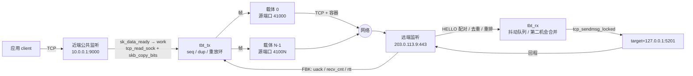

# tbtun 交接文档

写给下一位接手这个仓库的内核/网络工程师。假设你没有任何上下文。
文中每条结论都指向当前代码位置或 `DESIGN.md` 章节；两者冲突时以代码为准，并在第 8 节标注。

---

## 1. 一句话与目标

`tbtun` 是一个**全内核**的 TCP 隧道：近端（near）在本地监听一个端口，把应用的字节流
切成帧，经 `N + M` 条独立的 TCP 连接（载体，carrier）送到远端（far），远端再连到
`target=` 指定的字面地址。应用看到的就是一条普通 TCP 连接，用户态没有任何进程参与。

为什么是 `N + M` 条独立五元组：本地运营商按**每条流**限速（DESIGN §7.1、§16.1），
`N` 条活跃载体 + `M` 条备用载体各自占一个限速桶，于是同样的物理链路能拿到
`N + M` 份额度。备用载体不是闲置的：它保持温热，活跃载体失效时立刻接管（§9.7）。

HTTP/1.1 **只是 QoS 配置，不是互操作要求**。用户的原话是“我根本不在乎是不是 http，奈何 qos”：
`http-kal` 档位把载体包装成普通的 HTTP/1.1 keep-alive 流量，赌运营商的分类器会给它更高优先级。
这是一个**假设**，`raw` 档位可以随时关掉这层包装（§3.1.1、§16、§17）。

空洞修复要解决的问题：当某条载体的字节流出现空洞时，不要停下来等 TCP 重传。
发送端用几何判据判断“是晚了还是丢了”（§4.3），必要时在别的路径上重发；接收端用
抖动队列 + 第二机会合并把顺序恢复（§4.5）。代价写在 §4.6：补不上就在 `hole_budget_ms`
之后有界重置，而不是无限等待。

**原 tcp-brutal 拥塞控制产品已删除**：`brutal_cc.c`、`brutal_sockopt.c`、`brutal_rules.c`、
`brutal.h`、`tools/brutalctl.c`、`example/*.py` 全部移除，仓库不再包含任何用户态程序
（DESIGN §1.3、§11）。唯一保留的思路是“私有 `tcp_prot` 副本 + `sk_prot` 替换”，
它现在服务于载体（§9.2），与拥塞控制无关。

---

## 2. 当前状态

实现顺序见 DESIGN §15（C1–C8）；0.1.0 另含 FEC v6 与 256 载体扩展。
下表是**最终树**（`f1282df`；`af3b9ba` 只加
`review/final/`、`review/final-qemu/`、`review/final-bench/` 与
`review/dkms-qemu/` 证据，模块 `sha256 0b8f0006…`）的状态，不是计划。证据路径：
`review/final/`（主机、QEMU A–K、adversarial）、`review/final-qemu/`（运行日志与
console）、`review/final-bench/`（吞吐、flush、writer）、`review/dkms-qemu/`
（干净客户机内核上的 DKMS 安装/加载/卸载）。

| 阶段 | 内容 | 状态 | 验证方式 |
|---|---|---|---|
| C1 | 骨架：模块生命周期、`/proc/net/tbtun/*`、监听器、端口位图 | 完成 | `make check` 全绿；QEMU A–K |
| C2 | 单载体数据面：`tcp_read_sock` 捕获、`tcp_sendmsg_locked` 投递、raw 直帧 | 完成 | `n=1` 40 MiB 严格用例 `strict=1 rc=0`，app 3.11 Mbit/s（`review/final-bench/`，`20261106T003712`） |
| C3 | 远端：远端监听、HELLO nonce 配对、每流连 `target=`、双向 | 完成 | `far.data_path`/`near.data_path`/`near.second_conn` PASS |
| C4 | 多载体：`n` 条并行、每路径反馈（FBK）、按 inflight 调度 | 完成 | `n=4` 40 MiB `strict=1 rc=0`，4/4 载体；app 10.74 Mbit/s（`review/final-bench/`，`20261106T004314`），更早两次为 8.38/11.37 |
| C5 | 复制 + 重放环：`dup=`、`replay=`、`tbt_tx_retain_trim` | 完成 | `test_reorder` 52,792/0；探针 F；`dup_bytes_ppm` 在 stats |
| C6 | 空洞修复：几何判据、真字节重放注入、接收端有界重置 | 完成 | 探针 G/H PASS；`holes_unrecoverable=0`；占位路径已删除（`TBT_CONV 0x0005`） |
| C7 | 备用与替换：`m`、`carrier <i> down/up`、RETIRE 握手、`join_dup` 抑制 | 完成 | 探针 E/K；`carrier_replaced`/`join_dup` 计数 |
| C8 | HTTP 容器：`http-kal`、`http-kal-drip`、响应解析 | 完成 | `test_http` 249/0 + h11 交叉校验；profile 行 |
| FEC | FEC v6 grouped 数据面：`carriers = groups * (n + m)`，生产 32 组 × 8 = 256；`crypto=on` 的 ChaCha8 body 混淆 | 完成（0.1.0） | `test_fec`/probe N/O；`c9` 计数器；256 载体 `up=256`、`http_parse_err=0` |
| SCALE | 256 载体：per-carrier 数组与 `path_id` 扩到 256；旧 ARQ 的 per-path ack 仍为 16 位 | 完成（0.1.0） | probe N；`CHANGELOG.md` 的 0.1.0 条目 |

**最终验收（本树实测）**：

```sh
source ~/.cache/tbtun-build/env.sh && make check
# test_parse 357/0, test_fuzz 7,550,734/0, test_http 249/0,
# test_reorder 52,792/0, test_ack 10,026/0, test_control 181/0,
# test_multistream 68,580/0, test_anchor 124/0, h11 accepted
make host-test-san
# 同上四项 0 failures，ASan/UBSan 无报告
bash review/lint.sh
# 16/16 checks passed, 14/14 self-tests passed
```

`test_parse` 现为 357 checks；365 是删除 `framing`/`chunk`/`max_retry`/`dev`/`uid`
五个死键及其解析用例之前的旧快照。删除的是已从语法移除的键的测试，不是行为覆盖；
`make check` 仍为 0 failures。

QEMU A–K 的最终归档是 `review/final/qemu-AK-summary.txt` 与
`review/final-qemu/qemu-AK-console-f1282df.log`：**11 PASS / 0 FAIL / 0 SKIP，
165.7 s**（模块 `0b8f0006…`）。adversarial 的最终归档是
`review/final/adversarial-results.txt`：**91 PASS / 0 FAIL / 0 SKIP，284.4 s**，
18 个默认组加独立 crash repro；绿色运行只有 91 行 `ADV_RESULT` PASS，
`console.klog.*` 只在失败时打印，所以没有第 92 行。`pub.churn` 归档读数为
10000/10000（`retried=0`）；`pub.writer` 在应用不读时 10 s 窗口内保持阻塞在
`write()`（100 MiB `sent=73400320/104857600`，1 GiB
`sent=74448896/1073741824`，都是 `errno=0 eagain=0 blocked=1
child_state=running`，无 `EAGAIN`），flush 0.03 s 后内存回到写前水平；有读端
排空时 `pub.writer_drain` 100 MiB 收发都是 104,857,600/104,857,600、1.40 s、
71.5 MiB/s（结果行字段名 `mbps`），`pub.writer_drain_1g` 1 GiB 收发都是
1,073,741,824/1,073,741,824、14.64 s、69.9 MiB/s，两组都是
`errno=0/0 eagain=0 blocked=0`、`oom=0->0`；
DKMS 在干净客户机内核上完成安装→
`modprobe`→配置回读→
`rmmod`→再次加载/卸载→`--uninstall`，38 步/39 检查/0 失败
（`review/dkms-qemu/`）。

**与旧快照的区别**：`TBT_CONV` 是 `0x0006`（0.1.0 为 `0x0005`，不是 0x0003/0x0004）；PREDICT/CANCEL、
`spec_bytes*`、`predict_*`、`src=`、`framing=`、`chunk=`、`max_retry=` 都不存在；
`retx_ppm` 的口径拆成 `retx_hole/retx_slow/retx_pathloss/retx_other`；会话统计是
`atomic64_t` + `tbt_stat_read()`；lint 是 16/16 + 14/14，不是 15/12。

**0.2.0（当前 cut）**：生命周期加固与 wire 修订，设计见
`review/s2-merged-design.md`。0.2.0 已把 `TBT_CONV` 翻转到 `0x0006`、
`TBT_FEC_CONV` 翻转到 `0x1002`；`0.1.0` 与 `0.2.0` 不互操作，首个 HELLO
即硬拒绝。

| 阶段 | 内容 | 状态 |
|---|---|---|
| M1–M8 | carrier/session/stream 生命周期与锁序；FEC RX 工作项、逐包提交、FIN 基数、PARITY marker、ACK 溢出、`short_len`；256 槽越界 | 0.2.0（代码已落地） |
| M2 | `TBT_CONV 0x0006`：FIN 恰 16 字节 body（`pkt_end`/`pkt_base`）；`TBT_FEC_CONV 0x1002`：`win_len=0, payload_len=0, epoch=0` 的空块 PARITY marker | 0.2.0（已翻转） |
| M9 | 文档与版本号、1 GiB 验收、真机 DKMS 七步 | 0.2.0 目标 |

---

## 3. 架构

### 3.1 内核独占端点

模块**拥有**监听套接字和每一条被接受的公共连接，自己跑完整的 TCP 状态机
（DESIGN §2.1、§2.5）。应用看到的仍是普通 TCP 连接，因为模块用的是内核现成的
`tcp_prot` 代码，只是没有人把这个套接字交给用户态（它不在任何 fd 表里）。

- **捕获**（应用 → 隧道）：`sk_data_ready` 在软中断里只调度工作项；工作项
  `lock_sock()` 后调用 `tcp_read_sock()`，回调里 `skb_copy_bits()` 把数据拷进帧
  （§8.5，代码 `tbt_sock.c` / `tbt_tx.c`）。
- **投递**（隧道 → 应用）：在同一个被接受套接字上做**普通发送** `tcp_sendmsg_locked()`。
  远端到 `target=` 的连接是同一形状（§8.5）。

### 3.2 为什么不做 receive-queue injection

`docs/inject-probe.md` 在 7.2.9 上实测：向一个双向活跃的已接受套接字注入
（`tcp_send_rcvq`、直接 `tcp_queue_rcv`、或 repair 模式变体）会丢对端字节——
20520 字节里丢了 36 字节（`SKB_DROP_REASON_TCP_OLD_DATA` / `tcp_sequence()`）。
根因是注入推进了 `rcv_nxt`，随后到达的对端数据被判为旧数据。DESIGN §18.11 记录了
这次否决，结论是“投递就是在被接受套接字上发送”，**不使用 repair 模式**。

### 3.3 为什么不做 recvmsg override

`docs/recvmsg-probe.md` 实测：把已接受套接字的 `sock->ops` 换成自己的 `.recvmsg`/`.poll`
只对**那个 socket 对象**生效，对应用无效——应用持有的 fd 是 loopback 连接的**另一半**
（客户端 socket）。内核只在一个地方把套接字交给用户态，那不是 accept 路径。
所以“接管应用的 read/poll”这条路在 v0 不成立。

### 3.4 载体

每条载体是 `sock_create_kern` + 绑定端口段里的端口 + `kernel_connect`（§7.2、§9.1）。
载体把 `__ro_after_init` 的 `tcp_prot` 副本装到 `sk->sk_prot`，只为让 `destroy`
留在模块内；释放前用 `sock_replace_proto()` 恢复 `&tcp_prot`（§9.2，代码
`tbt_carrier.c`）。**没有 `.sendmsg`/`.recvmsg` 覆盖**：发送直接调用
`tcp_sendmsg_locked()`，接收用 `tcp_read_sock()` 喂容器/记录解析器。
健康检查是每 50 ms 的 `w_poll`：`sk_state` 不是 `TCP_ESTABLISHED`，或 `snd_una` 在
`carrier_stall_ms`（默认 3000 ms）内没动，就判定失效（§9.7）。
**背压不算失效**：`snd_nxt` 不动但 `sk_wmem_queued > 0` 时是窗口阻塞，不触发替换——
这条区分是实测出来的（§9.7 记录过一次 191 次替换、15 次 `join_dup` 的风暴）。
**stall-pause 门**：当对端报告队列满（或本端投递队列满）时，`snd_una` 不可能前进，
`w_poll` 重启 `carrier_stall_ms` 窗口并计 `stall_paused_skips`，不把投递背压误判成
路径失效（`tbt_carrier.c:300-340`）。

### 3.5 线上格式

帧头固定 32 字节（§3.3，代码 `tbtun/tbt_uapi.h`）：

```
+0  u8   type      10 DATA / 13 OPEN / 14 FIN / 15 RST
                   20 FBK / 21 WINDOW / 22 HELLO / 23 PAD / 24 RETIRE / 25 SACK
                   （11 PREDICT / 12 CANCEL 已在 0x0005 删除）
+1  u8   flags     bit0 HEAD_OF_RUN, bit1 DATA_VERIFIED, bit2 KEEP, bit3 low-prio,
                   bit4/bit5 保留（原 MUST_ORDER / has-token）
+2  u8   path_id   载体序号（0..255；旧 ARQ 的 per-path ack 字段仍只有 16 位）
+3  u8   path_ack_count
+4  u16  path_ack_mask
+6  u16  body_len
+8  u64  seq
+16 u64  uack
+24 u32  sid_lo
+28 u8   sid_hi
+29 u8   reserved2
+30 u16  conv      0x0006（0.1.0 为 0x0005）
```

**FIN body（`TBT_CONV 0x0006`）**：恰 16 字节，小端：
`+0 u64 pkt_end`（本流最后一个 DATA 包之后的绝对会话包序号）、
`+8 u64 pkt_base`（本流第一个 DATA 包的绝对会话包序号，按
`groups*n` 的 super-block 对齐）。非 FEC 会话也发 16 字节零 body，
保持单一长度规则。0.1.0 的 FIN body 是 0 字节，`tbt_body_bounds()` 的
`min=max=0`；0.2.0 已把 `TBT_F_FIN` 改成 `min=max=TBT_FIN_BODY_LEN`。

- **raw 容器**：没有前缀，帧头直接跟在 TCP 字节流里；`body_len` 在 32 字节头的 +6。
- **http-kal**：HTTP/1.1 `POST` + `Transfer-Encoding: chunked` keep-alive，
  **一个 chunk 恰好一条记录**（32 字节头 + `body_len`，没有长度前缀），空闲时每
  `keepalive_ms` 一个 PAD chunk（PAD 自成 38 字节 chunk，不是和数据共 chunk）；
  **http-kal-drip** 头完全相同，空闲时每 `drip_ms` 发一个 1 字节 chunk（§3.1.1）。
- **FBK** 负载是 `nr × 18 B`：`u8 path_id; u8 rx_state; u64 uack; u32 recv_cnt; u32 rtt_us`
  （§3.3）。`path_id` 低 4 位是载体序号，高 4 位是**对端**对该路径的代次，
  用来丢弃被替换载体的过期反馈。
- **HELLO** 体：`u8 ver; u8 role; u8 nonce[16]; u16 payload_max; u16 chunk_max; u8 profile|gen`。
  最后 1 字节的低 2 位是档位（1 http-kal / 2 http-kal-drip / 3 raw），
  位 5..2 是路径代次（0..15），位 7..6 为 0（§3.1.1）。接收端目前只取 `& 3` 和
  `>> 2`，不检查位 7..6。
- **HELLO v6（FEC 会话）**：旧 23 字节之后追加 43 字节，共 66 字节：
  `+23 u8 crypto`（bit0 启用，bit1 key 在 HELLO 中）、`+24 u8 key_id`
  （0 = 预共享/关闭，1 = key 在 +34）、`+25 u8 reserved`（必须为 0）、
  `+26 u8 crypto_nonce[8]`、`+34 u8 key[32]`。`crypto_nonce` 是本端 TX 方向的
  8 字节随机数，RX 用对端的值；两个方向不共享 nonce。`key_id=1` 时 key 在
  HELLO 中明文传输，远端采纳；两端都配 `crypto_key=` 时 `key_id=0` 且 key 字段
  为零，不匹配表现为每个 share 的 payload CRC 失败。旧 ARQ 永远不发 66 字节体。
- **RETIRE**：体是 `u8 index`（1 字节，旧载体序号），`seq` 是旧代次（旧 gen）。
  近端在替换载体拨号**之前**，
  在一条活载体上发 RETIRE，远端据此把旧 `(index, gen)` 标记为死，
  新载体的 `HELLO(gen+1)` 才能入座而不是收到 `EALREADY`（§9.7）。
- **FEC 记录（`TBT_FEC_CONV=0x1002`；0.1.0 为 `0x1001`）**：独立的 40 字节
  记录，不复用 32 字节旧帧。字段：`+0 u8 type`（0x30 DATA / 0x31 PARITY /
  0x32 ACK / 0x33 NACK / 0x34 CFG / 0x35 FBK）、`+1 u8 flags`、
  `+2 u16 share_index`、`+4 u8 n`、`+5 u8 m`、`+6 u16 epoch`、
  `+8 u64 block_id`、`+16 u64 seq`、`+24 u16 win_len`、
  `+26 u16 payload_len`、`+28 u16 conv`、`+30 u16 reserved`、
  `+32 u32 payload_crc32c`、`+36 u32 header_crc32c`（覆盖 +0..+35）。
  DATA/PARITY 的负载是 8 KiB share；`crypto=on` 时只有这段负载被 ChaCha8
  混淆，40 字节头和控制记录保持明文。接收端先校验 conv/type/长度，再校验
  header CRC，最后校验 payload CRC；任一失败都不得使用该头里的字段。
- **PARITY 空块 marker（`TBT_FEC_CONV 0x1002`）**：没有 4 字节
  marker，也没有魔数；marker 是 40 字节头内的一组值：`type=0x31`、
  `flags=0`、`share_index=n`（parity 0）、`epoch=0`、`win_len=0`、
  `payload_len=0`、`conv=0x1002`、`payload_crc32c=0`（空负载的 CRC32C）。
  0.1.0 的接收端要求 PARITY `payload_len == max_payload` 且 `win_len != 0`，
  所以 marker 必须随 `0x1002` 一起放宽；`win_len==0` 时还要求
  `payload_len==0 && epoch==0`，并且块内已有 DATA/parity 时拒绝 marker。
- **grouped 映射**：`carriers = groups * (n + m)`，`group(c) = c / (n + m)`，
  `share(c) = c % (n + m)`；全局包序号按 `group = seq % groups` 条带化，
  每组有独立的块窗口、codec 与校验。生产形状 `carriers=256, n=4, m=4`
  即 32 组 × 8。`carriers` 必须是 `n + m` 的整数倍；`fec=off` 时
  `n + m` 仍受旧 ARQ 的 16 载体上限约束。
- **流**：一个会话最多 128 条并发流（`TBT_STREAMS_MAX`，`tbtun.h:151`）。near 分配
  sid；far 对未知 sid 的 OPEN 会 adopt，未知 sid 的 DATA/FIN/RST 直接丢弃。
- **target**：每条流有自己的 target 连接，far 侧在该流 OPEN 时拨号；不是每会话一条。
- **复制 / 重放 / 空洞修复**：`dup=` 控制复制度；重放环保存已发帧供重传
  （`tbt_tx.c` 的 retain 链表）；空洞用环里的真实字节重发，环下溢时不发占位帧，
  由接收端 §4.6 的有界重置兜底。
- **每路径状态**：`uack`、`inflight`、`rtt_us` 随 FBK 刷新——每 10 ms 或每 32 个
  收到的 DATA 帧（`tbtun.h:175-176`），`peers` 里直接可读。50 ms 是 `w_poll` 的
  存活检查周期，不是反馈周期。
- **pump 唤醒**：`tx_queued` 只计载荷，零字节的 HELLO/OPEN/FIN/RST 不计入；所以
  `ctl_queued` 单独计数，pump 工作项在 `tx_queued || ctl_queued` 时运行
  （`tbt_carrier.c:177`）。否则一个只剩 RST 的队列在安静载体上永远等不到唤醒。
- **peer-window 门**：DATA 最多让一个 peer window 停在载体的 TCP 发送缓冲里
  （`write_seq - snd_una >= snd_wnd` 时暂停），其余留在模块队列，2 ms 后重试；
  计 `win_block`/`win_resume`。控制帧与 FBK 豁免。`snd_wnd` 是读快照，0 当作一个
  chunk，所以这是启发式，不是协议保证（`tbt_tx.c:1920-1960`）。
- **控制帧重试**：pinned 帧在 `-EAGAIN`/`-ENOMEM`/`-EIO` 时回队，间隔 2 ms、上限
  `TBT_CTL_MAX_RETRIES`；死载体槽按替换节奏等待；`ctl_lost/ctl_retry/ctl_requeue/
  ctl_obsolete/ctl_queued` 见 `stats` 的 `tunnel <id> ctl` 行。
- **stall 与替换**：见 3.4；替换在同序号上换新载体，旧载体走完 RETIRE 再释放。

### 3.6 数据流



---

## 4. 文件地图

`tbtun/`（内核模块，全部在 `tbtun-objs` 里）：

| 文件 | 职责 |
|---|---|
| `tbt_core.c` | 模块 init/exit、全局链表与锁、模块参数、能力探测 |
| `tbt_session.c` | 隧道/会话/载体数组、sid 分配、端口位图、`/proc` 的 tunnels/peers 渲染 |
| `tbt_carrier.c` | 载体套接字、`sk_prot` 替换、HTTP 请求生成、健康检查、替换与 RETIRE |
| `tbt_tx.c` | 公共字节 → 帧 → 载体；seq 分配、复制、重放环、令牌桶、FBK 生成、控制帧重试 |
| `tbt_rx.c` | 载体字节 → 记录 → 帧；去重、重排、第二机会合并 |
| `tbt_sock.c` | 公共侧套接字两个方向：捕获与投递 |
| `tbt_listen.c` | 近端监听器与 accept 工作项 |
| `tbt_procfs.c` | `/proc/net/tbtun/{config,tunnels,ports,peers,stats,http}` 的读写管道 |
| `tbt_parse.c` | `/proc` 语法的纯逻辑（无内核状态），同时编进 host 测试 |
| `tbt_parse.h` | `struct tbt_cfg`、`struct tbt_cmd`、行缓冲、语法常量 |
| `tbt_proto.c` | 帧编解码（纯代码，host 测试共用）；不含容器 |
| `tbt_rec.c` | 记录切分（32 字节头 + `body_len`，无长度前缀），host 测试共用 |
| `tbt_http.c` | HTTP/1.1 容器的生成与解析（纯代码，host 测试共用） |
| `tbt_uapi.h` | **契约**：线上常量、帧类型/边界、`/proc` 名字、版本、`TBT_CONV` |
| `tbtun.h` | 内部类型与内核侧声明（不含线上常量） |

其它目录：

| 路径 | 内容 |
|---|---|
| `host/` | 纯用户态测试：`test_parse.c`（语法）、`test_fuzz.c`（记录/帧模糊）、`test_http.c`（容器 + h11 交叉校验）、`tbt_burst.c`（端到端校验器，QEMU 与 bench 共用） |
| `tests/qemu/` | 内核态探针 A–K，`run.sh` / `init` / `mkinitramfs.sh`，`README.md` 是操作手册 |
| `tests/probe/`、`tests/probe2/` | 一次性注入探针（`docs/*-probe.md` 的证据），不在 SRCS 里 |
| `benches/` | 性能扫描：`run.sh`、`src/`、`results/*.csv`、`README.md`（数字的唯一来源） |
| `review/` | 独立评审：`findings.md`（编号 + 状态表）、`lint.sh`（机械不变量检查） |
| `adversarial/` | 外部攻击套件：`findings.md` F1–F12、`crash-repro.sh`、`run.sh` |
| `docs/` | `build-env.md`（构建环境）、`inject-probe.md`、`recvmsg-probe.md`、`prior-art.md`、`http-profile-integration.md` |
| `DESIGN.md` | 设计权威：目标、线上格式、模型、内核结构、实测与未决问题 |
| `README.md` / `README.zh.md` | 操作手册（用户视角），与本文档互补 |

**不要改的契约文件**：

- `tbtun/tbt_uapi.h`：线上常量（帧类型、边界、`TBT_CONV`）。改动 = 协议变更，
  必须同时改 `DESIGN.md §3.3` 并提升 `TBT_CONV`；`host/test_fuzz.c` 钉住了 `conv`。
- `tbtun/tbt_parse.h`：`/proc` 语法（`struct tbt_cfg` 字段、键名、`TBT_LINE_MAX`）。
  它是模块与 host 测试共用的唯一定义，改字段名会同时改到测试与文档。
- `benches/results/*.csv`：已发布数字的原始数据，不要覆盖。

---

## 5. 构建与测试

```sh
source ~/.cache/tbtun-build/env.sh    # KDIR / PAHOLE / LD_LIBRARY_PATH
make check                            # 模块 + 全部 host 测试（语法/模糊/HTTP + h11）
make host-test-san                    # 同一批测试，ASan+UBSan
make qemu-test                        # 构建后在 QEMU 里跑探针 A–K
bash review/lint.sh                   # 机械不变量检查（16 项 + 14 个自测）
adversarial/crash-repro.sh            # close-flush 崩溃复现（需要 QEMU）
benches/run.sh throughput --n 4 --mib 40
```

环境事实（`docs/build-env.md`）：

- 本机**没有安装内核头文件**，头文件来自解包的 `linux72-headers` 负载；
  `env.sh` 把它们指给 `KDIR`。
- 需要 **pahole 1.32**（`CONFIG_PAHOLE_VERSION=132`）；版本不对会在 `BTF [M]` 阶段失败。
- 模块是 **zstd 压缩**安装（`CONFIG_MODULE_COMPRESS_ALL=y`），手工装 `.ko` 要自己压。
- **`pkexec` 在本机无认证即可拿到 root**（polkit 配置错误）。这是安全缺陷，不要用它加载模块；
  加载用显式 `sudo`。详见 `docs/build-env.md` 的 Root 一节。

`make qemu-test` 的控制台日志在 `~/.cache/tbtun-build/qemu/console.log`；
探针可用 `--probes A,B,I` 单独跑，`--allow-skip` 接受部分跳过。

---

## 6. 运行手册

两机最小示例（`README.md` 的原文，已用 `tbt_parse.c` 验证可解析）：

```sh
# 近端
echo 'tunnel 1 role=near listen=10.0.0.1:9000 peer=203.0.113.9:443 n=4 m=1' \
     > /proc/net/tbtun/config

# 远端
echo 'tunnel 1 role=far listen=203.0.113.9:443 target=127.0.0.1:5201 n=4 m=1 peer=10.0.0.1:9000' \
     > /proc/net/tbtun/config

# 任一端
cat /proc/net/tbtun/tunnels
```

参数怎么选：

- `n`：活跃载体数。最终记录里 `n=4` 是单流的 3.93 倍（10.74 对 2.73 Mbit/s
  的 control），`n=8`/`n=16` 是 8.67/12.45 倍（22.36/32.75 对 2.58/2.63）；
  `fec=off` 时上限 16（旧 ARQ 的 per-path ack 宽度）；`fec=on` 时
  `n + m <= 256`，`carriers` 也受 `max_carriers` 与端口段大小约束。
- `m`：`fec=off` 时是备用载体数；备用会发热（`http-kal-drip` 约 8 bit/s），
  换来的是一条活载体失效时无需重新拨号即可接管，建议 `m=1`。`fec=on` 时
  它是每组的校验 share 数，必须 `>= 1`；生产形状 `n=4, m=4`。
- `dup`：复制度，默认 1。增加会在多条路径上重复发送同一帧，只对“丢包突发”有意义。
- `profile`：默认 `http-kal`；不确定线路是否给 HTTP 优先级时用 `raw` 做对照
  （`DESIGN.md §17` 的十分钟测量）。

看什么：

- `tunnels`：9 列 `id role state listen peer target n m streams`；`target` 在近端是 `-`。
- `peers`：19 列，重点是 `state`、`rtt_us`、`inflight`、`tx_bytes`、`rx_lag_ppm`
  （接收端滞后，**不是丢包**）、`retx_ppm`（重传比例，丢包的代理指标）。
- `stats`：第一行 `debug_loss=<0|1>`，随后 `gaps_total`、`streams_total`，
  再往后是每条隧道的队列/空洞/复制/替换计数器，以及 `ctl` 行（控制帧重试）与
  `reconcile` 行（C/E 对账）。
- `http`：`debug>=2` 时才输出，内容是载体最近一次真正发出的 HTTP 请求块，用于对照解析器。

动作：

- `drop_ppm` 只有加载时带 `debug_loss=1` 才允许，否则 `EPERM`。
- `echo 'carrier 2 down' > /proc/net/tbtun/peers` 强制某条载体下线；
  `up` 清除强制标志（不会拨号，替换由工作项完成）。
- `echo flush > /proc/net/tbtun/config` 清空所有隧道。传输后 `flush` 的旧阻塞
  已在最终树修复（`init.flush_midstream`/`init.echo_after_flush`/`stall.flush`
  PASS）；测量之间仍建议重发完整隧道行，便于看清状态。
- 配置**不持久化**。保存/恢复：

```sh
cat /proc/net/tbtun/config > /etc/tbtun.conf
cat /etc/tbtun.conf > /proc/net/tbtun/config
```

---

## 7. 实测性能

来源：`benches/results/*.csv`。条件：KVM 客户机、virtio-net、**每个源端口一条
10 Mbit htb 类**、netem `delay 20ms 10ms`、40 MiB 严格先发后读（逐字节校验）、
每次启动只测一种配置。**实验室数字，不是 ISP 实测。**

| 载体数 | 单向有效吞吐（app） | 相对该行 control | 证据 |
|---|---|---|---|
| `n=1` | 3.11 Mbit/s | 1.28x（control 2.43） | `review/final-bench/`（`20261106T003712`），`strict=1 rc=0` |
| `n=4` | 10.74 Mbit/s | 3.93x（control 2.73） | `review/final-bench/`（`20261106T004314`），`4/4`、`strict=1 rc=0` |
| `n=8` | 22.36 Mbit/s | 8.67x（control 2.58） | `review/final-bench/`（`20261106T004635`），`8/8`、`strict=1 rc=0` |
| `n=16` | 32.75 Mbit/s | 12.45x（control 2.63） | `review/final-bench/`（`20261106T004925`），`16/16`、`strict=1 rc=0` |

四行都是整段 `wire/app` 1.0123–1.0268、`retx_ppm` 0–12,719、
`holes_unrecoverable=0`。最终 `n=4` 的细节：`wire/app` 1.0138（CSV 的 2 s
窗口列是 1.0333），`retx_ppm` 2333，`retx_hole` 9，`retx_slow` 15，
`retx_pathloss` 0，`holes_*` 全 0，`kworker_pct` 99.1。同一模块
（`0b8f0006…`）的一次更早 `n=4` 运行是 8.38（`wire/app` 1.0146、
`retx_ppm` 1842），另一次是 11.37，这是运行间方差，不是配置差异；报告比值时
同时给出绝对值和 control。`n=16` 是单载体应用速率的 10.5 倍。

| 代价 | 实测 | 备注 |
|---|---|---|
| `http-kal` vs `raw` | 字节约多 1%（每约 4 KB 记录一个 chunk）；单 vCPU 系统态 CPU 约多 3.5 个百分点 | 2026-11-05 旧构建的 profile 行；最终树未重跑 profile 扫描 |
| 丢包下的空洞修复 | 1%/5%/10% 注入的 `holes_unrecoverable` 都是 0 | 旧构建的 loss 行；最终树以 G/H 探针为准 |
| 时延（1 KB 回显） | p50 +156 µs、p99 +274 µs；补一个空洞会把 p99 推到 22–31 ms | 旧构建的 latency 行；最终树未重跑 |

读法：**比值**是产品主张，**绝对值**是这台机器的 QEMU/slirp 路径属性。
单流封顶 2.5–2.9 Mbit/s 不是 10 Mbit 桶，而是 20 ms ± 10 ms 抖动。
最终性能回归与完整矩阵见 `review/final-bench/summary.md`；本文的数字来自
`f1282df` 代码树（模块 `0b8f0006…`）的归档。

---

## 8. 已知缺陷与风险

`review/findings.md` 是独立评审，最终状态表在文件最前。下面是最终树的转写。
FIXED = 代码带修复且有记录过检查；OPEN = 仍存在，附限制与发布理由。

### 严重（会崩溃或泄漏）

- **2026-11-06 生产 Oops（FIXED，RK3588 near）**：`tbt_carrier_new_locked()`
  用 `kmalloc()` 分配 per-carrier 的 `parser` 与 `http_rx`。复用 slab 对象时
  `parser->have` 可能是脏值，`tbt_http_rx_parse()` 把它当作 `memmove()` 长度，
  于是按 GB 级长度越界写内核内存。.65 上 6 次 `Internal error: Oops` 全部在加载后
  1–7 秒内：其中一次 `lr=tbt_http_rx_parse+0x1bc`，栈为
  `tbt_rx_parse → tbt_rx_parse_pending → tbt_car_rx_work`，崩在 `__memcpy`
  （`len=0x0000ffff2433bb80`，约 256 TiB）；其余几次落在无关进程的 dcache 路径，
  说明破坏是全局 slab 级的。修复：新建路径改 `kzalloc()`，复用路径显式
  `memset(parser)` 并 `tbt_http_rx_new_message()`；`tbt_rx_parse_pending()` 增加
  `have > sizeof(parser->buf)` 守卫作为第二道防线。验证：受控 c8（8 carriers、
  1 MiB、5 s、单次不重试）通过、near 存活
  （`review/wan-experiment/arm64/controlled-c8-20261106T232839Z/`）。
  复现与取证流程见
  `review/wan-experiment/arm64/stop-65-down-20261106T2250Z/forensics-65/README.md`。
- **无 OPEN 的严重项。** review 1/2/37/38/39 与 adversarial F1/F2 均已修复。
  F1 的 `ctl.close_flush` PASS；F2 的退出序是 `tbt_procfs_exit` →
  `tbt_tunnel_shutdown` → `synchronize_rcu` → `rcu_barrier`（`tbt_core.c`），
  `init.dmesg_after_rmmod` PASS（无 warning/BUG/oops）。`init.rmmod` 的
  “clean close” 断言在 12:02 的旧日志里仍是 FAIL：旧探针把 EOF 前后的错误打成
  `ECHO_ABORT op=read errno=0`，`read_to()` 现在读取 `SO_ERROR` 并报告真实 errno
  （`adv_probe.c:189-218`）。QEMU A–K 在 `0b8f0006…` 上 11/11 PASS（覆盖加载/
  卸载）；最终 adversarial 91 PASS 含 `init.rmmod` 与 `init.reload`，归档在
  `review/final/adversarial-results.txt`。真机未直接执行 modprobe/rmmod；
  干净客户机内核已跑通全流程（见 §8.1）。

### 高（协议/资源正确性）

- **adversarial F4 顺序 churn**：FIXED。`pub.churn` 10,000 次
  connect/send/close，判据是每周期 2 s 超时、仅超时后重试一次（`retried=`
  计数），仍要求 `usable=10000 refused=0 other=0`。两次最终判据运行都是
  10000/10000（`retried=1` 与 `retried=0`）；归档的
  `review/final/adversarial-results.txt` 是 `retried=0` 那次。`pub.two` 与
  `pub.concurrent`（100/100）PASS。far 流在优雅 FIN 路径上 detach
  （`tbt_stream_detach_from_session()`，`tbt_session.c:800`），`n_active`
  不再顶到 128。
- **adversarial F5 半关闭**：FIXED，`pub.halfclose` PASS，`EOF=1`。
- **adversarial F6 远端载体输入与投递停滞**：FIXED。RX 工作在每条 `-EAGAIN`/
  read-zero 路径上重新布防（`review/analysis/multiconn-p01-plan.md`）；QEMU
  `far.second_carrier`（`rx_adopt_events=2`）、`far.open_other_sid`、
  `far.data_path`、`near.data_path`、`near.second_conn` PASS。
- **adversarial F7 `deprecated workqueue`**：FIXED。全树没有
  `system_unbound_wq`/`alloc_workqueue`；`w_fbk` 用 `system_dfl_wq`（`tbt_tx.c:2578`）。
- **review 13 PREDICT 惰性**：FIXED（删除）。占位帧、`predict_*` 字段与计数器、
  procfs 渲染全部移除，`TBT_CONV` 升到 `0x0005`。真正生效的是
  `tbt_tx_inject_locked()` 重放真实字节；环下溢由接收端有界重置兜底。
- **review 14 空洞门控计入失败写**：FIXED。`data_frames++` 只在写成功后或注入器
  显式丢弃时（`tbt_carrier.c:658`、`:741`、`:825`）。
- **review 16 首个 HELLO 的 nonce 抢占**：FIXED。far 在 nonce 之前检查源锚；
  已设锚的会话拒绝其他源（`join_src_reject++`）；只有通过 nonce 检查的首条 HELLO
  才能设锚。`nonce=` 固定 nonce，`peer=` 在会话创建时固定锚；两者都没有时仍是
  TOFU，但 `pr_warn_once` 告警。`tbt_session_join()` 另有源锚断言。
  QEMU `far.anchor`/`far.dup_index`/`far.srcaddr_free`/`far.nonce_pinned`/
  `far.src_anchor` PASS；`test_anchor` 124/0。
- **review 20 重叠重排帧**：FIXED。`tbt_rx_pull_locked()` 淘汰完全过期节点并裁剪
  跨界节点（`tbt_rx.c:33-90`）；QEMU `far.overlap` PASS。

### 中（可观测的错误行为）

- **`retx_ppm` 已降到万级以内**：FIXED。最终矩阵是 `n=1` 0、`n=4` 2,333、
  `n=8` 2,041、`n=16` 12,719；旧文档的 96k–304k 是旧口径。新口径把重发按来源
  拆成 `retx_hole/retx_slow/retx_pathloss/retx_other`，并给出 `data_tx`、
  `retx_data_ppm`、`dup_bytes_ppm`。3×RTO 宽限与停滞路径避让见
  DESIGN §4.3/§4.6。
- **`flush` 在传输后可能阻塞**：FIXED。`init.flush_midstream` PASS（应用干净关闭，
  `ECHO_ABORT errno=104`），`init.echo_after_flush` PASS，`stall.flush` PASS。
- **`/proc/net/tbtun/http` 只输出原始请求块**：设计如此，`debug>=2` 才输出；
  读取在 `pump_lock` 下复制快照（`tbt_procfs.c:523-568`），不再撕裂。
- **端口段耗尽**：FIXED。`port_exhaust`/`port_alloc_fail` 在 stats 中，日志
  ratelimited；carrier 保持存活并按 200 ms 重试。`init.port_exhaust` PASS
  （`port_exhaust=16`、`alloc_fail=16`，tunnel 仍 up）。
- **`framing=ext`/`chunk=`/`max_retry`/`dev=`/`uid=`/`src=`**：FIXED（语法已删）。
  未知键返回 `EINVAL`；`grep -rn 'src=' tbtun/` 为空。入站过滤不存在（§8.1）。
- **`max_tunnels`/`max_carriers`**：FIXED。`max_carriers` 在 `tbt_session.c:123`
  检查，`max_tunnels` 在 `:199` 检查；`netns_optin` 已删除。
- **`ports 0-0`、空行写 `/ports`**：FIXED，都是 no-op（`tbt_procfs.c:427`）。
- **`config` 的 32 KiB 截断与一次性读**：FIXED，精确大小快照 + 偏移读
  （`tbt_procfs.c:292`）。
- **部分 procfs 初始化失败删除不存在的条目**（review 34）：FIXED。
  `tbt_procfs_exit()` 用 `remove_proc_subtree(TBT_PROC_SUBDIR, init_net.proc_net)`；
  `review/lint.sh` 的 `proc-entries-removed` 接受子树证明。

### 低 / 规格漂移

- **review 12**：FIXED。HELLO 布局是 `profile | (gen<<2)`；DESIGN §3.1.1/§3.3
  与代码注释一致（`tbt_carrier.c:1397-1398`）。
- **review 15**：FIXED。`fbk_mask` 形参及调用实参已删除，`grep` 为空。
- **review 21 计数器非原子**：FIXED。多写者会话计数器是 `atomic64_t`，经
  `tbt_stat_read()` 读取；单写者计数器保留 `u64` 并在 `tbtun.h` 注明；
  `review/lint.sh` 的 `atomic-stats` 钉住集合。
- **review 22 pinned 控制帧**：FIXED。`-EAGAIN`/`-ENOMEM`/`-EIO` 不再 `kfree`，
  而是回队重试（`ctl_retry`/`ctl_requeue`），间隔 2 ms、上限
  `TBT_CTL_MAX_RETRIES`；死载体槽按替换节奏等待；FIN/RST 换代重钉；旧代
  HELLO/OPEN/RETIRE 计入 `ctl_obsolete`；只有耗尽上限才 `ctl_lost`。
  `stats` 的 `tunnel <id> ctl` 行给出五个计数；QEMU `near.fin_eagain`/
  `near.rst_eagain` PASS。
- **review 23**：FIXED。`rx_reorder_bytes=0`/`hole_budget_ms=0` 在解析时被拒
  （`tbt_parse.c:474-482`）。
- **review 24**：FIXED。`tbt_rx_check_hole()` 先算 `age` 再清零
  （`tbt_rx.c:923-924`）。
- **review 26**：FIXED。载体 `SO_REUSEADDR` 开着，DESIGN §7.2 也写 “on”。
- **review 35**：FIXED。五个未用键已从语法删除；`tbt_passive_port()`/
  `tbt_tunnel_flush()` 已从 `tbtun.h` 删除（全树无引用）。
- **`TBT_CONV`**：0.2.0 为 `0x0006`（0.1.0 为 `0x0005`），RETIRE、HELLO 的 gen 位与占位帧的删除都已在其中
  （`tbt_uapi.h:61`）。

### 8.1 已知限制（发布时保留）

- **无 IPv6**：地址只接受字面 IPv4；IPv6 被明确拒绝（DESIGN §1.1、§19 Q5）。
- **默认不加密、不认证；`crypto=on` 只是混淆**：`crypto=on`（`fec=on` 时的
  默认值）只对 FEC 的 DATA/PARITY 负载做 ChaCha8；40 字节 FEC 头、HTTP 头、
  chunk 分帧与控制帧保持明文。未配置 `crypto_key=` 时，会话密钥在 HELLO v6
  body 里明文传输（`key_id=1`），而且没有消息认证；两端都配置时 `key_id=0`，
  密钥不匹配表现为 payload CRC 失败。需要机密性就套 WireGuard（DESIGN §1.2、§13）。
- **FEC 可选，grouped 是生产形状**：`fec=on` 支持单组（`carriers == n + m`）
  与 grouped（`carriers = groups * (n + m)`，最多 256 条载体）；FEC 路径没有
  NACK/选择性重传，丢失超过校验能力的块会停到关闭计时器重置。`fec=off` 时
  只有复制（`dup=`）与重放，不做前向纠错。
- **无入站过滤**：`src=`/`dev=`/`uid=` 不存在；far 的身份是 nonce/peer，不是源
  地址白名单。单个 anchor 会拒绝多宿/NAT 重绑定后的 near 源（这是有意的严格性，
  代价是 near 换地址后必须重建会话）。
- **TOFU**：既无 `nonce=` 也无 `peer=` 的 far 信任首个通过 HELLO 的连接，只告警
  一次。需要确定性身份时必须配 `nonce=` 或 `peer=`。
- **window gate 是启发式**：`snd_wnd` 的读取没有协议保证；0 被当作一个 chunk。
  它只限制 DATA，控制帧和 FBK 豁免；代价见 `win_block`/`win_resume`。
- **rx 环 64 MiB 约 2× 物理内存放大**：`rx_reorder_bytes` 与流/队列的账本不是
  精确的堆占用；512 MiB 客户机下这是最大的单项内存风险。
- **应用不读时 `pub.writer` 停在发送窗口上，不是固定上限**：最终判据要求写完
  （`sent==total`），或 10 s 观察窗口结束时仍阻塞在 `write()` 中
  （`blocked=1`、`child_state=running`）。探针不设 `SO_SNDTIMEO`；出现
  `EAGAIN` 即失败。应用不读的两例分别停在 `sent=73400320/104857600`
  （100 MiB）与 `sent=74448896/1073741824`（1 GiB），都是 `errno=0 eagain=0`
  且保持阻塞；有读端排空时 `pub.writer_drain` 100 MiB 收发都是
  104,857,600/104,857,600（`errno=0/0 eagain=0 blocked=0`），1.40 s、
  71.5 MiB/s（结果行字段名 `mbps`），`pub.writer_drain_1g` 1 GiB 收发都是
  1,073,741,824/1,073,741,824，14.64 s、69.9 MiB/s，两组都是
  `errno=0/0 eagain=0 blocked=0`、`oom=0->0`。
  关闭套接字并 flush 0.03 s 后，
  `MemAvailable` 从 218–223 MB 的低点回到 396–397 MB，`oom=0->0`，无 RST。
  停在哪个字节取决于当时的发送窗口，不是设计边界，也不是泄漏；重复用例
  不会无界增长。
- **运行间方差**：最终 `n=4` 是 10.74 Mbit/s，更早同一模块的一次运行是
  8.38 Mbit/s（`wire/app` 1.0146、`retx_ppm` 1,842），另一次是 11.37。
  同一构建、同一拓扑，报告比值时必须同时给 control 与绝对值。
- **guest `kworker` ~99%**：单 vCPU 客户机里软中断/工作项占满一个 CPU；这是
  QEMU/slirp 环境的属性，不是模块的 CPU 预算结论。
- **DKMS 宿主本机未直接执行，干净客户机内核已验证**：本机 `sudo` 需要密码，
  且没有 `dkms`/匹配内核头，所以宿主没有跑 `install_dkms.sh`/`modprobe`/
  `rmmod`。在 QEMU 客户机里用干净的 `7.2.9-1-MANJARO` 内核、真实 `dkms 3.4.4`
  与 `linux72` 头文件跑通了安装→加载→配置回读→卸载→再次加载/卸载→
  `--uninstall`，38 步/39 检查/0 失败（`review/dkms-qemu/`）。不要把这写成
  “宿主安装成功”。
- **replay ring 两次拷贝**：`skb_copy_bits()` 进 `r->data`，再 `memcpy()` 进帧
  （`tbt_tx.c:2364`、`:2371`）；DESIGN 必须写“copy”，不是“reference”。
- **小写入低于分类下限**：1 字节 DATA 会发出 39 字节 chunk；DESIGN §3.2 的
  `[0x800, 0x2020]` 是目标，不是保证。
- **Host 头总是带端口**：`snprintf("%pI4:%u", ...)`（`tbt_carrier.c:603`），
  不区分 80 端口。
- **HTTP 容器没有 chunked 终止符**：一条载体是一个不设界的 chunked 消息，
  不发送 `0\r\n\r\n`；对端解析器必须按 keep-alive 流处理。
- **不越过空洞交付**：接收端只在 `seq == rx_next` 前进，补不上就按
  `hole_budget_ms` 有界重置；不做透明空洞推进（会破坏字节精确性）。
- **bench CSV 尚未采集新口径**：`run.sh` 的 header 没有
  `retx_other`/`data_tx`/`retx_data_ppm`；stats 有这些键，CSV 仍用
  `retx_ppm`/`retx_hole`/`retx_slow`/`retx_pathloss`。这是文档-代码的已知差异。

## 9. 未完成清单（按优先级）

P0–P3 的代码项全部完成。下面每条给出最终状态和可复现的验收命令；“剩余”只列
文档漂移、未覆盖的规模档和真机验证。

### P0 — 崩溃与竞态（全部完成）

1. **替换/退休路径的锁序回归**：完成。验收：`bash review/lint.sh` 16/16 + 14/14；
   QEMU E/K PASS（`review/final-qemu/`）。
2. **F1/F2 回归**：完成。验收：`ADV_RESULT ctl.close_flush PASS`；
   `init.dmesg_after_rmmod PASS`；`init.rmmod` 的 clean-close 行按最终归档
   （`adversarial/console-rmmod.log`）读取。

### P1 — 协议正确性（全部完成）

3. **PREDICT 接收端推进**：完成（删除占位路径）。验收：`grep -rn 'predict_' tbtun/`
   为空；探针 G/H PASS 且 `holes_unrecoverable=0`。
4. **顺序多连接 churn**：完成。验收：`pub.churn` 10,000/10,000 usable、
   0 refused、0 other；两次最终判据运行 `retried=1` 与 `retried=0`
   （`review/final/adversarial-results.txt`）；`pub.concurrent` 100/100。
5. **首个 HELLO 的 nonce 抢占**：完成。验收：`far.nonce_pinned`/`far.src_anchor`
   PASS；`test_anchor` 124/0。
6. **F6 远端载体输入停滞**：完成。验收：`far.second_carrier`/`far.data_path` PASS。
7. **near.data_path / near.second_conn 复跑**：完成。两行 PASS
   （`adversarial/console-near.log`）。

### P2 — 性能（完成）

8. **`retx_ppm`**：完成。最终矩阵（`review/final-bench/summary.md`）：
   `n=1` 0、`n=4` 2,333、`n=8` 2,041、`n=16` 12,719；整段 `wire/app`
   1.0123–1.0268，全部 `strict=1 rc=0`、`holes_unrecoverable=0`。
9. **`flush` 阻塞**：完成。验收：`init.flush_midstream`/`init.echo_after_flush`/
   `stall.flush` PASS。

### P3 — 文档与打包（完成，文档漂移另列）

10. **代码注释与文档不一致**：完成。`tbt_proto.c` 顶部是 `header | payload`
    （无长度前缀，`body_len` 在头部 +6）；FBK 每项 18 字节；HELLO 注释是
    `profile | (gen << 2)`。
11. **adversarial F8 的 `src=` 测试契约**：完成（契约改写）。`init.src_key` 现在
    检查 `src=` 被拒、`nonce=` 被接受并渲染；`pub.srcfilter` PASS。
12. **低优先 OPEN（review 21）**：完成。多写者计数器 `atomic64_t` + `tbt_stat_read()`；
    lint `atomic-stats` 钉住。
13. **review 35 死声明**：完成。`grep -rn 'tbt_passive_port\|tbt_tunnel_flush' tbtun/`
    为空。
14. **端口段耗尽可见性**：完成。`init.port_exhaust PASS`；stats 有
    `port_exhaust`/`port_alloc_fail`。

### 剩余（不阻塞 0.2.0）

- **DESIGN 文档漂移**：`review/findings.md` 的 spec-drift 表 14 行已逐条复核，
  全部 `RESOLVED`（replay ring 的两次拷贝、chunk 最小尺寸、Host 端口、chunked
  终止符、透明空洞推进等）。代码是最终事实；DESIGN 已按代码改写或标为
  “目标/已知限制”。0.2.0 的 wire 常量已翻转（FIN 16 字节、PARITY marker、
  `TBT_CONV 0x0006`/`TBT_FEC_CONV 0x1002`），0.1.0 与 0.2.0 不互操作。
- **规模档**：`n=8`/`n=16` 已有最终 bench（22.36/32.75 Mbit/s），但只有单次
  40 MiB 记录；`n=4` 仍有 8.38–11.37 的历史运行间方差。
- **真机**：DKMS/`modprobe`/`rmmod` 未在宿主直接执行；干净客户机内核已验证
  全流程（`review/dkms-qemu/`）。0.2.0 的真机 DKMS 七步是发布门（release §4），
  未通过前不得发布。
- **bench CSV 口径**：`run.sh` header 尚未加入 `retx_other`/`data_tx`/
  `retx_data_ppm`；stats 已有这些键。

## 10. 决策记录

| 决策 | 理由 | 出处 |
|---|---|---|
| 全内核、模块拥有公共端点 | 消灭“向别人的套接字注入”的整类竞态（`rcv_nxt`、`sk_rmem_alloc`、应用 `recvmsg` 竞争） | §2.1、§2.5 |
| 没有用户态数据面 | 两次多余拷贝 + 每 8 KiB 两次系统调用；QoS 不需要用户态；用户态桥会把“空洞”语义泄漏给应用 | §18.1 |
| HTTP 只是 profile | 分类器只看可解析性；HTTP 语义（CONNECT、认证）对目标无用 | §3.1.1、§18.9 |
| 删除 brutal 拥塞控制 | 固定速率 + 丢包膨胀在重复发送下是自伤（self-DoS） | §5.1、§1.3 |
| 不用 nf_nat/REDIRECT 识别流 | 需要第二个 `rcv_nxt` 写者，与应用的 `recvmsg` 竞争，`MSG_ZEROCOPY` 下崩 | §18.2、§8.6 |
| sid 不用四元组哈希 | 碰撞与劫持面；改为 PRNG 前缀 + 显式 OPEN + HELLO nonce 门 | §3.6、§18.6 |
| 第二机会合并只按精确 seq | 透明空洞推进（越过缺口投递再回填）未实现；当前策略是“只按精确 seq 前进，补不上就有界重置”，实测更安全（避免窗口把空洞永久保活） | §4.5、§4.6 |
| 背压不等于失效 | `snd_nxt` 不动但 `sk_wmem_queued > 0` 是窗口阻塞；误判会导致替换风暴 | §9.7 |
| RETIRE 先于重入 | 否则新载体 `HELLO(gen+1)` 会收到 `EALREADY`，`join_dup` 风暴 | §9.7、§3.3 |
| 删除 PREDICT/CANCEL 占位 | 接收端从不据此推进；真正生效的是重放环真实字节重发。占位要么无效果，要么越过空洞交付而破坏字节精确性；环下溢由有界重置兜底 | §4.4、§4.6 |

---

## 11. 坑与教训

1. **非线性 skb 只能 `skb_copy_bits()`**。捕获路径拿到的 skb 可能是分片的，
   直接读 `skb->data` 会越界或读到错的字节；`tbt_rx.c:759`、`tbt_tx.c:1637` 都是这么做的。
2. **`tcp_check_space()` 只在有待发数据时由 `tcp_ack` 调用**。空发送队列上它不会回调，
   所以“等对端腾出窗口”不能用它当唯一唤醒源（`tbt_carrier.c:156` 的注释记录了这一点）。
3. **`tcp_send_rcvq()` 本身不检查 repair 模式，但设了 `tp->repair` 后应用的所有读都返回
   `-EPERM` 且 `close()` 不发 FIN**。`docs/inject-probe.md` 的第一条结论就是“不要设 repair”。
4. **`sk_data_ready` 永不为 NULL**，且 `sock_def_readable` 未导出。给套接字装回调时
   必须自己提供，并且清理时**先清 `sk_user_data` 再恢复回调**，否则软中断会进到已释放的对象
   （review 4）。
5. **work 的 `INIT_WORK` 顺序**：对象在能被任何路径引用之前必须初始化完毕；
   `tbt_carrier_new` 里 `INIT_LIST_HEAD` 现在排在第一（review 39 的教训）。
6. **`cancel_work_sync()` 不能持有可能被该 work 获取的锁**。替换路径先在锁外取消，
   再拿 `pump_lock` 换入新载体（review 6、§9.7）。
7. **`kmalloc_large()` 的释放**：大块要走 `kvfree()`，不要 `kfree()`；
   `tbt_session.c:73` 的端口位图就是这样释放的。
8. **QEMU 里 `/proc/cmdline` 为空**：`tests/qemu/run.sh` 因此把探针列表写成镜像里的
   `/probes.txt`，不再依赖内核命令行。
9. **busybox 需要全部 applet 的软链**：`mkinitramfs.sh` 用 `busybox --list` 全量创建；
   手工挑列表会在“命令缺失”时表现为模块故障。
10. **`hostfwd` 端口冲突**：上一个 qemu 还占着端口时，新 qemu 的转发规则建立失败，
    表现为“载体连上了但对端不 accept”。`run.sh` 现在先检查端口占用。
11. **`cp` 会写穿符号链接**：`mkinitramfs.sh` 曾把 `tc` 复制到 `bin/tc`（指向 busybox 的软链）上，
    结果把 `/bin/busybox` 覆盖成 tc，内核于是把 tc 当 init 跑。复制前必须 `rm -f` 目标。
12. **同一条流上的 TIME_WAIT**：替换/重连会在端口段里留下 TIME_WAIT；
    探针之间必须用互不重叠的端口段（`I_PORTS`/`J_PORTS`/`K_PORTS`），否则 `bind` 返回 `-EADDRNOTAVAIL`。
13. **`kmalloc()` 出来的 per-carrier 解析器必须零初始化**。`struct tbt_parser` 的
    `have` 和 `struct tbt_http_rx` 的 chunk 状态机都是长度与分支依据，"反正马上会被
    填满"不成立：复用路径保留缓冲区，`have` 只在解析成功后前进，任何一次漏掉清零，
    就会把上一个 slab 用户的残留当成长度（2026-11-06 的 Oops 就是这么来的）。
    新建用 `kzalloc()`，复用路径显式 `memset()` 并把 chunk 解析器重置为 `SIZE` 态。
    `tbt_rx_parse_pending()` 里的 `have > sizeof(buf)` 守卫是第二道防线，不是第一道：
    它挡住越界读取，挡不住被污染的状态机。复现/取证流程见
    `review/wan-experiment/arm64/stop-65-down-20261106T2250Z/forensics-65/README.md`。

---

## 12. 给接手者的第一小时

1. 读 `DESIGN.md` 的 §1、§2、§3.3、§4.3–§4.6、§8.5、§9.7——这六处解释“为什么长这样”。
2. 读 `docs/inject-probe.md` 与 `docs/recvmsg-probe.md`——它们决定了 §3.2/§3.3 的两个“不做”。
3. `source ~/.cache/tbtun-build/env.sh && make check`，确认 `test_parse` 357 checks
   与 `test_http` 249 checks 全绿（`review/findings.md` 的最终记录）。
4. `bash review/lint.sh`，确认 16/16 + 14/14。
5. `tests/qemu/run.sh --probes A,B --timeout 180`，先确认最基本的控制面与数据面。
6. 跑一次完整探针：`tests/qemu/run.sh --probes A,B,C,D,E,F,G,H,I,J,K --allow-skip --timeout 900`
   （约 3 分钟），对照 §2 的状态表看有没有回归。
7. 先复跑 **P0-2 的 F1/F2 回归**，确认 `ctl.close_flush` 与 `init.rmmod` 仍 PASS；
   再按 §9 逐项复核已完成项。
8. **P1-3（PREDICT 惰性）已按删除占位路径结案**；跑探针 G/H 看
   `holes_repaired/declared` 与 `rx_max_stall_us`，确认空洞修复仍是真实字节。
