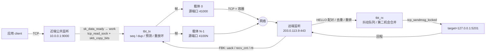

# tbtun 交接文档

写给下一位接手这个仓库的内核/网络工程师。假设你没有任何上下文。
文中每条结论都指向当前代码位置或 `DESIGN.md` 章节；两者冲突时以代码为准，并在第 8 节标注。

---

## 1. 一句话与目标

`tbtun` 是一个**全内核**的 TCP 隧道：近端（near）在本地监听一个端口，把应用的字节流
切成帧，经 `N + M` 条独立的 TCP 连接（载体，carrier）送到远端（far），远端再连到
`target=` 指定的字面地址。应用看到的就是一条普通 TCP 连接，用户态没有任何进程参与。

为什么是 `N + M` 条独立五元组：本地运营商按**每条流**限速（DESIGN §7.1、§16.1），
`N` 条活跃载体 + `M` 条备用载体各自占一个限速桶，于是同样的物理链路能拿到
`N + M` 份额度。备用载体不是闲置的：它保持温热，活跃载体失效时立刻接管（§9.7）。

HTTP/1.1 **只是 QoS 配置，不是互操作要求**。用户的原话是“我根本不在乎是不是 http，奈何 qos”：
`http-kal` 档位把载体包装成普通的 HTTP/1.1 keep-alive 流量，赌运营商的分类器会给它更高优先级。
这是一个**假设**，`raw` 档位可以随时关掉这层包装（§3.1.1、§16、§17）。

预测注入要解决的问题：当某条载体的字节流出现空洞时，不要停下来等 TCP 重传。
发送端用几何判据判断“是晚了还是丢了”（§4.3），必要时在别的路径上重发；接收端用
抖动队列 + 第二机会合并把顺序恢复（§4.5）。代价写在 §4.6：补不上就在 `hole_budget_ms`
之后有界重置，而不是无限等待。

**原 tcp-brutal 拥塞控制产品已删除**：`brutal_cc.c`、`brutal_sockopt.c`、`brutal_rules.c`、
`brutal.h`、`tools/brutalctl.c`、`example/*.py` 全部移除，仓库不再包含任何用户态程序
（DESIGN §1.3、§11）。唯一保留的思路是“私有 `tcp_prot` 副本 + `sk_prot` 替换”，
它现在服务于载体（§9.2），与拥塞控制无关。

---

## 2. 当前状态

实现顺序见 DESIGN §15（C1–C8）。下表是**当前代码**的状态，不是计划。

| 阶段 | 内容 | 状态 | 验证方式 |
|---|---|---|---|
| C1 | 骨架：模块生命周期、`/proc/net/tbtun/*`、监听器、端口位图 | 已验证 | QEMU 探针 A（`tests/qemu/init`）；`make host-test` 的 `test_parse` |
| C2 | 单载体数据面：`tcp_read_sock` 捕获、`tcp_sendmsg_locked` 投递、raw 直帧 | 已验证 | 探针 B；`n=1` 的 40 MiB 严格用例 `strict=1 rc=0`（`benches/results/20261105T112725-throughput.csv`） |
| C3 | 远端：远端监听、HELLO nonce 配对、每流连 `target=`、双向 | 已验证 | 探针 B/C/D/E；`benches` 的 n=1/n=4 行 `strict=1` |
| C4 | 多载体：`n` 条并行、每路径反馈（FBK）、按 inflight 调度 | 部分验证 | 探针 C/E/I；`n=4` 40 MiB `strict=1 rc=0`，app 11.39 Mbit/s；`n=8/16` 待最终回归 |
| C5 | 复制 + 重放环：`dup=`、`replay=`、`tbt_tx_retain_trim` | 已验证 | 探针 F（`dup=2` + 注入丢包，`dup_same_path=0`） |
| C6 | 预测：几何判据、PREDICT/CANCEL、抖动队列、第二机会合并 | 部分验证 | 探针 G/H 通过；但 PREDICT 的接收端推进是惰性的（review 13） |
| C7 | 备用与替换：`m`、`carrier <i> down/up`、RETIRE 握手、`join_dup` 抑制 | 已验证 | 探针 E（备用接管）、K（100% 丢包后恢复）、D |
| C8 | HTTP 容器：`http-kal`、`http-kal-drip`、响应解析 | 已验证 | `host/test_http`（249 checks）+ h11 交叉校验；`benches` profile 行 |

**最近一次已知全绿**：`tests/qemu/run.sh --probes A,B,C,D,E,F,G,H,I,J,K` 在 **00:54** 跑出
11/11 PASS、0 skip（控制 3.0 Mbit/s，n=4 11.7 Mbit/s，3.90×）。当时模块约 4.9 MB。

**此后模块被重建多次**（最近一次 05:28，5,403,144 B），**没有再跑过整套 QEMU 探针**。
这段时间落地的改动：

- `http_rx` 分配（review 37）：`tbt_carrier.c:694` 分配，`:695` 判空；
- retain 的 snd_una 门控（review 36a）：`tbt_retain_wire_ns()` `tbt_tx.c:619-645`；
- `tbt_carrier_free()` 统一释放（review 38）：`tbt_carrier.c:841-852`，三处调用；
- 构造顺序（review 39）：`INIT_LIST_HEAD(&c->node)` 移到第一次分配之前
  （`tbt_carrier.c:691-702`），OOM 路径不再空指针；
- 行缓冲上限 1024（review 29）：`tbt_parse.h:33`，最大渲染 642；
- DATA 最小 1 字节（review 27）：`tbt_uapi.h:131-133`；
- RETIRE（review 11）：`TBT_F_RETIRE=0x24`，`TBT_CONV=0x0004`（`tbt_uapi.h:46`、`:66`）。

**当前可以确认的绿**（`review/findings.md` 的 2026-11-05 记录）：
`make check` → `test_parse` 355 checks / 0 failures，`test_http` 249 checks / 0 failures，
h11 交叉校验通过；`test_fuzz` 0 failures（计数随 seed 变化）。此前的 365 是旧快照。
`bash review/lint.sh` → 15/15 checks，12/12 self-tests。

---

## 3. 架构

### 3.1 内核独占端点

模块**拥有**监听套接字和每一条被接受的公共连接，自己跑完整的 TCP 状态机
（DESIGN §2.1、§2.5）。应用看到的仍是普通 TCP 连接，因为模块用的是内核现成的
`tcp_prot` 代码，只是没有人把这个套接字交给用户态（它不在任何 fd 表里）。

- **捕获**（应用 → 隧道）：`sk_data_ready` 在软中断里只调度工作项；工作项
  `lock_sock()` 后调用 `tcp_read_sock()`，回调里 `skb_copy_bits()` 把数据拷进帧
  （§8.5，代码 `tbt_sock.c` / `tbt_tx.c`）。
- **投递**（隧道 → 应用）：在同一个被接受套接字上做**普通发送** `tcp_sendmsg_locked()`。
  远端到 `target=` 的连接是同一形状（§8.5）。

### 3.2 为什么不做 receive-queue injection

`docs/inject-probe.md` 在 7.2.9 上实测：向一个双向活跃的已接受套接字注入
（`tcp_send_rcvq`、直接 `tcp_queue_rcv`、或 repair 模式变体）会丢对端字节——
20520 字节里丢了 36 字节（`SKB_DROP_REASON_TCP_OLD_DATA` / `tcp_sequence()`）。
根因是注入推进了 `rcv_nxt`，随后到达的对端数据被判为旧数据。DESIGN §18.11 记录了
这次否决，结论是“投递就是在被接受套接字上发送”，**不使用 repair 模式**。

### 3.3 为什么不做 recvmsg override

`docs/recvmsg-probe.md` 实测：把已接受套接字的 `sock->ops` 换成自己的 `.recvmsg`/`.poll`
只对**那个 socket 对象**生效，对应用无效——应用持有的 fd 是 loopback 连接的**另一半**
（客户端 socket）。内核只在一个地方把套接字交给用户态，那不是 accept 路径。
所以“接管应用的 read/poll”这条路在 v0 不成立。

### 3.4 载体

每条载体是 `sock_create_kern` + 绑定端口段里的端口 + `kernel_connect`（§7.2、§9.1）。
载体把 `__ro_after_init` 的 `tcp_prot` 副本装到 `sk->sk_prot`，只为让 `destroy`
留在模块内；释放前用 `sock_replace_proto()` 恢复 `&tcp_prot`（§9.2，代码
`tbt_carrier.c`）。**没有 `.sendmsg`/`.recvmsg` 覆盖**：发送直接调用
`tcp_sendmsg_locked()`，接收用 `tcp_read_sock()` 喂容器/记录解析器。
健康检查是每 50 ms 的 `w_poll`：`sk_state` 不是 `TCP_ESTABLISHED`，或 `snd_una` 在
`carrier_stall_ms`（默认 3000 ms）内没动，就判定失效（§9.7）。
**背压不算失效**：`snd_nxt` 不动但 `sk_wmem_queued > 0` 时是窗口阻塞，不触发替换——
这条区分是实测出来的（§9.7 记录过一次 191 次替换、15 次 `join_dup` 的风暴）。

### 3.5 线上格式

帧头固定 32 字节（§3.3，代码 `tbtun/tbt_uapi.h`）：

```
+0  u8   type      10 DATA / 11 PREDICT / 12 CANCEL / 13 OPEN / 14 FIN / 15 RST
                   20 FBK / 21 WINDOW / 22 HELLO / 23 PAD / 24 RETIRE / 25 SACK
+1  u8   flags     bit0 HEAD_OF_RUN, bit1 DATA_VERIFIED, bit2 KEEP, bit3 low-prio,
                   bit4 MUST_ORDER, bit5 has-token
+2  u8   path_id
+3  u8   path_ack_count
+4  u16  path_ack_mask
+6  u16  body_len
+8  u64  seq
+16 u64  uack
+24 u32  sid_lo
+28 u8   sid_hi
+29 u8   reserved2
+30 u16  conv      0x0004
```

- **raw 容器**：没有前缀，帧头直接跟在 TCP 字节流里；`body_len` 在 32 字节头的 +6。
- **http-kal**：HTTP/1.1 `POST` + `Transfer-Encoding: chunked` keep-alive，
  **一个 chunk 恰好一条记录**（32 字节头 + `body_len`，没有长度前缀），空闲时每
  `keepalive_ms` 一个 PAD chunk（PAD 自成 38 字节 chunk，不是和数据共 chunk）；
  **http-kal-drip** 头完全相同，空闲时每 `drip_ms` 发一个 1 字节 chunk（§3.1.1）。
- **FBK** 负载是 `nr × 18 B`：`u8 path_id; u8 rx_state; u64 uack; u32 recv_cnt; u32 rtt_us`
  （§3.3）。`path_id` 低 4 位是载体序号，高 4 位是**对端**对该路径的代次，
  用来丢弃被替换载体的过期反馈。
- **HELLO** 体：`u8 ver; u8 role; u8 nonce[16]; u16 payload_max; u16 chunk_max; u8 profile|gen`。
  最后 1 字节的低 2 位是档位（1 http-kal / 2 http-kal-drip / 3 raw），
  位 5..2 是路径代次（0..15），位 7..6 为 0（§3.1.1）。接收端目前只取 `& 3` 和
  `>> 2`，不检查位 7..6。
- **RETIRE**：体是 `u8 index`（1 字节，旧载体序号），`seq` 是旧代次（旧 gen）。
  近端在替换载体拨号**之前**，
  在一条活载体上发 RETIRE，远端据此把旧 `(index, gen)` 标记为死，
  新载体的 `HELLO(gen+1)` 才能入座而不是收到 `EALREADY`（§9.7）。
- **流**：一个会话最多 128 条并发流（`TBT_STREAMS_MAX`，`tbtun.h:134`）。near 分配
  sid；far 对未知 sid 的 OPEN 会 adopt，未知 sid 的 DATA/FIN/RST 直接丢弃。
- **target**：每条流有自己的 target 连接，far 侧在该流 OPEN 时拨号；不是每会话一条。
- **复制 / 重放 / 预测**：`dup=` 控制复制度；重放环保存已发帧供重传
  （`tbt_tx.c` 的 retain 链表）；PREDICT 占位 + CANCEL 取消，接收端按 §4.5 合并，
  补不上则 §4.6 的有界重置。
- **每路径状态**：`uack`、`inflight`、`rtt_us` 随 FBK 刷新——每 10 ms 或每 32 个
  收到的 DATA 帧（`tbtun.h:158-159`），`peers` 里直接可读。50 ms 是 `w_poll` 的
  存活检查周期，不是反馈周期。
- **stall 与替换**：见 3.4；替换在同序号上换新载体，旧载体走完 RETIRE 再释放。

### 3.6 数据流



---

## 4. 文件地图

`tbtun/`（内核模块，全部在 `tbtun-objs` 里）：

| 文件 | 职责 |
|---|---|
| `tbt_core.c` | 模块 init/exit、全局链表与锁、模块参数、能力探测 |
| `tbt_session.c` | 隧道/会话/载体数组、sid 分配、端口位图、`/proc` 的 tunnels/peers 渲染 |
| `tbt_carrier.c` | 载体套接字、`sk_prot` 替换、HTTP 请求生成、健康检查、替换与 RETIRE |
| `tbt_tx.c` | 公共字节 → 帧 → 载体；seq 分配、复制、预测、重放环、令牌桶、FBK 生成 |
| `tbt_rx.c` | 载体字节 → 记录 → 帧；去重、重排、第二机会合并 |
| `tbt_sock.c` | 公共侧套接字两个方向：捕获与投递 |
| `tbt_listen.c` | 近端监听器与 accept 工作项 |
| `tbt_procfs.c` | `/proc/net/tbtun/{config,tunnels,ports,peers,stats,http}` 的读写管道 |
| `tbt_parse.c` | `/proc` 语法的纯逻辑（无内核状态），同时编进 host 测试 |
| `tbt_parse.h` | `struct tbt_cfg`、`struct tbt_cmd`、行缓冲、语法常量 |
| `tbt_proto.c` | 帧编解码（纯代码，host 测试共用）；不含容器 |
| `tbt_rec.c` | 记录切分（32 字节头 + `body_len`，无长度前缀），host 测试共用 |
| `tbt_http.c` | HTTP/1.1 容器的生成与解析（纯代码，host 测试共用） |
| `tbt_uapi.h` | **契约**：线上常量、帧类型/边界、`/proc` 名字、版本、`TBT_CONV` |
| `tbtun.h` | 内部类型与内核侧声明（不含线上常量） |

其它目录：

| 路径 | 内容 |
|---|---|
| `host/` | 纯用户态测试：`test_parse.c`（语法）、`test_fuzz.c`（记录/帧模糊）、`test_http.c`（容器 + h11 交叉校验）、`tbt_burst.c`（端到端校验器，QEMU 与 bench 共用） |
| `tests/qemu/` | 内核态探针 A–K，`run.sh` / `init` / `mkinitramfs.sh`，`README.md` 是操作手册 |
| `tests/probe/`、`tests/probe2/` | 一次性注入探针（`docs/*-probe.md` 的证据），不在 SRCS 里 |
| `benches/` | 性能扫描：`run.sh`、`src/`、`results/*.csv`、`README.md`（数字的唯一来源） |
| `review/` | 独立评审：`findings.md`（编号 + 状态表）、`lint.sh`（机械不变量检查） |
| `adversarial/` | 外部攻击套件：`findings.md` F1–F12、`crash-repro.sh`、`run.sh` |
| `docs/` | `build-env.md`（构建环境）、`inject-probe.md`、`recvmsg-probe.md`、`prior-art.md`、`http-profile-integration.md` |
| `DESIGN.md` | 设计权威：目标、线上格式、模型、内核结构、实测与未决问题 |
| `README.md` / `README.zh.md` | 操作手册（用户视角），与本文档互补 |

**不要改的契约文件**：

- `tbtun/tbt_uapi.h`：线上常量（帧类型、边界、`TBT_CONV`）。改动 = 协议变更，
  必须同时改 `DESIGN.md §3.3` 并提升 `TBT_CONV`；`host/test_fuzz.c` 钉住了 `conv`。
- `tbtun/tbt_parse.h`：`/proc` 语法（`struct tbt_cfg` 字段、键名、`TBT_LINE_MAX`）。
  它是模块与 host 测试共用的唯一定义，改字段名会同时改到测试与文档。
- `benches/results/*.csv`：已发布数字的原始数据，不要覆盖。

---

## 5. 构建与测试

```sh
source ~/.cache/tbtun-build/env.sh    # KDIR / PAHOLE / LD_LIBRARY_PATH
make check                            # 模块 + 全部 host 测试（语法/模糊/HTTP + h11）
make host-test-san                    # 同一批测试，ASan+UBSan
make qemu-test                        # 构建后在 QEMU 里跑探针 A–K
bash review/lint.sh                   # 机械不变量检查（15 项 + 12 个自测）
adversarial/crash-repro.sh            # close-flush 崩溃复现（需要 QEMU）
benches/run.sh throughput --n 4 --mib 40
```

环境事实（`docs/build-env.md`）：

- 本机**没有安装内核头文件**，头文件来自解包的 `linux72-headers` 负载；
  `env.sh` 把它们指给 `KDIR`。
- 需要 **pahole 1.32**（`CONFIG_PAHOLE_VERSION=132`）；版本不对会在 `BTF [M]` 阶段失败。
- 模块是 **zstd 压缩**安装（`CONFIG_MODULE_COMPRESS_ALL=y`），手工装 `.ko` 要自己压。
- **`pkexec` 在本机无认证即可拿到 root**（polkit 配置错误）。这是安全缺陷，不要用它加载模块；
  加载用显式 `sudo`。详见 `docs/build-env.md` 的 Root 一节。

`make qemu-test` 的控制台日志在 `~/.cache/tbtun-build/qemu/console.log`；
探针可用 `--probes A,B,I` 单独跑，`--allow-skip` 接受部分跳过。

---

## 6. 运行手册

两机最小示例（`README.md` 的原文，已用 `tbt_parse.c` 验证可解析）：

```sh
# 近端
echo 'tunnel 1 role=near listen=10.0.0.1:9000 peer=203.0.113.9:443 n=4 m=1' \
     > /proc/net/tbtun/config

# 远端
echo 'tunnel 1 role=far listen=203.0.113.9:443 target=127.0.0.1:5201 n=4 m=1' \
     > /proc/net/tbtun/config

# 任一端
cat /proc/net/tbtun/tunnels
```

参数怎么选：

- `n`：活跃载体数。最新记录里 `n=4` 约为单流的 5 倍；`n=8/16` 待最终回归；
  上限 16（端口段与 `max_carriers`）。
- `m`：备用数。备用会发热（`http-kal-drip` 约 8 bit/s），换来的是一条活载体失效时
  无需重新拨号即可接管。建议 `m=1`。
- `dup`：复制度，默认 1。增加会在多条路径上重复发送同一帧，只对“丢包突发”有意义。
- `profile`：默认 `http-kal`；不确定线路是否给 HTTP 优先级时用 `raw` 做对照
  （`DESIGN.md §17` 的十分钟测量）。

看什么：

- `tunnels`：9 列 `id role state listen peer target n m streams`；`target` 在近端是 `-`。
- `peers`：16 列，重点是 `state`、`rtt_us`、`inflight`、`tx_bytes`、`rx_lag_ppm`
  （接收端滞后，**不是丢包**）、`retx_ppm`（重传比例，丢包的代理指标）。
- `stats`：第一行 `debug_loss=<0|1>`，随后 `gaps_total`、`streams_total`，
  再往后是每条隧道的队列/空洞/预测/复制/替换计数器。
- `http`：`debug>=2` 时才输出，内容是载体最近一次真正发出的 HTTP 请求块，用于对照解析器。

动作：

- `drop_ppm` 只有加载时带 `debug_loss=1` 才允许，否则 `EPERM`。
- `echo 'carrier 2 down' > /proc/net/tbtun/peers` 强制某条载体下线；
  `up` 清除强制标志（不会拨号，替换由工作项完成）。
- `echo flush > /proc/net/tbtun/config` 清空所有隧道——**注意**：大流量传输之后
  `flush` 可能阻塞（§8），测量之间请重发完整隧道行而不是 flush。
- 配置**不持久化**。保存/恢复：

```sh
cat /proc/net/tbtun/config > /etc/tbtun.conf
cat /etc/tbtun.conf > /proc/net/tbtun/config
```

---

## 7. 实测性能

来源：`benches/README.md`，原始行在 `benches/results/*.csv`。
条件：KVM 客户机、virtio-net、**每个源端口一条 10 Mbit htb 类**、netem `delay 20ms 10ms`、
40 MiB 严格先发后读（逐字节校验）、每次启动只测一种配置。**实验室数字，不是 ISP 实测。**

| 载体数 | 单向有效吞吐（app） | 相对单流 |
|---|---|---|
| 1 条流（对照） | 2.48 Mbit/s | 1.00x |
| `n=1` | 3.46 Mbit/s | 1.40x |
| `n=4` | 11.39 Mbit/s | 5.08x |
| `n=8` | 待最终回归 | — |
| `n=16` | 待最终回归 | — |

来源行：`20261105T112725-throughput.csv`（对照、`n=1`）与
`20261105T112245-throughput.csv`（`n=4`）。更早的 `n=8/16` 行（18.47/34.18
Mbit/s）是旧构建的记录，不能当作当前结果。

| 代价 | 实测 |
|---|---|
| `http-kal` vs `raw` | 字节约多 1%（每约 4 KB 记录一个 chunk）；单 vCPU 系统态 CPU 约多 3.5 个百分点 |
| 预测与丢包 | 拐点在每路径第一个 1%：9.85 → 6.91 Mbit/s，之后到 10% 持平在 5.40；1%/5%/10% 的 `holes_unrecoverable` 都是 0 |
| 时延（1 KB 回显） | p50 +156 µs、p99 +274 µs；补一个空洞会把 p99 推到 22–31 ms |

读法：**比值**是产品主张，**绝对值**是这台机器的 QEMU/slirp 路径属性。
单流封顶 2.6–2.7 Mbit/s 不是 10 Mbit 桶，而是 20 ms ± 10 ms 抖动。

---

## 8. 已知缺陷与风险

`review/findings.md` 是独立评审。下面是该文件 **2026-11-05 “Current status” 表**
的转写，行号会随代码漂移；先按编号看状态，再按当前代码确认。
FIXED = 代码带修复且记录过检查；OPEN = 仍存在；UNVERIFIED = 修了或测试改了但没复跑。
下面按严重度排列。

### 严重（会崩溃或泄漏）

- **无 OPEN 的严重项。** adversarial F1 close-flush 与 F2 rmmod 均为 FIXED：
  F1 的 `ctl.close_flush` PASS；F2 的 `init.rmmod` PASS，退出序是
  `tbt_procfs_exit` → `tbt_tunnel_shutdown` → `synchronize_rcu` → `rcu_barrier`
  （`tbt_core.c:141-154`）。review 37/38/39 也是 FIXED（`http_rx` 分配与判空、
  `tbt_carrier_free()` 统一释放、`INIT_LIST_HEAD` 在第一次分配之前）。
  历史记录：F1 在 05:19 快照中标“修复中”，F2 在 12:02 的 `console-rmmod.log`
  还是 FAIL；两者都早于当前代码。

### 高（协议/资源正确性）

- **adversarial F4 并发部分已修，顺序 churn 仍 OPEN**（high）：并发第二条连接
  FIXED（`pub.two` PASS：A 可用、B 可用、B 关闭后 A 仍可用）。顺序复用仍受限：
  far 流在 FIN 后没有及时 detach，`n_active` 涨到 `TBT_STREAMS_MAX`=128
  （`tbtun.h:134`），下一条连接被拒。修复在进行中。`pub.churn` 本身是 UNVERIFIED：
  busybox `timeout` 的返回码映射已修，但没有复跑。
- **adversarial F5 半关闭**（high）：FIXED，`pub.halfclose` PASS，`EOF=1`。
- **adversarial F6 远端载体输入与投递停滞**（high）：UNVERIFIED。恶意 chunk 用例
  一半 PASS；far 后续连接不读没有当前用例。需要新探针，不能按已修处理。
- **adversarial F7 `deprecated workqueue` 警告**（high）：FIXED。全树没有
  `system_unbound_wq`/`alloc_workqueue`；`w_fbk` 用 `system_dfl_wq`
  （`tbt_tx.c:2258`）。
- **adversarial near.data_path / near.second_conn**（high）：UNVERIFIED。旧 FAIL
  是探针把 40 位 sid 截断；`adv_probe.c` 已带 `sidhi`，之后没有复跑。
- **review 13：PREDICT 在接收端是惰性的**（medium）：`predict_seq`/`predict_token`
  只被记录，从不用于推进 `rx_next` 或提升副本（`tbt_rx.c:438-458`）。
  *影响*：`predict_used` 计数的是“什么也没做的占位”；真正生效的只有发送端立即重传。
  *建议*：实现 token 匹配与有界推进，或删掉占位路径和它的计数器。
- **review 14：空洞门控把失败的写也计入**（medium）：FIXED。`data_frames++` 只在
  写成功后，或注入器显式丢弃时（`tbt_carrier.c:603`、`:686`、`:770`）。
- **review 16：首个 HELLO 的 nonce 可被抢占**（medium）：远端在第一条 HELLO 上采纳 nonce，
  谁先连上谁定义会话，随后就能让模块拨 `target=`（OPEN）。已配置 `nonce=` 时会被
  强制校验；未配置的 far 仍是 TOFU（`tbt_rx.c:525-552`）。
  *建议*：far 隧道强制 `nonce_pinned`，或在 §9.5 写清信任模型。
- **review 20：重叠的重排帧永不淘汰**（low-medium）：FIXED。`tbt_rx_pull_locked()`
  淘汰完全过期的节点并裁剪跨界的节点（`tbt_rx.c:33-80`）。只有代码，没有专项测试。

### 中（可观测的错误行为）

- **`retx_ppm` 在整形链路上仍偏高**（review 36a 的 snd_una 门控已落地）。
  最新 `n=4` 记录是 96,095（`20261105T112245`，`wire/app` 1.0005），目标 <100k 刚
  达到；13:12 的另一次 raw `n=4` 运行是 173,824（`20261105T131203`），说明该指标
  波动很大。旧文档的 115k–304k 已过时，`n=8/16` 仍待回归。DESIGN §19 Q7 记录了
  两次失败的重试：去掉误重传后暴露了 carrier-stall/`join_dup` 替换循环，最终回退。
  *影响*：白耗 ISP 额度。*建议*：按 Q7 的 sender-driven 方案做，先用
  `retx_frames`/`retx_bytes` 与 `hole_checks`/`gate_fail`/`time_fail` 定位。
- **`flush` 在传输后可能阻塞**（`benches/README.md` 的“Observed module behaviour”1、
  adversarial 的 deferred 项）。*复现*：同一客户机里连续两次 40 MiB 传输后
  `echo flush > config`。*建议*：在 `tbt_tunnel_shutdown` 与 carrier 停止路径上
  检查是否有 work 在等自己。
- **顺序复用仍可能被 reset**（同 F4 顺序 churn）：延迟流关闭后再连，首写成功、
  首读 EOF/`ECONNRESET`，直到 far 侧在 FIN 后释放流。并发用例已 PASS。
- **`n=1` 的 40 MiB 严格用例**：FIXED。`20261105T112725` 与 `20261105T131203`
  两次都是 `strict=1 rc=0`；旧的 `rc=3`/1.98 倍写入是更早构建的记录。
- **`/proc/net/tbtun/http` 只输出原始请求块**：`tbt_show_http()`（`tbt_procfs.c:364`）
  把最近一次请求块原样 `seq_write`，没有“冻结格式”视图。*建议*：需要结构化输出时再加。
- **`framing=ext`/`chunk=`/`max_retry`/`dev=`/`uid=`**：FIXED（语法已删）。
  未知键返回 `EINVAL`；`grep 'cfg\.\(framing\|chunk\|max_retry\|uid\|dev\)' tbtun/`
  为空。adversarial F8 的 `src=` 键也已删除，但测试契约还没改写（OPEN）。
- **`max_tunnels`/`max_carriers`**：FIXED。`max_carriers` 在 `tbt_session.c:123`
  检查，`max_tunnels` 在 `:199` 检查；`netns_optin` 已删除。
- **`ports 0-0`、空行写 `/ports`**：FIXED，都是 no-op（`tbt_procfs.c:415-430`）。
- **`config` 的 32 KiB 截断与一次性读**：FIXED，精确大小快照 + 偏移读
  （`tbt_procfs.c:244-344`）。
- **部分 procfs 初始化失败会删除不存在的条目**（review 34）：OPEN。`fail:` 无条件
  调用 `tbt_procfs_exit()`，会 remove 六个名字，包括尚未创建的条目。

### 低 / 规格漂移

- **review 12**：FIXED（文档）。HELLO 的布局是 `profile | (gen<<2)`，DESIGN §3.1.1
  与代码一致；只有 `tbt_carrier.c:1287` 的代码注释还写“zero flags byte”，那是
  代码注释待改，不是文档问题。
- **review 15**：OPEN。`fbk_mask` 参数仍未使用（`tbt_tx.c:1040`）。
- **review 21：计数器非原子**（low）：OPEN。`rx_frames`/`data_frames` 等是普通自增，
  多载体并发下会丢更新；DESIGN §8.7 把它们定义为估算值。
- **review 22：`-EAGAIN` 时 pinned 控制帧被释放**（low）：OPEN。FIN 已有例外重试
  （`tbt_tx.c:2320-2330`、`tbt_sock.c:118-135` 的 `tx_fin_queued`），其他 pinned
  控制帧仍会在 `-EAGAIN` 时被 `kfree`（`tbt_tx.c:1761-1764`）。
- **review 23**：FIXED。`rx_reorder_bytes=0`/`hole_budget_ms=0` 在解析时被拒
  （`tbt_parse.c:474-482`）。
- **review 24**：OPEN。`tbt_rx_check_hole()` 先清零 `hole_since_ns` 再打印年龄
  （`tbt_rx.c:968`、`:976`），日志里的年龄是天数。
- **review 26**：FIXED。载体的 `SO_REUSEADDR` 是开的，DESIGN §7.2 也写“on”。
- **review 35**：未用键 FIXED（五个键已从语法删除）；死声明仍 OPEN：
  `tbt_passive_port()` 与 `tbt_tunnel_flush()` 只有声明（`tbtun.h:100`、`:113`）。
- **IPv6 不支持**：地址只接受字面 IPv4，IPv6 被明确拒绝（§1.1、§19 Q5）。
- **无加密**：隧道层不加密；需要保密就套 WireGuard（§1.2、§16.5）。
- **`TBT_CONV`**：当前 `0x0004`，RETIRE 与 HELLO 的 gen 位已在其中（`tbt_uapi.h:46`、
  §3.1.1）。如果评审清单里写“未因 RETIRE 提升”，那是旧快照，已不成立。

---

## 9. 未完成清单（按优先级）

只列 OPEN/UNVERIFIED 的项，以及已修项的回归验收；FIXED 的细节见 §8。

### P0 — 崩溃与竞态

1. **替换/退休路径的锁序回归**（review 6/7/36c 的回归面）。验收：
   `review/lint.sh` 全绿 + 探针 E/K 连续 3 次通过。
2. **F1/F2 回归**（已 FIXED，保留验收命令）：`adversarial/crash-repro.sh` 输出
   `ADV_RESULT ctl.close_flush PASS`；`adversarial/run.sh init.rmmod` 不再 oops，
   `dmesg` 无 "freed module text"。

### P1 — 协议正确性

3. **PREDICT 接收端推进**（review 13）。验收：注入 1% 丢包时 `predict_used > 0`
   且 `holes_unrecoverable=0`，探针 G 的 p99 不劣于当前。
4. **顺序多连接 churn**（F4 的 OPEN 部分）。并发已修；验收：同一隧道上 100 条
   顺序 connect/send/close 全部可用，`n_active` 不长期顶到 128。
5. **首个 HELLO 的 nonce 抢占**（review 16）。验收：`nonce_pinned` 下陌生首连被拒。
6. **F6 远端载体输入停滞**（UNVERIFIED）。验收：far 侧在首条连接之后继续读取
   新接受的载体；需要一个新探针。
7. **near.data_path / near.second_conn 复跑**（UNVERIFIED）。探针已修 sid 截断，
   验收：`adversarial/results.txt` 对应行 PASS。

### P2 — 性能

8. **`retx_ppm`**（§19 Q7）。验收：整形链路上 `retx_ppm < 100k`、`wire/app < 1.2`
   （README 的当前目标），且 `benches` 的 n=4 吞吐不降；n=8/16 一并回归。
9. **`flush` 阻塞**。验收：两次 40 MiB 传输后 `flush` 在 1 s 内返回。

### P3 — 文档与打包

10. **代码注释与文档不一致**（只能改代码注释）：`tbt_proto.c:9-10` 仍把容器写成
    带长度前缀，`tbt_proto.c:69` 还写 FBK 每项 8 字节，`tbt_carrier.c:1287`
    还写 HELLO 末字节是 zero flags。文档已按代码修正，注释待改。
11. **adversarial F8 的 `src=` 测试契约**：键已从语法删除，`init.src_key` /
    `pub.srcfilter` 仍 FAIL；需要重写测试契约，不是代码修复。
12. **低优先 OPEN**（review 15/21/22/24/34）：`fbk_mask` 未用、计数器非原子、
    pinned 控制帧在 `-EAGAIN` 时释放、空洞年龄日志先清零、部分 procfs 初始化失败
    删除不存在的条目。逐条见 §8；都不阻塞当前数据面。
13. **review 35 死声明**：`tbt_passive_port()`/`tbt_tunnel_flush()` 只有声明；
    数据面冻结后删除。

---

## 10. 决策记录

| 决策 | 理由 | 出处 |
|---|---|---|
| 全内核、模块拥有公共端点 | 消灭“向别人的套接字注入”的整类竞态（`rcv_nxt`、`sk_rmem_alloc`、应用 `recvmsg` 竞争） | §2.1、§2.5 |
| 没有用户态数据面 | 两次多余拷贝 + 每 8 KiB 两次系统调用；QoS 不需要用户态；用户态桥会把“空洞”语义泄漏给应用 | §18.1 |
| HTTP 只是 profile | 分类器只看可解析性；HTTP 语义（CONNECT、认证）对目标无用 | §3.1.1、§18.9 |
| 删除 brutal 拥塞控制 | 固定速率 + 丢包膨胀在重复发送下是自伤（self-DoS） | §5.1、§1.3 |
| 不用 nf_nat/REDIRECT 识别流 | 需要第二个 `rcv_nxt` 写者，与应用的 `recvmsg` 竞争，`MSG_ZEROCOPY` 下崩 | §18.2、§8.6 |
| sid 不用四元组哈希 | 碰撞与劫持面；改为 PRNG 前缀 + 显式 OPEN + HELLO nonce 门 | §3.6、§18.6 |
| 第二机会合并只按精确 seq | 透明空洞推进（越过缺口投递再回填）未实现；当前策略是“只按精确 seq 前进，补不上就有界重置”，实测更安全（避免窗口把空洞永久保活） | §4.5、§4.6 |
| 背压不等于失效 | `snd_nxt` 不动但 `sk_wmem_queued > 0` 是窗口阻塞；误判会导致替换风暴 | §9.7 |
| RETIRE 先于重入 | 否则新载体 `HELLO(gen+1)` 会收到 `EALREADY`，`join_dup` 风暴 | §9.7、§3.3 |

---

## 11. 坑与教训

1. **非线性 skb 只能 `skb_copy_bits()`**。捕获路径拿到的 skb 可能是分片的，
   直接读 `skb->data` 会越界或读到错的字节；`tbt_rx.c:759`、`tbt_tx.c:1637` 都是这么做的。
2. **`tcp_check_space()` 只在有待发数据时由 `tcp_ack` 调用**。空发送队列上它不会回调，
   所以“等对端腾出窗口”不能用它当唯一唤醒源（`tbt_carrier.c:156` 的注释记录了这一点）。
3. **`tcp_send_rcvq()` 本身不检查 repair 模式，但设了 `tp->repair` 后应用的所有读都返回
   `-EPERM` 且 `close()` 不发 FIN**。`docs/inject-probe.md` 的第一条结论就是“不要设 repair”。
4. **`sk_data_ready` 永不为 NULL**，且 `sock_def_readable` 未导出。给套接字装回调时
   必须自己提供，并且清理时**先清 `sk_user_data` 再恢复回调**，否则软中断会进到已释放的对象
   （review 4）。
5. **work 的 `INIT_WORK` 顺序**：对象在能被任何路径引用之前必须初始化完毕；
   `tbt_carrier_new` 里 `INIT_LIST_HEAD` 现在排在第一（review 39 的教训）。
6. **`cancel_work_sync()` 不能持有可能被该 work 获取的锁**。替换路径先在锁外取消，
   再拿 `pump_lock` 换入新载体（review 6、§9.7）。
7. **`kmalloc_large()` 的释放**：大块要走 `kvfree()`，不要 `kfree()`；
   `tbt_session.c:73` 的端口位图就是这样释放的。
8. **QEMU 里 `/proc/cmdline` 为空**：`tests/qemu/run.sh` 因此把探针列表写成镜像里的
   `/probes.txt`，不再依赖内核命令行。
9. **busybox 需要全部 applet 的软链**：`mkinitramfs.sh` 用 `busybox --list` 全量创建；
   手工挑列表会在“命令缺失”时表现为模块故障。
10. **`hostfwd` 端口冲突**：上一个 qemu 还占着端口时，新 qemu 的转发规则建立失败，
    表现为“载体连上了但对端不 accept”。`run.sh` 现在先检查端口占用。
11. **`cp` 会写穿符号链接**：`mkinitramfs.sh` 曾把 `tc` 复制到 `bin/tc`（指向 busybox 的软链）上，
    结果把 `/bin/busybox` 覆盖成 tc，内核于是把 tc 当 init 跑。复制前必须 `rm -f` 目标。
12. **同一条流上的 TIME_WAIT**：替换/重连会在端口段里留下 TIME_WAIT；
    探针之间必须用互不重叠的端口段（`I_PORTS`/`J_PORTS`/`K_PORTS`），否则 `bind` 返回 `-EADDRNOTAVAIL`。

---

## 12. 给接手者的第一小时

1. 读 `DESIGN.md` 的 §1、§2、§3.3、§4.3–§4.6、§8.5、§9.7——这六处解释“为什么长这样”。
2. 读 `docs/inject-probe.md` 与 `docs/recvmsg-probe.md`——它们决定了 §3.2/§3.3 的两个“不做”。
3. `source ~/.cache/tbtun-build/env.sh && make check`，确认 `test_parse` 355 checks
   与 `test_http` 249 checks 全绿（`review/findings.md` 的当前记录）。
4. `bash review/lint.sh`，确认 15/15 + 12/12。
5. `tests/qemu/run.sh --probes A,B --timeout 180`，先确认最基本的控制面与数据面。
6. 跑一次完整探针：`tests/qemu/run.sh --probes A,B,C,D,E,F,G,H,I,J,K --allow-skip --timeout 480`
   （约 3 分钟），对照 §2 的状态表看有没有回归。
7. 先复跑 **P0-2 的 F1/F2 回归**，确认 `ctl.close_flush` 与 `init.rmmod` 仍 PASS；
   再按 §9 的顺序处理 OPEN 项。
8. 再修 **P1-3（PREDICT 惰性）**：它决定“预测”这个名字是否名副其实，
   探针 G 会直接给出 `holes_repaired/declared` 与 `rx_max_stall_us`。
